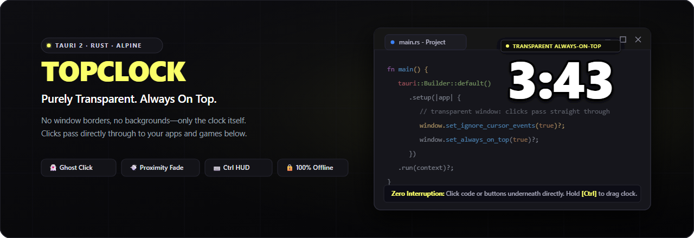

# TopClock



<p align="center">
  <strong>Always On Top. Zero Interruption.</strong><br>
  A transparent, click-through desktop clock for Windows built with Tauri 2, Rust, and Alpine.js.
</p>

<p align="center">
  
  
  
  
  
</p>

---

## Overview

**TopClock** is a sleek, ultra-lightweight desktop clock that stays pinned above your windows, full-screen games, videos, and IDEs without ever getting in your way. 

By default, the clock is non-intrusive and transparent to input: mouse clicks pass directly through to whatever window is underneath, and approaching the clock with your cursor smoothly fades it out. When you want to adjust or position it, simply hold <kbd>Ctrl</kbd> to unlock full HUD control.

## Key Features

- 👻 **Ghost Click-Through** — Clicks pass straight through the clock window. Play games, click browser tabs, or code without ever misclicking the widget.
- 💨 **Proximity Fade** — As your cursor approaches the clock, it automatically fades to prevent obscuring important UI or text underneath.
- ⌨️ **Ctrl-Driven Interaction** — Hold <kbd>Ctrl</kbd> to drag, reposition, toggle time formats, or open the context menu.
- 🎨 **Deep Customization** — Tailor the clock to your aesthetic:
  - **Layouts**: 6 layout presets (`H:M:S`, `H:M`, `M:S`, `H M S`, `H M`, `M S`).
  - **12 / 24-Hour Modes**: Instant toggle with optional `AM`/`PM` badge.
  - **System Font Picker**: Enumerates fonts installed directly on your Windows PC—works 100% offline.
  - **Styling**: Independent text color, outline color, outline size slider, and font size from 24px to 200px.
  - **Animations**: Independent colon animations and numeric transition effects (fade, slide, flip, pulse, or none).
- ⚡ **Native Windows Performance** — Written in Rust with direct Win32 API integration, ensuring virtually zero CPU overhead and minimal memory usage.
- 🔒 **Private & Offline** — No network telemetry, no external font CDNs, no web requests. Settings stay on your machine.

---

## Controls & Shortcuts

| Action | Control | Description |
| :--- | :--- | :--- |
| **Move / Reposition** | <kbd>Ctrl</kbd> + **Left Drag** | Drag the clock anywhere on your desktop (position is saved automatically). |
| **Toggle 12 / 24-Hour** | <kbd>Ctrl</kbd> + **Left Click** | Quick-toggle between 12-hour and 24-hour time formats. |
| **Context Menu** | <kbd>Ctrl</kbd> + **Right Click** | Open the clock menu (access Settings or Quit). |
| **Quit Application** | <kbd>Ctrl</kbd> + <kbd>Q</kbd> | Instantly exit TopClock when focused. |
| **Open Settings** | **Left Click Tray Icon** | Open the modern ClickHouse-inspired Settings panel. |
| **Tray Context Menu** | **Right Click Tray Icon** | Access tray options and application exit. |

---

## Configuration & Storage

TopClock stores your configuration locally in your Windows user profile:

- **Settings File**: `%APPDATA%\topclock\settings.json`
- **Auto-Start**: Controlled via the current user's Windows Run registry key (`HKCU\Software\Microsoft\Windows\CurrentVersion\Run\TopClock`).

Settings and desktop positions automatically persist across reboots and app launches.

---

## Building from Source

### Prerequisites

- [Node.js](https://nodejs.org/) (v18+)
- [Rust](https://rustup.rs/) (MSVC toolchain)
- Visual Studio C++ Build Tools with Windows SDK

If the repository's `.tools/` folder is present, the included scripts configure the toolchain paths automatically.

### Development

```powershell
# Install frontend dependencies
npm install

# Run the app in live development mode
npm run tauri:dev
```

### Production Build

To build a standalone executable:

```powershell
npm run tauri:build -- --no-bundle
```

The compiled binary will be placed at:
```
src-tauri/target/release/top_clock.exe
```

To build a full Windows installer (NSIS setup):

```powershell
npm run tauri:build
```

---

## Updates & Releases

TopClock includes an automated in-app updater backed by GitHub Releases and cryptographic signatures (requiring zero paid Microsoft code signing certificates). See [doc/UPDATE_SYSTEM.md](doc/UPDATE_SYSTEM.md) for the full architecture, cryptographic key management, and step-by-step release publishing instructions.

