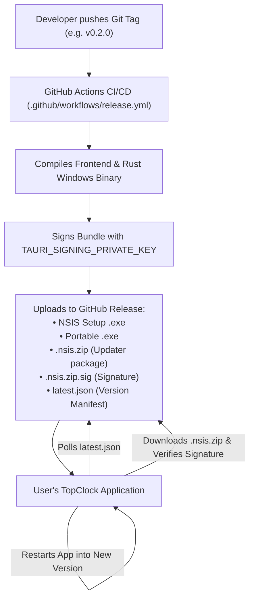

# TopClock Update System Guide & How-To

This document describes how TopClock's update system works, how cryptographic signing operates without costly Microsoft certificates, and how to publish updates using GitHub Actions.

---

## 1. Overview & Architecture

TopClock uses **Tauri 2’s official in-app updater** (`tauri-plugin-updater` / `@tauri-apps/plugin-updater`) backed by **GitHub Releases**.



### Key Advantages
- **100% Free**: No expensive Microsoft Authenticode or EV code signing certificates ($200–$500/year).
- **Cryptographically Secure**: Releases are verified using an **Ed25519 Minisign** public/private key pair.
- **Zero Server Overhead**: GitHub Releases serves the binaries and `latest.json` manifest for free.
- **Bypasses Browser SmartScreen**: Updates download inside the app’s process stream rather than through Edge or Chrome, avoiding browser "Mark-of-the-Web" download warnings.

---

## 2. Key Management & Signing

Tauri updater relies on asymmetric cryptography:
- **Public Key** (`pubkey` in `src-tauri/tauri.conf.json`): Distributed inside every installed copy of TopClock. The app uses it to verify that incoming update files were created by the true project owner.
- **Private Key** (`TAURI_SIGNING_PRIVATE_KEY` in GitHub Secrets): Kept strictly confidential. Used only by the build machine to stamp new release bundles with a digital signature (`.sig`).

### Active Project Public Key
The public key is configured in [`src-tauri/tauri.conf.json`](file:///src-tauri/tauri.conf.json):
```json
"plugins": {
  "updater": {
    "endpoints": [
      "https://github.com/tbkmax/TopClock/releases/latest/download/latest.json"
    ],
    "pubkey": "dW50cnVzdGVkIGNvbW1lbnQ6IG1pbmlzaWduIHB1YmxpYyBrZXk6IDg5MkI1QTI4NDVFN0MxMEMKUldRTXdlZEZLRm9yaWIvbmNyRkJXZXdVaHR5VFF2cGNJZ2U1UWxxK1dWYkg4V1BLLzBsY0lKZFoK"
  }
}
```

### Active Private Key (For GitHub Secrets)

> [!CAUTION]
> Never commit private keys to Git. The project's [`.gitignore`](file:///../../.gitignore) automatically ignores `*.key`, `*.key.pub`, and `/.tauri/`.

### How to Generate a Brand-New Key Pair (Optional)
If you ever need to generate a new key pair from scratch:
```powershell
cmd /c "scripts\tauri-windows.cmd signer generate"
```
Then:
1. Put the new **Public Key** into [`src-tauri/tauri.conf.json`](file:///src-tauri/tauri.conf.json) under `plugins.updater.pubkey`.
2. Update the **Private Key** in your GitHub Repository Secrets (see Step 3 below).

---

## 3. How-To: One-Time GitHub Actions Configuration

To enable automated release signing in GitHub Actions:

1. Open your browser and navigate to your GitHub repository:
   **`repo`**
2. Click the **Settings** tab in the repository's top navigation bar.
3. In the left sidebar, click **Secrets and variables** ▾ and select **Actions**.
4. Click the green button: **New repository secret**.
5. Set:
   - **Name**: `TAURI_SIGNING_PRIVATE_KEY`
   - **Secret**: Paste the private key string from Section 2 above.
6. Click **Add secret**.

---

## 4. How-To: Publishing a New Update

Whenever you want to release an update (e.g. `v0.2.0`), follow these four steps:

### Step 4.1: Development & Release Versioning
- **In development**, the repository defaults to version `0.0.0`. This ensures that any published release (`v0.0.1`, `v0.1.0`, `v0.2.0`, etc.) is always recognized as a newer update, making in-app update testing effortless.
- **When releasing**, you can simply push a Git tag like `v0.0.1` or `v0.1.0`. The GitHub Actions workflow will automatically synchronize `tauri.conf.json` and `Cargo.toml` with the tag version before bundling.

### Step 4.2: Commit and Tag
In your local terminal:
```powershell
git add .
git commit -m "Prepare release v0.1.0"
git tag v0.1.0
git push origin main
git push origin v0.1.0
```
> [!NOTE]
> The GitHub Actions workflow automatically extracts the version number from your git tag (e.g. `v0.2.0` -> `0.2.0`) and synchronizes `tauri.conf.json` and `Cargo.toml` during the build so all installer, portable, and updater asset filenames match the tag.

### Step 4.3: Automated Build & Sign
The workflow in [`.github/workflows/release.yml`](file:///../../.github/workflows/release.yml) will trigger automatically:
1. It builds the Vite frontend and Rust backend.
2. It signs the update package using `TAURI_SIGNING_PRIVATE_KEY`.
3. It creates `release-assets/` containing:
   - `TopClock_0.2.0_x64-setup.exe` (NSIS Installer)
   - `TopClock.exe` (Standalone Portable)
   - `TopClock_0.2.0_x64.nsis.zip` (Updater bundle)
   - `TopClock_0.2.0_x64.nsis.zip.sig` (Cryptographic signature)
   - `latest.json` (Tauri update manifest)
   - `checksums-sha256.txt`
4. It creates a **Draft Release** on GitHub.

### Step 4.4: Publish the Draft Release
1. Go to **`repo/releases`**.
2. Click **Edit** on the new draft release.
3. Review release notes and click **Publish release**.

---

## 5. End-User Experience

Once the release is published on GitHub:

### Automatic Check
- If the user has **"Automatically check for updates"** turned on in **Settings > General** (enabled by default), TopClock silently checks `latest.json` on application startup.
- If a newer version exists, the Settings General tab displays:
  > *"Version 0.2.0 available (current: v0.1.0)"*

### Manual Check
- Users can open **Settings > General** and click **"Check for updates"**.
- The app indicates its check status (*"Checking for updates…"*, *"TopClock v0.1.0 is up to date"*, or *"Version 0.2.0 available"*).

### One-Click Update & Restart
- When an update is available, the button changes to **"Update & Restart"**.
- Clicking it downloads the `.nsis.zip` package with live percentage tracking (`Downloading update: 45%`).
- Once downloaded and cryptographically verified, the app installs the update and immediately relaunches using `tauri-plugin-process`.

---

## 6. Troubleshooting & FAQs

### What if I lose my Private Key?
If you lose the private key:
1. Existing installed versions of TopClock will not accept updates signed with a different key.
2. You must generate a new key pair using `scripts\tauri-windows.cmd signer generate`.
3. Put the new public key in `tauri.conf.json` and publish a manual installer update. Once users install that version, future auto-updates will use the new key.

### Does Windows SmartScreen block in-app updates?
No. Because the update package (`.nsis.zip`) is downloaded by TopClock through its internal network stream rather than via a web browser, Windows does not attach the browser "Mark-of-the-Web" security attribute that normally triggers SmartScreen warnings.

### How does the app check for updates offline?
If a user is offline or GitHub cannot be reached, the check fails gracefully:
- The error is caught silently in the background without disturbing the user or showing modal popups.
- On manual check, the status displays *"Could not reach update server"*.
- The desktop clock continues running normally.
