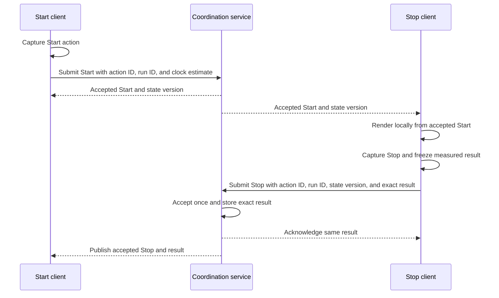
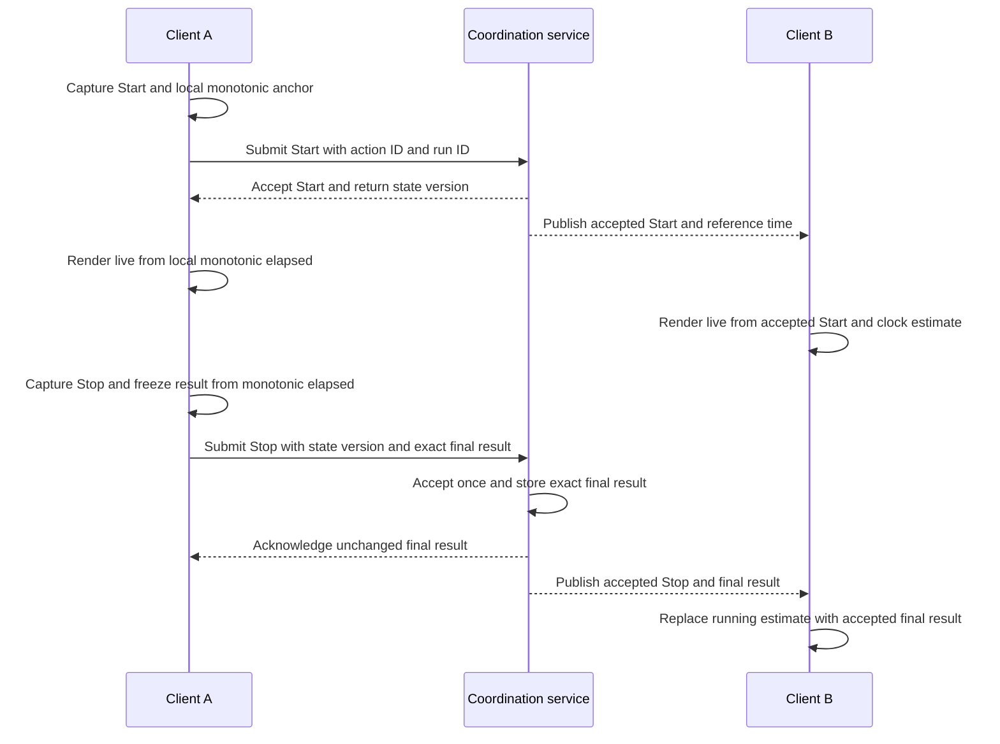

# Connected timer synchronization agreement

Status: design agreement for future implementations; no particular client, server, database, or transport is assumed. Date: 2026-11-19.

This document defines how independent clients should measure and exchange the state of a timer that can be started on one device and stopped on another. It is intended to be usable by a web service and its clients as well as by desktop applications. A stopwatch, countdown, or signed counter can use the same synchronization contract while retaining its own rules for direction, target, pause, reset, and automatic completion.

## Terms and goals

- **Run:** One uninterrupted period from an accepted Start or Resume to an accepted Stop, Pause, direction change, or completion.
- **Action client:** The client where the user or an authorized local detector initiated a transition.
- **Coordination service:** The authority that accepts an order of actions and publishes accepted results. It may persist them in any suitable store.
- **Measured result:** The value calculated and frozen by the action client at Stop or Pause, in integer milliseconds. A timer type defines whether this is elapsed time, remaining time, or a signed balance. The action message identifies which meaning applies.
- **Clock estimate:** A client's mapping from its local monotonic clock to a common reference clock, with an uncertainty estimate.
- **State version:** A sequence number for the timer's accepted actions. It identifies which run state a client saw; it is not a timestamp or a measured duration.

The main user-facing guarantee is: **after an uncontested Stop is accepted, the client where Stop occurred must not receive a different final value from the service.** The service either accepts the client's exact result or rejects the whole Stop; it never accepts a Stop while changing its time. Other clients eventually adopt the accepted value. Message delivery time is not part of the measured duration. This guarantee concerns agreement on a stored result, not perfect measurement of the physical interval between actions on different machines.

## Required action contract

1. A client captures the action at the click or detection event, before awaiting a network response. Every action carries a unique action ID, run ID, timer ID, origin client ID, and the state version the client observed. Retrying the same action ID must not apply it twice.
2. An accepted Start establishes the reference from which every client renders that run. The service persists the Start client's submitted, calibrated action time unchanged and publishes that accepted reference. It rejects an implausible Start instead of silently replacing its click time with receipt time. A client must use the accepted Start for a later cross-device Stop, rather than an unacknowledged local Start estimate from another device.
3. During a run, clients render locally from the accepted Start and their current common-clock estimate. They do not require a per-second message or database write.
4. At Stop or Pause, the action client uses the same time mapping and rounding rule as its live display, captures one local snapshot, and freezes its displayed result immediately. It sends that exact integer result with the action. The service accepts or rejects the action; for an accepted action, it persists and broadcasts the supplied result **without recomputing it from UTC endpoints or server receipt time**.
5. A later clock-calibration change must not alter an accepted stopped result. The service may retain Start/Stop timestamps and clock-quality metadata for history, auditing, and calendar graphs, but the accepted measured result remains the source for totals.
6. Timer-specific operations remain explicit. For example, a countdown may reach its preset limit deterministically, while a signed counter may switch direction and close one run before opening another. This agreement does not make those behaviors interchangeable.

### Start on Client A and Stop on Client B

### Start and Stop on Client A

Both actions occur on one device, so Client A can measure the run with its local monotonic clock. Client B displays an estimate while the run is active and adopts Client A's exact final result when the Stop message arrives.

## Time measurement

UTC is a shared *time standard*, but two devices' UTC clocks can still have different errors. If the Start client's clock error is `eStart` and the Stop client's is `eStop`, subtracting their raw timestamps adds `eStop - eStart` to the measured duration. An Internet connection alone does not remove that difference.

Clients should calibrate against the **same reference clock** before cross-device controls are used. A four-timestamp exchange can estimate offset, round-trip delay, and uncertainty. Retain an anchor between the client's monotonic clock and estimated reference time, use that anchor when capturing actions, and refresh it after reconnect, reload, sleep, or material drift. Prefer low-delay samples; record the uncertainty associated with an action. Neither calibration nor a higher-resolution clock guarantees zero error over arbitrary network paths.

When Start and Stop occur on one device, a local monotonic interval is preferable because system-wall-clock adjustments cannot change the elapsed measurement. A browser's `performance.now()` and a native system's monotonic timer are useful for that case, but their raw readings cannot be subtracted across devices or assumed valid after a process or page restarts. For cross-device actions, map both action instants into the calibrated common clock. Keep live rendering and Stop calculation on the **same** mapping so the Stop click does not introduce a fresh display jump. If a newer calibration is applied while a run is live, apply a defined adjustment policy before Stop; do not change an already accepted result.

The service's own receive timestamp is useful for diagnostics and ordering. It is not the user's click timestamp and must not be substituted into the accepted duration.

## Ordering, conflicts, and offline use

The service must define one accepted order per timer. A state version or equivalent precondition prevents a Stop from silently applying to a different run; it never recalculates time. Duplicate delivery returns the original outcome. The service may validate authorization, run state, and clock-quality bounds, but it must **accept the supplied result exactly or reject the action**; silently substituting a recalculated value breaks the Stop-client guarantee. A competing action is an explicit conflict: if two clients freeze different Stop values before learning about each other, they cannot both remain unchanged **and** converge to one final value. One action can be accepted; the other must be shown as rejected or resolved by a documented product rule.

An offline client may keep a locally pending Stop and its frozen display, but must distinguish **pending** from **globally accepted**. The agreement cannot promise that an offline Stop will later win a conflict. Applications may prevent competing controls, grant a single action owner, or choose a conflict-resolution rule. The choice must be made before promising an unconditional no-correction experience.

## Persistence and graph agreement

Persist the accepted action ID, run ID, state version, origin, accepted final result, and action timing metadata. Keep elapsed values as integers at a declared unit and apply one shared display-rounding rule. Do not infer a new final result by subtracting stored wall-clock endpoints. UTC endpoints can place a run on a calendar; their uncertainty may differ from the accepted measured duration. A daily graph must define how a run crossing a day boundary allocates its accepted duration, and its buckets must sum to the accepted total.

The storage engine and replication transport are implementation choices. The protocol exchanges identified actions and accepted results, not a shared live database file.

## Acceptance examples

| Scenario | Required outcome |
| --- | --- |
| Stop message arrives two seconds after the click | The accepted duration is the Stop client's frozen result; the two seconds are not added. |
| Stop client retries after a lost acknowledgment | The same action ID returns the original accepted result, without a second Stop. |
| Device wall clock is adjusted during a same-device run | The local monotonic elapsed measurement remains stable. |
| Two clients Stop the same state version before seeing each other | One accepted order is chosen; the losing action is an explicit conflict. |
| A client reconnects after an offline Stop | Its local result remains pending until accepted or rejected under the documented conflict policy. |
| A stopped run is viewed days later | Every client displays the stored accepted result, regardless of later clock calibration. |

## Research basis

- [Lamport, *Time, Clocks, and the Ordering of Events in a Distributed System*](https://lamport.org/pubs/time-clocks.pdf): physical time and event ordering are separate concerns.
- [RFC 5905, NTPv4](https://www.rfc-editor.org/info/rfc5905/): offset, delay, and uncertainty estimation.
- [W3C High Resolution Time](https://www.w3.org/TR/hr-time-3/): monotonic browser measurements and their cross-execution limits.
- [Microsoft, high-resolution timestamps](https://learn.microsoft.com/en-us/windows/win32/sysinfo/acquiring-high-resolution-time-stamps): local interval measurements versus cross-machine timestamps.
- [Herlihy and Wing, *Linearizability*](https://www.cs.cmu.edu/~wing/publications/HerlihyWing90.pdf): a single accepted order for concurrent actions.
