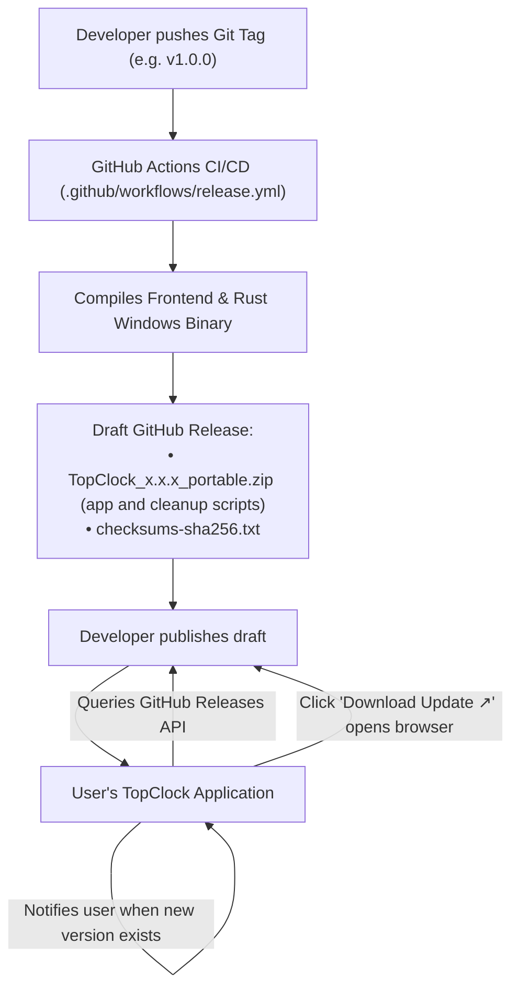

# TopClock Update Reminder & Release Guide

This document describes how TopClock's update system operates using a lightweight **GitHub Releases reminder**.

This is the GitHub direct-download release channel for the portable ZIP. A [Store-identity MSIX](../plan/MSIX_STORE_PLAN.md) is built locally and submitted separately through Partner Center. When TopClock runs with package identity, Settings shows Microsoft Store update delivery and suppresses GitHub download actions. Store-signed installation, upgrade checks, and submission remain open.

---

## 1. Overview & Architecture

Direct builds use a GitHub Releases update reminder:



The direct build has no background installer or updater. The portable executable is not signed by this workflow, so [SmartScreen can warn on download or launch](https://learn.microsoft.com/en-us/windows/apps/package-and-deploy/smartscreen-reputation). The Store MSIX is signed by Microsoft after certification and follows Store-managed updates.

---

## 2. How the In-App Check Works

1. **Automatic Check on Launch**:  
   If **"Automatically check for updates"** is toggled on in **Settings > General** (enabled by default), TopClock fetches `https://api.github.com/repos/tbkmax/TopClock/releases/latest`.
2. **Semver Comparison**:  
   TopClock compares the latest release tag (e.g. `v0.1.0`) against the currently running version (e.g. `0.0.0` in dev).
3. **One-Click Download Action**:  
   - If an update is found, Settings shows:  
     `New version v0.1.0 is available!` with a **Download Update ↗** button.
   - Clicking it calls `open_release_page`, opening the GitHub release download page directly in the user's default web browser.

---

## 3. How to Publish an Update

Choose one three-part version for the Git tag and local MSIX build. The GitHub workflow builds the portable ZIP from the tagged commit; it does not build or upload the Store MSIX.

### Step 3.1: Commit, tag, and build the Store package locally

Commit all intended release changes and confirm `git status --short` is clean before tagging. The tag must point to the same source used for the local MSIX build.

```powershell
git tag v1.0.0
$releaseTag = git describe --tags --exact-match HEAD
powershell -NoProfile -ExecutionPolicy Bypass -File .\scripts\Build-Msix.ps1 -Version $releaseTag
git push origin main
git push origin $releaseTag
```

The build script maps `v1.0.0` to MSIX version `1.0.0.0` without changing the repository's development version. Upload the unsigned MSIX to Partner Center, not to the public GitHub release. Do not push the tag until the local build succeeds.

### Step 3.2: Automated Build in GitHub Actions
The workflow in [`.github/workflows/release.yml`](../../.github/workflows/release.yml) triggers automatically:

1. It extracts `1.0.0` from your Git tag and sets the executable's build version.
2. It builds the standalone executable with Tauri's `--no-bundle` option; no NSIS installer is produced.
3. It creates a GitHub Release draft with:
   - `TopClock_1.0.0_portable.zip` (contains `TopClock.exe`, `Uninstall-TopClock.cmd`, and `Uninstall-TopClock.ps1`)
   - `checksums-sha256.txt`

The portable ZIP contains the standalone `TopClock.exe`. It still stores settings in the user's app config directory. To update a portable copy, quit TopClock and extract the new `TopClock.exe` over the old one in the same folder. Launch at sign-in uses the executable's full path, so keeping both the folder and filename unchanged preserves that setting. Deleting the executable without disabling launch at sign-in leaves a stale Windows Run entry; restore the file at that path or remove the startup entry.

To remove a portable copy, quit TopClock and run `Uninstall-TopClock.cmd` beside that copy's `TopClock.exe`. It removes only the adjacent executable and a sign-in entry that points to it. It asks separately before deleting TopClock data shared by all copies for the current Windows user. Delete the remaining cleanup scripts and extracted folder manually afterward. Older NSIS installations can still be removed through Windows Installed apps. See [Uninstalling](../../README.md#uninstalling).

### Step 3.3: Publish the Draft

1. Visit **`https://github.com/tbkmax/TopClock/releases`**.
2. Click **Edit** on the draft and click **Publish release**.

---

## 4. Development Versioning Convention
- In local development, the repository version is set to **`0.0.0`**.
- This ensures that any published release on GitHub (`v0.0.1`, `v0.1.0`, etc.) will always be seen as a newer version, allowing you to test the update indicator at any time.
