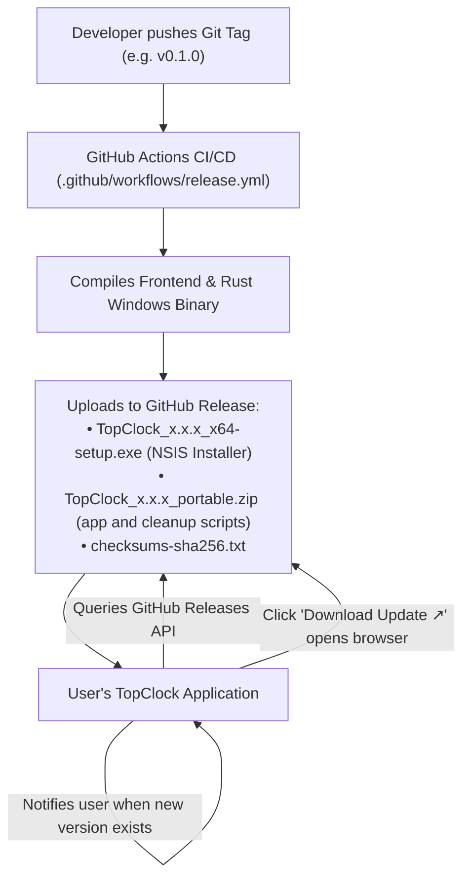

# TopClock Update Reminder & Release Guide

This document describes how TopClock's update system operates using a lightweight **GitHub Releases reminder**.

This is the current direct-download release channel. An [MSIX development package](../plan/MSIX_STORE_PLAN.md) can now be built separately. When TopClock runs with package identity, Settings shows Microsoft Store update delivery and suppresses GitHub installer checks and download actions. The MSIX is not yet the default release artifact; signing, installed-package checks, and Store submission remain.

---

## 1. Overview & Architecture

TopClock uses a **zero-overhead, heuristic-safe update reminder**:



### Why This Approach Was Chosen
- 🛡️ **Zero Windows Defender False Positives**: Does not bundle background file-replacement or dropper code, avoiding automated `!ml` (machine-learning) antivirus heuristic flags.
- ⚡ **Lightweight & Fast**: No external updater runtime plugins or extra runtime binary dependencies.
- 🆓 **100% Free**: No corporate Microsoft Authenticode / EV signing certificates required.
- 🔒 **Zero Private Key Management**: No need to manage or configure signing private keys locally or in CI secrets.

---

## 2. How the In-App Check Works

1. **Automatic Check on Launch**:  
   If **"Automatically check for updates"** is toggled on in **Settings > General** (enabled by default), TopClock fetches `https://api.github.com/repos/tbkmax/TopClock/releases/latest`.
2. **Semver Comparison**:  
   TopClock compares the latest release tag (e.g. `v0.1.0`) against the currently running version (e.g. `0.0.0` in dev).
3. **One-Click Download Action**:  
   - If an update is found, Settings shows:  
     `New version v0.1.0 is available!` with a **Download Update ↗** button.
   - Clicking it calls `open_release_page`, opening the GitHub release download page directly in the user's default web browser.

---

## 3. How to Publish an Update

Publishing an update takes just a single git command:

### Step 3.1: Commit and Tag
```powershell
git add .
git commit -m "Prepare release v0.1.0"
git tag v0.1.0
git push origin main
git push origin v0.1.0
```

### Step 3.2: Automated Build in GitHub Actions
The workflow in [`.github/workflows/release.yml`](file:///../../.github/workflows/release.yml) triggers automatically:
1. It extracts `0.1.0` from your Git tag and synchronizes `tauri.conf.json` and `Cargo.toml`.
2. It builds the Windows installer and standalone executable.
3. It generates SHA-256 checksums and creates a GitHub Release draft with:
   - `TopClock_0.1.0_x64-setup.exe`
   - `TopClock_0.1.0_portable.zip` (contains `TopClock.exe`, `Uninstall-TopClock.cmd`, and `Uninstall-TopClock.ps1`)
   - `checksums-sha256.txt`

The portable ZIP contains the standalone `TopClock.exe`; it does not require the NSIS installer. It still stores settings in the user's app config directory. To update a portable copy, quit TopClock and extract the new `TopClock.exe` over the old one in the same folder. Launch at sign-in uses the executable's full path, so keeping both the folder and filename unchanged preserves that setting. Deleting the executable without disabling launch at sign-in leaves a stale Windows Run entry; restore the file at that path or remove the startup entry.

To remove a portable copy, quit TopClock and run `Uninstall-TopClock.cmd` beside that copy's `TopClock.exe`. It removes only the adjacent executable and a sign-in entry that points to it. It asks separately before deleting TopClock data shared by all copies for the current Windows user. Delete the remaining cleanup scripts and extracted folder manually afterward. For an installed copy, use Windows Installed apps; the NSIS uninstaller offers an optional application-data checkbox. See [Uninstalling](../../README.md#uninstalling).

### Step 3.3: Publish the Draft
1. Visit **`https://github.com/tbkmax/TopClock/releases`**.
2. Click **Edit** on the draft and click **Publish release**.

---

## 4. Development Versioning Convention
- In local development, the repository version is set to **`0.0.0`**.
- This ensures that any published release on GitHub (`v0.0.1`, `v0.1.0`, etc.) will always be seen as a newer version, allowing you to test the update indicator at any time.
