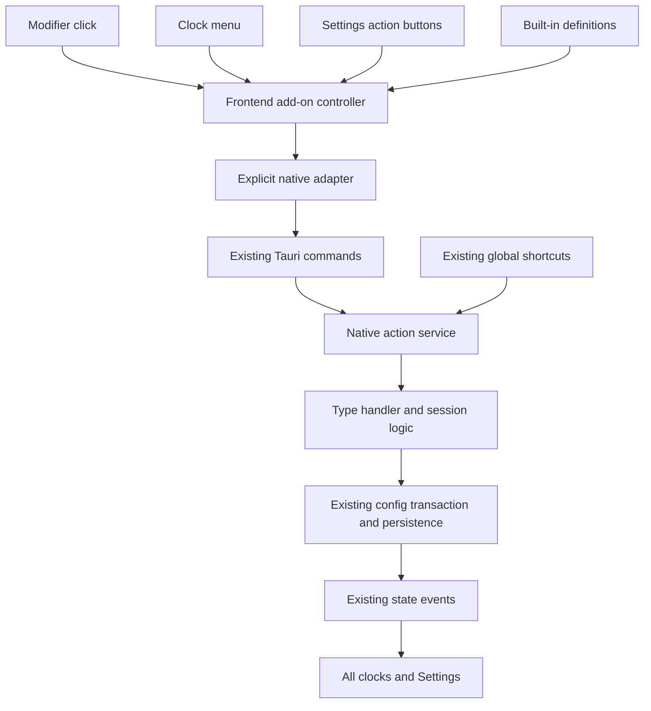

# Add-on structure refactor implementation plan

Date: 2026-11-01  
Status: implemented in source; automated checks passed, live Windows and packaged checks remain open.  
Scope: reorganize the four existing built-in add-ons while preserving their behavior.

Implementation record (2026-11-07): The four built-ins now own their display, actions, option editors, and native validation in [frontend modules](../../src/addons/builtins/) and [native modules](../../src-tauri/src/addons/). Progress calculations live beside its definition in [progress-display.js](../../src/addons/builtins/progress-display.js); the old top-level path re-exports them for compatibility. The [controller](../../src/addons/controller.js) resolves current instances and action descriptors; the [state adapter](../../src/addons/state.js) owns native session subscriptions. Vite composes a shared [clock row](../../src/addons/views/clock-row.html) and distinct Settings controls from allowlisted local fragments. The legacy frontend command names, native events, serialized fields, and capabilities were retained. A future type with the same display shape can reuse the shared clock row; a special type can register a dedicated bundled view.

Automated verification: 28 frontend tests, 27 Rust tests, and `npm run build` passed. The assembled clock and Settings HTML was also checked for balanced tags and single-root Alpine templates. `tauri:dev` launched the native process with a temporary identifier and wrote only to an isolated config directory; that test process and directory were removed. The first launch attempt hit a Vite watcher `EBUSY` error on generated Rust output, so [Vite configuration](../../vite.config.js) now ignores `src-tauri/target/` during development. Live interaction across the clock, Settings, tray, modifier and drag behavior, multi-window synchronization, persistence and position restore is still pending. MSIX upgrade verification is also pending. Static bundled fragments remove the proposed `x-html` rendering path; the existing `csp: null` remains a separate security limitation and requires a dedicated CSP design before connected or downloaded add-ons.

Read the [README](../../README.md), [frontend architecture](../../src/doc/architecture.md), and [native architecture](../../src-tauri/src/doc/architecture.md) for current behavior. The earlier [add-on system plan](../feature/ADDON_SYSTEM_PLAN.md) and [Progress plan](../feature/PROGRESS_ADDON_PLAN.md) provide history; source code takes precedence where those plans are stale.

## 1. Objective and scope

Make Date, Region clock, Timer, and Progress easier to maintain and extend. Each type should own its formatting, options, and action declarations. A small host controller should handle shared orchestration: looking up definitions, routing actions, producing menu contributions, synchronizing state, and cleaning up subscriptions. The host should delegate type behavior rather than accumulate a new chain of type checks.

This is a behavior-preserving refactor. It includes the frontend, native validation and action organization, focused regression tests, and code-folder documentation. It keeps Alpine.js, Vite, Tauri, and the existing settings file. No framework replacement or settings migration is needed.

Future direction supplied by the owner: add-ons may eventually be installed/uninstalled, with all packages supplied by the owner. A future add-on may connect to the owner's web service, manage a signed-in account, and start/stop a timer whose authoritative state is stored on the server. This plan reserves boundaries for those needs; it does not implement installation, accounts, credentials, network transport, server timers, or integration with the other project.

No new menu actions, shortcuts, add-on types, or install/uninstall UI belong to this refactor. Existing add/remove instance and enable/disable controls retain their meanings.

## 2. Current structure and pressure points

| Current code | What already works | Refactor target |
| --- | --- | --- |
| [addons.js](../../src/addons.js) | Catalog, defaults, shared instance shape, display formatting | Move type behavior into individual modules; retain one registry |
| [settings-addons.js](../../src/settings-addons.js) | Shared ordering plus type-specific edits and actions | Keep ordering in the host; move type editors and rules to their modules |
| [main.js](../../src/main.js), [settings.js](../../src/settings.js) | Shared formatting, native events, separate live and preview views | Share state subscription and action adapters; keep view-local animation state separate |
| [index.html](../../index.html), [settings.html](../../settings.html) | Ordered stacks, dashboard, preview and menu | Replace type checks in common shells with registered, bundled views and action descriptors |
| [addons.rs](../../src-tauri/src/addons/mod.rs) | Validated instances and TimerSession calculations | Separate common validation, type validators and session logic |
| [timer.rs](../../src-tauri/src/timer.rs), [hotkeys.rs](../../src-tauri/src/hotkeys.rs) | Durable timer commands and shortcut dispatch | Route existing entry points through shared native action services |
| [settings_commands.rs](../../src-tauri/src/settings_commands.rs), [config_store.rs](../../src-tauri/src/config_store.rs) | Save validation, rollback, recovery and session cleanup | Preserve transaction ownership and delegate type rules through a small internal interface |

The current catalog is an extension point for compiled built-ins, not an installer or executable plugin loader. Timer and Progress already share the TimerSession representation, but use different persisted storage and command/event paths. Preserve those paths behind adapters before considering any later unification.

## 3. Behavior and compatibility contract

The implementation must preserve these observable behaviors:

- Stable instance IDs, array ordering, above/below placement, size range of 10–100%, and 30% defaults for newly created instances. Date and Timer are singletons; Region clock permits up to 12; the total remains 16. Progress remains repeatable.
- Date formats and optional localized weekday; Region clock labels, time zones, shared time format and animations; existing translations and fallback behavior.
- Timer countdown/stopwatch, mode-change confirmation and its saved dismissal, duration restrictions, Start/Pause/Reset, completion, and restart restoration.
- Progress date, daily-range and countdown modes; retained values when switching modes; range validation; appearance defaults for older records; percentage, length and thickness; completion pulse, auto-hide, and reduced-motion behavior.
- Independent Progress countdown sessions. Minutes stay locked after first Start through Pause and restart, and unlock after finish or Reset. Numeric Timer remains independent.
- Configured modifier plus left-click toggles Timer or its targeted Progress countdown. The main clock's modifier-click toggles 12/24-hour format. Dragging suppresses click actions. Date and Region clicks do not accidentally toggle the main clock.
- Modifier plus right-click opens the existing clock menu: Settings, Reset timer only when Timer is enabled, then Quit. Opening a menu does not require changing default click-through behavior. Reset retains its existing menu-close behavior. No Progress entries are added in this refactor.
- The four optional action shortcuts and their off-by-default enable flags. Timer shortcuts still target the singleton Timer. Tray behavior remains unchanged.
- Shared settings and durable sessions across display windows, with independent positions, interaction state and menu state. Keep resize anchoring, proximity fade, position restoration, and unrestricted drag placement.
- Immediate settings previews, debounced serialized saves, native readback after failure, and rollback. Previewing settings must not run actions or modify durable timer state.

Preserve the JSON field names, optional-field defaults, legacy Timer migration, existing command arguments/results, and event names/payloads. In particular, retain `timer_session`, `progress_timer_sessions`, `timer_action`, `progress_timer_action`, `timer-state-changed`, and `progress-timer-states-changed`. Reorganization does not imply replacing these with a generic public RPC.

Disabling, removing, changing mode, changing duration, and restarting have different cleanup behavior today. Capture those cases from the actual save/load/action code before extraction; do not introduce an automatic reset-on-disable rule. Existing unrelated defects should be recorded separately instead of silently changing behavior during extraction.

## 4. Proposed module ownership

The implemented layout keeps individual type modules together without extra directory depth:

```text
src/addons/
  registry.js            # fixed list of built-in definitions
  controller.js          # instance lookup, action routing, menu composition
  state.js               # native session snapshots and event lifecycle
  native-adapter.js      # explicit existing Tauri command/event mappings
  instance-editor.js     # common add/remove/order/placement/size behavior
  contracts.json         # checked frontend/native kind and action names
  builtins/
    date.js
    region-clock.js
    timer.js
    progress.js          # definitions, formatting and type editor rules
    progress-display.js  # Progress date, range, countdown and pulse calculations
  views/
    clock-row.html       # shared row and host-owned interaction boundary
    settings-row.html    # shared dashboard shell
    preview-row.html     # shared preview row
    date.html
    region-clock.html
    timer.html
    progress.html        # bundled type controls/display fragments as needed

src-tauri/src/addons/
  mod.rs                 # existing public internal API/re-exports
  registry.rs            # known kinds and native handler lookup
  instance.rs            # common serialized shape and common constraints
  actions.rs             # typed internal routing and target checks
  session.rs             # existing TimerSession implementation
  date.rs
  region_clock.rs
  timer.rs
  progress.rs            # type validation and type-specific rules
```

Every new maintained folder above has its own `doc/architecture.md`, `doc/workflow_diagram.md`, `doc/changelog.md`, and `doc/backlog.md`, following [the documentation templates](../../templates/doc/). The listing omits those files for readability. Each document links to its parent and describes the actual folder. Parent docs were updated while preserving their history.

Keep `main.js` responsible for the clock window, pointer input, resize and menu visibility. Keep `settings.js` responsible for the Settings page and save controller. The add-on controller receives narrow dependencies such as a settings getter, draft-edit callback and action adapter; it does not receive unrestricted access to either Alpine page object.

Keep pure formatting and progress calculations usable by both the clock and Settings preview. A type's display function takes settings, the relevant session snapshot, language and an explicit time value; it returns display data without writes or network calls. Each view owns its animation/completion history so rendering a preview cannot consume an animation intended for a clock window.

### Definition contract

Use JavaScript modules with JSDoc contracts; introducing TypeScript is unnecessary for this refactor. Each definition provides:

| Member | Responsibility |
| --- | --- |
| `kind`, `labelKey`, `maxInstances` | Stable identity, localized label, instance limit |
| `createOptions(context)` | Fresh options with current defaults; no shared mutable nested objects |
| `describe(instance, context)` | Dashboard name and subtitle |
| `display(instance, context)` | Pure display result for clock and preview |
| `editor` | Type-specific option edit validation and changes, passed through the existing save flow |
| `viewKey`, `settingsViewKey` | References to known bundled fragments; never user-supplied markup |
| `actions(instance, state)` | Supported action IDs, labels, enabled state and presentation metadata |

The registry rejects duplicate kinds and missing view/action references during development/tests. The frontend registry is a presentation definition; native validation remains authoritative. Frontend and Rust definitions share stable kind/action names through a small checked fixture or equivalent consistency test, without adding a schema generation framework.

For markup extraction, use a small Vite `transformIndexHtml` composition step to insert explicitly registered local fragments before Alpine initializes. Both development and production must receive the same composed markup. Keep runtime templates and bindings packaged with TopClock; do not load HTML from settings, a server or arbitrary paths. The include helper must validate allowed local files and fail the build for missing slots. Keep this helper in an already maintained folder and document it there. Confirm Alpine scope, unique IDs and above/below/preview reuse in a small first extraction before moving every view.

## 5. Shared action and menu handling



Expose an internal frontend call such as `dispatch(instanceId, actionId)`. Resolve the instance from current settings, find its registered definition, and check that the action exists and is available for its current mode/state. The native service repeats target, enabled-state and action validation; disabling a UI button is not an authorization boundary.

For this release, preserve `toggle` and `reset` semantics. Timer and Progress countdown both declare them, and route to their respective existing native commands. Date and Region declare no runtime actions. Mode changes and option edits continue through the validated settings save path. Unsupported action requests must fail without changing state.

Each action declaration can expose a primary-click role, a Settings-button role, or a clock-menu role. The host decides placement, shortcut presentation, interaction modifier checks and drag suppression. Definitions provide localized label keys and availability; they cannot insert executable menu markup. Menu items carry instance ID plus action ID, and availability is rechecked on execution. Timer Reset is the only existing add-on menu contribution. Preserve Settings/Quit ordering and separator behavior when that contribution is absent.

Native global shortcuts must enter the same native action service as UI commands. They cannot depend on a frontend window being focused or alive. Resolve the singleton Timer at execution time; do not persist a second shortcut-to-instance mapping in this refactor.

Preserve transactional behavior: validate, compute the change, persist, then publish the successful action state. Retain rollback when an action write fails. Centralize error handling without treating an unsuccessful action as applied. The adapter must reconcile command responses and broadcasts consistently, including messages from another clock window, and dispose event listeners when its view is destroyed. Avoid duplicate listeners or optimistic session updates that can overwrite a newer native snapshot.

A shared controller means shared implementation in each webview plus one authoritative native service. It does not mean creating one JavaScript singleton shared across Windows webviews. Keep the existing completion-monitor ownership and timing during this refactor; do not start a timer engine per display or per preview.

## 6. Native extraction and persistence

Move common instance constraints and each kind's options validation out of the large match body into named validators. Keep a static known-kind registry; native registry entries select validators and handlers from compiled code. Preserve Rust's validation of JSON options even if the frontend already validated them.

Move TimerSession calculation methods intact into `session.rs`. Timer and Progress handlers may share those calculations while retaining different state storage and duration-lock rules. Keep persistence and event publication owned by the application service; a type validator or pure calculation helper must not write the configuration independently.

Retain the existing command functions as thin compatibility wrappers. Existing Rust imports can temporarily use re-exports from `addons/mod.rs` while modules are moved. Remove obsolete duplicate paths after all callers use the new service. Do not leave two implementations of action semantics.

Add fixture coverage for older settings, optional Progress fields, the legacy Timer flag, saved active/paused/finished sessions, and failed saves. Do not rewrite user data merely because modules moved. Keep startup recovery behavior unchanged and record its limitations: currently semantically invalid add-on data can clear the add-on list. Before separately installed packages are supported, missing/unknown package instances will need independent preservation or quarantine so one unavailable add-on cannot discard unrelated instances; that is a later migration project.

## 7. Future extension boundaries — no implementation in this refactor

### Package, instance and account are separate identities

An eventual package has a publisher identity, package ID, version and supported host API version. An instance has the existing instance ID and its user configuration. One installed package may support several instances. An account is a separate resource that several instances may reference. Do not turn `removeAddon(id)` into an uninstall operation or use an instance ID as an account credential key.

The current registry uses bundled code only. Future owner-provided installation needs a separate package manager with provenance/integrity checks, compatibility checks, atomic installation, rollback and lifecycle cleanup. Decide then whether “install” activates bundled modules or adds separately delivered code; those choices have different packaging and security implications. This refactor does not introduce a package manifest format, loader, DLL mechanism, remote JavaScript execution, marketplace, or signature infrastructure.

### Narrow native services for a future connected add-on

The native action-service boundary should be able to grow an explicit service for the owner's server. It must not become a frontend-controlled `invoke(commandName, arbitraryPayload)` or unrestricted HTTP proxy. Keep host window control, persistence and service access behind deliberate interfaces.

For a later connected timer, plan native-owned credentials and account sessions, authenticated requests to explicitly approved service endpoints, sanitized status snapshots for the UI, and errors that do not expose secrets. Store durable tokens in an appropriate OS-protected credential store after a separate design review. Never put passwords/tokens in ordinary `settings.json`, serialized add-on options, localStorage, global events or logs. The frontend can eventually receive an account reference and signed-in status, not the secret itself.

The future server timer needs an explicit state-authority and synchronization design: idempotent Start/Stop requests, server-confirmed state, conflict handling, retry/cancellation, logout and revocation, and defined offline behavior. It should use a separate service/session adapter rather than silently inheriting the local Timer's wall-clock persistence or `toggle` behavior. Async action results and explicit time inputs in this refactor leave room for that adapter without implementing it now.

One native service should own future refresh/network work across all clock windows. Package disable/uninstall must eventually stop subscriptions and requests, remove menu/shortcut registrations, and apply a deliberate data/credential retention policy. Removing one instance must not revoke credentials still used by another instance. These lifecycle rules belong to the later installation/account design.

### Security and Microsoft Store release gate

Owner-provided code still needs review for dependency, package and account compromise. Module separation itself provides organization, not a sandbox or per-add-on permission isolation. Tauri capabilities are not automatically individual permissions for modules sharing the same webview.

The current [Tauri configuration](../../src-tauri/tauri.conf.json) has `csp: null`, and the current [capability file](../../src-tauri/capabilities/default.json) grants window/event permissions to the clock and Settings windows. Record this baseline. This refactor should not add remote content, credentials or broader capabilities. Before introducing network-connected or downloaded add-ons, review CSP/Alpine compatibility, webview origins, custom-command authorization, URL restrictions, credential storage, package integrity and uninstall handling together.

Treat server responses as data. Do not expose privileged Tauri commands to a remote web app or execute a server response as local HTML/JavaScript. Restrict future native requests and redirect handling to the intended service, use authenticated encrypted transport, and define what clock data is sent and why. Revisit privacy disclosures when the feature exists; current local add-on behavior does not authorize transmitting data.

Before selecting a downloadable-code mechanism or shipping the connected add-on through Microsoft Store, verify current Store requirements for the chosen delivery mechanism, account/data handling and updates. Owner-only distribution does not establish policy compliance. Consult [Microsoft Store policies](https://learn.microsoft.com/en-us/windows/apps/publish/store-policies) and [Tauri capabilities](https://v2.tauri.app/security/capabilities/) at implementation time. Retrieval of these pages failed while preparing this plan; the document makes no claim that a future mechanism is Store-approved. Continue to use the existing Store release path for the refactor.

## 8. Implementation sequence and acceptance gates

### Phase 1 — Capture the baseline

Read affected folder docs and check `git status --short` before edits. Record the current commands/events/schema and a behavior matrix for every built-in, including disable/remove/mode changes and failed saves. Reuse existing tests and add focused fixtures where the compatibility contract lacks coverage. Run the existing suites/build before structural edits and record any pre-existing failure separately.

Gate: a reviewer can identify expected behavior and existing verification gaps without relying on this proposal as proof that the app works. Existing [frontend live checks](../../src/doc/backlog.md) remain open until actually exercised.

### Phase 2 — Extract definitions and pure behavior

Create the fixed registry and individual builtin modules. Extract defaults, names, formatting, limits and editor rules. Keep temporary exports through `src/addons.js` so callers can migrate incrementally. Keep pure display output equivalent for fixed time/settings/session inputs.

Gate: all four add-ons produce the same values/defaults as before; cloned defaults do not share options/ranges; existing frontend tests and build pass.

### Phase 3 — Centralize state and actions

Introduce the frontend state/native adapters and action controller. Route clock clicks and Settings buttons through it. Introduce the typed native action service behind existing commands and shortcuts. Keep existing session storage/events. Test independent targets, unsupported/disabled actions, save failure, and listener cleanup.

Gate: UI and global shortcut entry points reach the same native semantics; two Progress countdowns and the numeric Timer remain independent and synchronize across views without duplicate action dispatch.

### Phase 4 — Extract views and generate existing menu contributions

Prove the bundled-fragment approach with one type, then move type controls and repeated render fragments. Shared rows own layout, size, order, accessibility, modifier checks and drag behavior. Use definition action descriptors to render Settings action buttons and the existing Timer Reset menu entry. Keep translated labels and dynamic shortcut hints.

Gate: development and production render the same UI; above/below stacks and preview match; no add-on-specific branches remain in the main clock click handler or menu shell. Type selection is confined to registry/view composition and the relevant type modules.

### Phase 5 — Finish native module extraction

Split validation and session calculations while retaining serialized fields, defaults and compatibility wrappers. Move type-specific save rules behind named handlers without changing transaction order. Confirm cleanup and recovery fixtures, then remove obsolete duplicate implementations and imports.

Gate: Rust tests and frontend/build checks pass, old settings fixtures round-trip without losing data, and no new capabilities or network dependencies were introduced.

### Phase 6 — Verify and document

Update architecture/workflow documents for every affected folder, add dated changelog entries (including newly created doc folders), and update backlogs only for work actually completed or still outstanding. Update this plan's status with actual results. Record manual checks unavailable in the environment as pending.

Gate: the regression checklist below is satisfied or explicitly records the remaining live verification gaps; no pending installer, account or network feature is represented as implemented.

## 9. Verification checklist and completion criteria

- Run `npm run test:frontend`, `npm run build`, and `cargo test --manifest-path src-tauri/Cargo.toml` for the implementation. Use the repository Windows toolchain setup if required; record the exact environment limitation if a command cannot run.
- Exercise valid and invalid options, singleton/instance limits, defaults and older saved fixtures. Cover draft-save rollback and failed native action persistence, not just registry function existence.
- Test descriptor-to-action routing: Timer Reset menu entry visibility, modifier clicks, drag suppression, disabled/removed targets, invalid actions, and native shortcut parity.
- Test Timer and at least two Progress countdowns together: Start/Pause/Reset, completion, mode/duration restrictions, restart restoration, and session cleanup. Use explicit time inputs for calculations; avoid timing-dependent sleeps in unit tests.
- Use `npm run tauri:dev` to check clock, Settings, tray, configurable modifier interaction, click-through after menu close/release, above/below ordering, preview, localization, menu geometry, settings persistence and position restore. Include zero and 16 instances, a second display and mixed DPI when available.
- Verify an installed MSIX launches and retains existing settings through the normal upgrade path before release. A successful local build alone does not establish packaged behavior or Store approval.
- Confirm the refactor introduces no token storage, downloads, remote code/content, new network traffic, or expansion of native capabilities. This statement concerns the refactor; the application's existing update checks remain in place.

Done means all existing add-ons use the shared contracts, type behavior is located in its modules, current commands/data and user interactions remain compatible, tests/build pass, and manual verification evidence or explicit outstanding gaps are recorded. A future built-in should require its type module/view and native validator/handler registration without rewriting the clock menu, click handler or common layout.

## 10. Risks and rollback

The main risks are Alpine scope changes during fragment extraction, duplicated subscriptions/actions across windows, stale session snapshots, differing Timer/Progress rules being accidentally merged, and changes to saved data during module moves. The phased sequence isolates these risks so each step can be reviewed and reverted.

Keep changes in small commits and use disposable copies of settings for compatibility tests. Temporary facades should be removed only after consumers migrate. Because this refactor preserves the persisted schema and public command/event contract, reverting its code should not require a user-data downgrade migration. If implementation reveals a need to change those contracts, stop that part of the extraction and amend the plan with an explicit compatibility design first.
