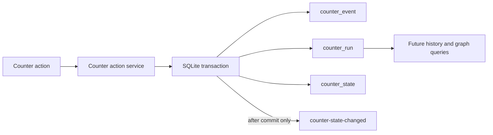

# Counter database change: implementation plan

Status: implemented locally on 2026-11-19; live Windows and packaged acceptance remain open. The approved choice is a focused Counter SQLite store with JSON settings reconciliation.

This plans the [Counter database TODO](../TODO.md), separately from Add-on 7 Tracker. The connected, cross-client timing contract is in the [connected time concept](../concept/CONNECTED_TIME_MODEL.md). This plan introduces **local** history and a durable Counter state; it does not implement a web service, account, sync, Tracker detection, or Timer migration.

## Goal and existing contract

Counter currently stores one `CounterSession` (`value_ms`, `running`, `direction`, `started_at_ms`) in `settings.json`. [Native Counter](../../src-tauri/src/addons/counter.rs) folds an active interval into `value_ms` when it stops or switches direction, then [config store](../../src-tauri/src/config/store.rs) writes the whole configuration. [Frontend Counter](../../src/addons/builtins/counter.js) derives the running display from the snapshot. This supports a signed balance but does not retain start/stop history for graphs.

Preserve the existing Count up, Count down, Stop, confirmed Reset, direction switch, zero/signed appearance, singleton instance, removal/re-add behavior, explicit-disable stop, normal-quit stop, and unclean-restart checkpoint semantics. Counter remains distinct from the Timer's stopwatch/countdown and Progress sessions. A future Tracker has automatic app/website detection, per-source totals, and a current-session display; none of those are Counter fields or Counter actions.

## Proposed storage boundary

Create one SQLite database in TopClock's app config directory. Make it authoritative for Counter **runtime state and history**. Keep add-on instances, enable flags, appearance, and other settings in `settings.json`. Do not maintain two independently authoritative copies of `counter_session`; after migration the JSON field is legacy input only. Expose the existing Counter command and event shape through an adapter at first so the UI can be updated separately.

| Table | Purpose and key fields |
| --- | --- |
| `counter_state` | Singleton current projection: signed checkpoint balance, running direction, active run ID, revision, and migration marker. |
| `counter_event` | Transition history within the current reset epoch: unique event ID, local sequence, action, captured UTC time, resulting revision, and relevant run ID. Reserve optional origin/sync fields without adding network behavior now. |
| `counter_run` | Queryable counting interval: run ID, direction (+1/-1), start/end UTC time, accepted measured duration on close, close reason, and reset epoch. At most one open run. |

Count up, Count down, and Stop update state, append an event, and open or close a run in one SQLite transaction. Reset atomically deletes all event and run rows and zeros state. Use a unique event ID to deduplicate actions while their event remains in the current history and a unique partial index to prevent two open Counter runs. Index runs by start time and reset epoch for future graph queries. Derive signed graph changes from `direction × measured_duration`; keep UTC endpoints for placing activity on a calendar. A confirmed Reset deletes every Counter event and run, zeros the current state, and advances its epoch in one transaction. The singleton state keeps only the most recent Reset action ID to prevent an immediate retry from erasing new work. The UI's current balance comes from `counter_state` plus the open run, not from a sum over the entire database on every frame. SQLite transactions and partial indexes support these constraints. [Transaction reference](https://www.sqlite.org/lang_transaction.html), [partial-index reference](https://www.sqlite.org/partialindex.html).

## Clock and action rules

- Capture the local action instant once. For an active run on the same machine, use a monotonic interval measurement for its accepted duration; also store UTC start/end for calendar placement. Do not calculate the final signed delta from two wall-clock readings if the system clock can change. Select a Windows clock with explicit sleep behavior so the existing running Counter behavior is preserved.
- Count up/down while already running closes the old direction's run and opens the new one at the same captured action instant. Stop closes the current run. Reset clears all Counter transition and interval history and sets the current balance to zero only after confirmation.
- Normal Quit closes an active run before exit. On an unclean restart, retain the last durable checkpoint and do not invent time while TopClock was closed, matching current recovery. Mark any abandoned open run with a recovery reason so graphs do not imply it was fully measured.
- Disable stops and retains balance. Removing the Counter instance leaves its session as it was, including a running session; re-adding restores the display. These are different operations and must stay different.
- An accepted local Stop produces one exact stored result. A later connected implementation must follow the concept's rule that an accepted Stop client's final duration is not recomputed by a server.

## Migration and two-store consistency

1. Add a versioned database schema and a migration routine. On first open, import the saved `counter_session` as a **balance baseline**, not fictional historical runs. If it was saved as running after an unclean exit, import the checkpoint balance stopped, as the current loader does. Commit an import marker with the state so retrying startup cannot double-import it.
2. Only after the database import commits, retire `counter_session` from new JSON writes. Keep reading old JSON files for first-run migration; never prefer a stale JSON session when the database has an import marker. Document that older binaries cannot safely write the new state after downgrade.
3. Direct Counter actions touch only the database and emit `counter-state-changed` after commit. Settings changes that disable Counter touch both JSON settings and Counter state. These are **two files and cannot share one SQLite transaction**. Implement one coordinated command: hold the existing config lock, begin a Counter database transaction, stage the stop, save JSON, then commit the database; emit events only after success. Handle JSON write failure by rolling back the database transaction. Handle a database commit failure after JSON save by restoring prior JSON when possible, reloading actual disk state, and reporting a recoverable error. On every startup, reconcile a disabled JSON Counter with any running database state. Test crash windows explicitly before release.
4. Route normal Quit, settings updates, and any other Counter state writers through this service; do not leave a `save_config` call that silently writes a second runtime source. Keep settings migration and other add-on sessions independent.

The cross-file failure window in step 3 is a design gate. If implementation cannot make its recovery predictable, move the relevant settings transaction into the same database before releasing the Counter migration. Do not claim atomicity across `settings.json` and SQLite.

## Work sequence

1. Add the local database module, schema versioning, migration, constraints, and read-only history queries under the native code structure. Follow the repository's per-code-folder `doc/` requirement for any new folder.
2. Extract Counter's pure balance and transition rules from file writing. Implement the transactional database adapter behind the existing Tauri commands/events and preserve frontend serialized fields during migration.
3. Route enable/disable, removal, Quit, and startup recovery through the coordinated service. Remove JSON Counter writes only after the database is authoritative.
4. Add a small history-query boundary for future graphs. Do not add Tracker source tables or a graph UI as part of this change.
5. Update affected code-folder architecture, workflow, changelog, and backlog documents when implementation occurs.

## Verification and release criteria

- Unit/integration checks: legacy absent/stopped/running import; idempotent migration; up/down/Stop/switch/Reset; signed totals; one-open-run constraint; duplicate action ID; graph query totals; clock adjustment while running; DB write failure; JSON write failure; crash at each cross-store boundary; unclean restart without closed-app time.
- Run `cargo test --manifest-path src-tauri/Cargo.toml` and `npm run build` for the later Rust/frontend changes. Add focused frontend checks only if the adapter or display changes.
- In `npm run tauri:dev`, inspect clock and Settings displays across windows and monitors, menu and tray actions, Ctrl interactions, Counter removal/re-add, explicit disable, Settings persistence, Quit/restart, and position restore. Use a disposable config directory for failure and migration checks.
- The database is a local application file, not a live multi-machine SQLite file. A future service will exchange identified transitions/results through an API, as specified in the concept, rather than share or copy the SQLite file while it is open.

## Open product decisions for later work

Reset removes the event IDs used for deduplication before that Reset. The local frontend does not queue retries; the singleton state keeps the latest Reset action ID so a repeated Reset cannot clear a new run. Any future connected or queued-action implementation must reject stale actions from an earlier reset epoch or state version before applying them.

- Future Counter graphs begin after the most recent Reset because earlier Counter runs and events are deleted.
- Decide graph day-boundary allocation and time-zone selection before shipping daily charts.
- Define connected Counter conflict and offline policies before exposing web Start/Stop. The local database migration does not resolve cross-client clock uncertainty or concurrent actions.
