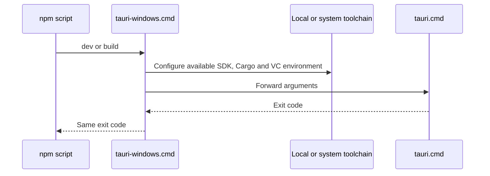

# Script workflow

This directory contains one batch script and no classes, so a class diagram would not describe its structure. The command flow is:

The steps are visible in [tauri-windows.cmd](../tauri-windows.cmd). `.tools/` is optional; the script still calls the CLI when it is absent.
