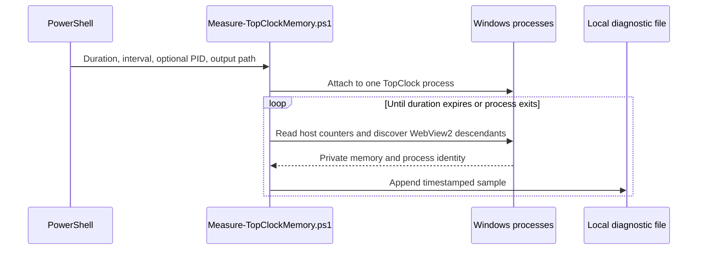
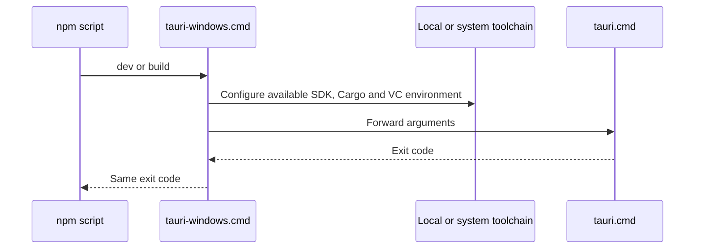
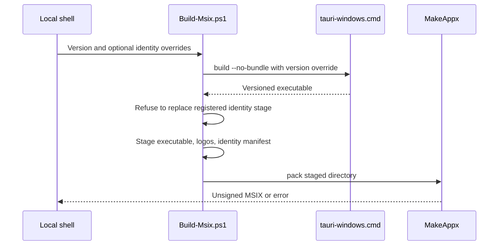
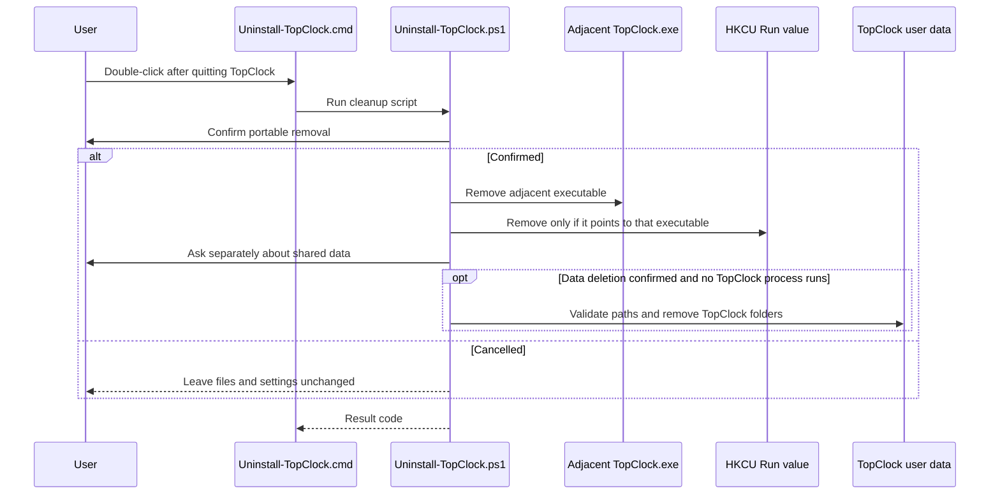

# Script workflow

## Runtime measurement

The [long-run launcher](../Test-TopClockLongRun.ps1) creates a dated run directory and delegates sampling to the flow below. A `STOP` file ends sampling on the next iteration. On return or failure, it records the end state, requests local Windows events since startup of the test, and calls the [report generator](../New-TopClockMemoryReport.ps1). The generator reads completed CSV rows and metadata, flags coverage problems, estimates memory trends, then writes HTML, JSON and a ZIP. After a forced terminal close, the same generator reads the available rows from the saved directory; the previous `Running` state identifies an interrupted capture.

[Collect-TopClockFailures.ps1](../Collect-TopClockFailures.ps1) separately queries raw Windows event XML, retains events mentioning TopClock, and writes a new local XML file. Both tools fail visibly on unavailable data sources or an existing output path. See [diagnostic usage](architecture.md#runtime-diagnostics).

This directory contains procedural build, cleanup, and diagnostic scripts. A class diagram would misrepresent their structure. The build command flow follows.

The steps are visible in [tauri-windows.cmd](../tauri-windows.cmd). `.tools/` is optional; the script still calls the CLI when it is absent.

The MSIX build extends that workflow:

[Build-Msix.ps1](../Build-Msix.ps1) defaults to the reserved Partner Center identity and stops if the version, toolchain, Tauri build, registered staging folder, or MakeAppx validation fails. Its identity-specific staging directory keeps a loose-registered development build intact when a different identity is built. Signing and installation are outside this flow.

The portable cleanup flow is:

The script leaves its own files and the containing folder for manual deletion. The [release guide](../../doc/feature/UPDATE_SYSTEM.md) explains the installer and portable paths.
