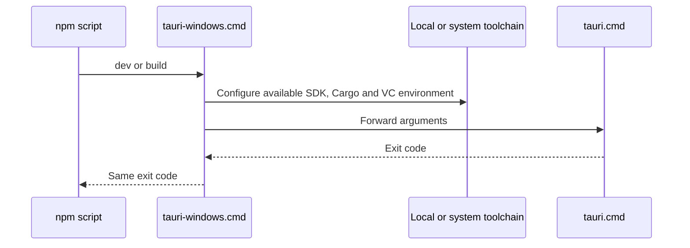
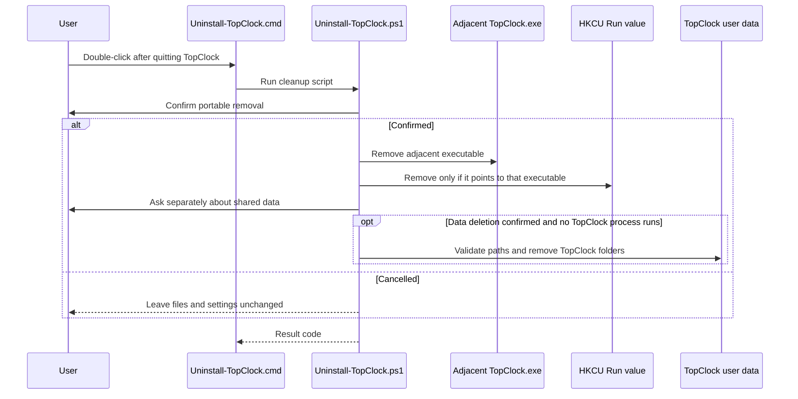

# Script workflow

This directory contains command scripts and one PowerShell cleanup script, but no classes, so a class diagram would not describe its structure. The build command flow is:

The steps are visible in [tauri-windows.cmd](../tauri-windows.cmd). `.tools/` is optional; the script still calls the CLI when it is absent.

The portable cleanup flow is:

The script leaves its own files and the containing folder for manual deletion. The [release guide](../../doc/feature/UPDATE_SYSTEM.md) explains the installer and portable paths.
