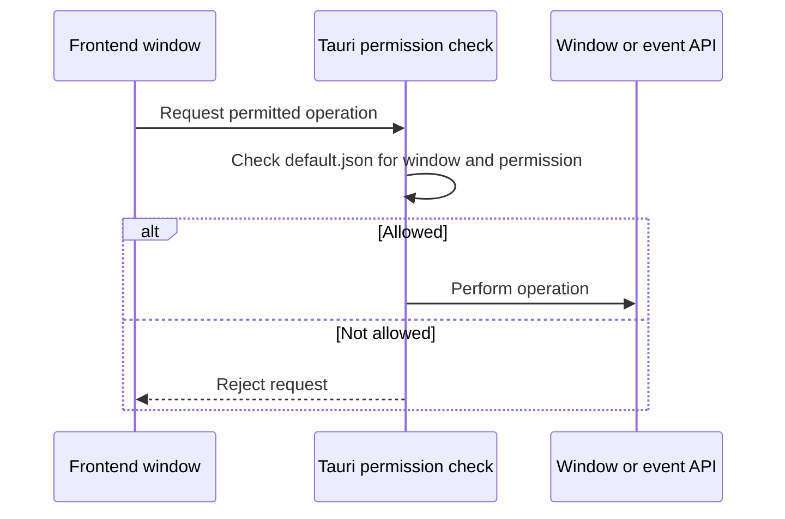

# Capability workflow

This directory holds JSON configuration, not classes, so no class diagram applies.

The shared allowlist is in [default.json](../default.json). Window size and position operations by [main.js](../../../src/main.js) pass through this check for `main` and runtime `clock-*` windows. The separate `menu` webview receives the same capability for Tauri commands and events; Rust fits its native window to the display. [palette.json](../palette.json) additionally lets only the [palette WebView](../../../src/palette/palette.js) hide itself after release; the native [monitor](../../src/input/palette.rs) closes on key release and owns any brief error reveal. The diagram describes the configuration's role; Tauri implements the permission check outside this repository's source.
