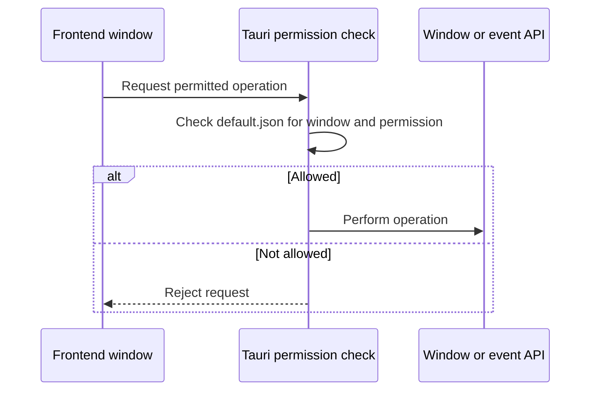

# Capability workflow

This directory holds JSON configuration, not classes, so no class diagram applies.

The allowlist is in [default.json](../default.json). The diagram describes the configuration's role; Tauri implements the permission check outside this repository's source.
