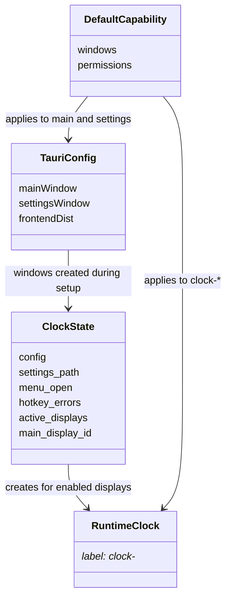
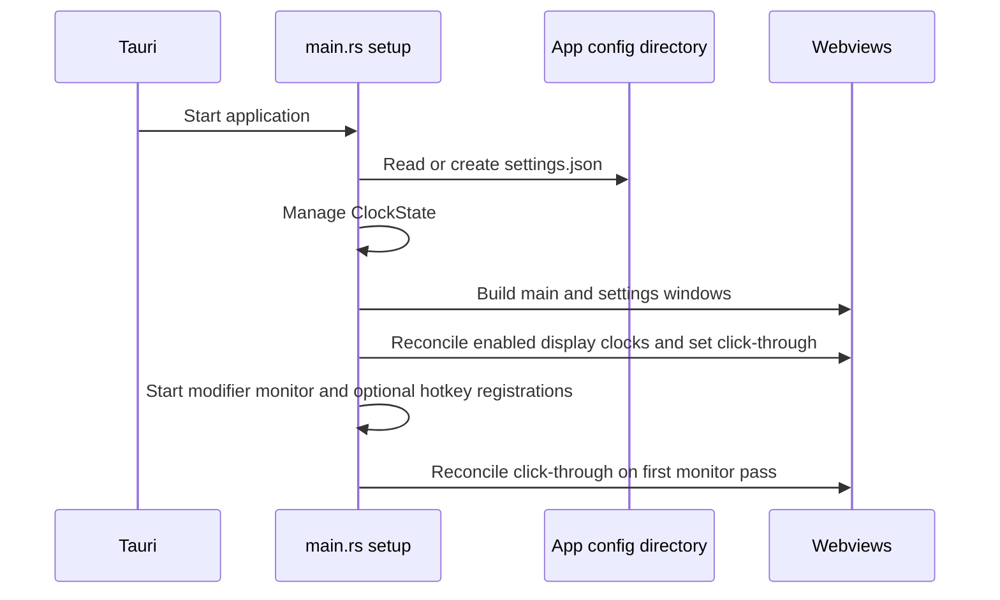

# Tauri package workflow

The package connects webview configuration to the Rust application. This class diagram describes package relationships rather than Rust inheritance.

The definitions are in [tauri.conf.json](../tauri.conf.json), [main.rs](../src/main.rs), and [default.json](../capabilities/default.json). This diagram omits generated Tauri types. Add-on instances and Timer sessions live inside `ClockState.config`; see the [Rust workflow](../src/doc/workflow_diagram.md).

The startup order comes from [main.rs](../src/main.rs); the two configured windows come from [tauri.conf.json](../tauri.conf.json), and secondary clocks are created at runtime. Each visible clock checks its click-through state on the first monitor pass. [main.js](../../src/main.js) can resize and reposition its own window without display-edge clamping under [default.json](../capabilities/default.json). The Settings window can request installed fonts from [fonts.rs](../src/fonts.rs). Native Timer actions update the shared session in `settings.json` and emit live state to all clocks. The file is durable state; per-window menu flags and active window records in `ClockState` are in-process state.
