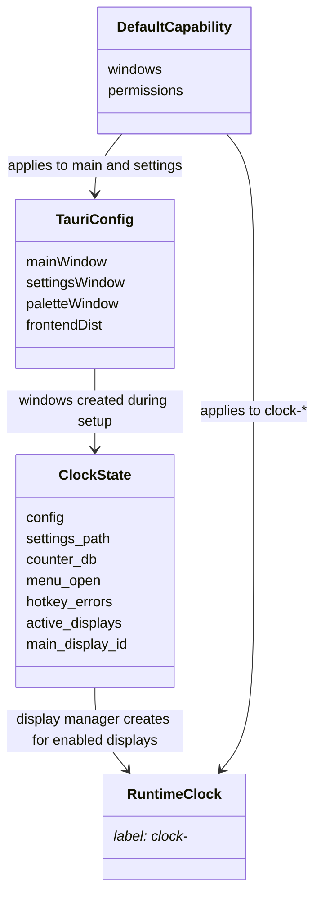

# Tauri package workflow

The Clock tab broadcasts transparency and display schedule drafts through the existing settings event path. Rust persists accepted values; each clock webview updates content opacity while its native window remains available to the existing input and display monitors. Menu and palette window lifecycles remain separate.

An existing v1 Counter database is upgraded to v2 before webviews start. Reset then clears Counter history transactionally while retaining the singleton zero state and its latest retry marker.

Startup opens [the Counter database](../src/addons/counter_db.rs) after loading legacy settings and before building webviews. A saved JSON Counter balance is imported only when the database is first created. An abandoned run is closed at its durable checkpoint; no closed-process time is counted.

The package builds the same [native locale command](../src/platform/locale.rs) and bundled frontend translations into direct and MSIX outputs. The `get_system_locale` Tauri command uses the Windows user's UI language; the MSIX manifest does not select or persist the app language. The user's explicit choice remains in `settings.json`. See the [native language workflow](../src/doc/workflow_diagram.md).

The package connects webview configuration to the Rust application. The palette window starts hidden with `focus: false` and `focusable: false`, so showing its topmost overlay should leave keyboard focus with the foreground application. This class diagram describes package relationships rather than Rust inheritance.



The definitions are in [tauri.conf.json](../tauri.conf.json), [lib.rs](../src/lib.rs), [state.rs](../src/state.rs), [display module](../src/displays/mod.rs), and [default.json](../capabilities/default.json). This diagram omits generated Tauri types. The optional palette is a configured window with a separate [input monitor](../src/input/palette.rs) beside the other native interaction modules. Add-on instances and Timer sessions live inside `ClockState.config`; see the [Rust workflow](../src/doc/workflow_diagram.md).

```mermaid
sequenceDiagram
    participant Tauri
    participant Rust as lib.rs setup
    participant Disk as App config directory
    participant UI as Webviews
    Tauri->>Rust: Start application
    Rust->>Rust: Check Evergreen WebView2 availability
    Rust->>Disk: Read or create settings.json
    Rust->>Disk: Open topclock.db; import legacy Counter balance once
    Rust->>Rust: Manage ClockState
    Rust->>UI: Build main and settings windows
    Rust->>UI: Reconcile enabled display clocks and set click-through
    Rust->>Rust: Start modifier monitor and optional hotkey registrations
    Rust->>UI: Reconcile native click-through on each visible monitor pass
```

The startup order comes from [lib.rs](../src/lib.rs), with settings loading in [config store](../src/config/store.rs); the four configured windows come from [tauri.conf.json](../tauri.conf.json), and secondary clocks are created at runtime by [display module](../src/displays/mod.rs). Each visible clock checks its actual click-through style on every [interaction.rs](../src/input/interaction.rs) monitor pass and writes only if it differs from the modifier's desired state. [main.js](../../src/main.js) can resize and reposition its own window without display-edge clamping under [default.json](../capabilities/default.json). The Settings window can request installed fonts from [fonts.rs](../src/platform/fonts.rs). Native Timer actions update the shared session in `settings.json` and emit live state to all clocks. The file is durable state; current menu request, owning clock, and active window records in `ClockState` are in-process state.

The separate MSIX build is defined in [Build-Msix.ps1](../../scripts/Build-Msix.ps1) and its [script workflow](../../scripts/doc/workflow_diagram.md). The manifest's `TopClockStartup` task starts disabled. At runtime, [startup.rs](../src/platform/startup.rs) probes package identity and routes the sign-in setting to Windows StartupTask or the direct build's Run key. This package flow does not change window creation or click-through. The [Store listing icon exports](../icons/doc/workflow_diagram.md) are uploaded separately and do not enter the package build.

For a Store-installed MSIX, [store_updates.rs](../src/platform/store_updates.rs) uses the Settings window handle to check published package updates and request Store download and installation. The Store owns the permission dialog and package installation. A future package must first be submitted and certified through Partner Center. A direct build uses GitHub only as a release reminder and opens the browser; it never installs that download inside TopClock. See the [update channel guide](../../doc/feature/UPDATE_SYSTEM.md) and [native update workflow](../src/doc/workflow_diagram.md).

The [tag-triggered GitHub workflow](../../.github/workflows/release.yml) builds this same executable with `--no-bundle`, then archives it with the portable cleanup scripts. The local MSIX build and Partner Center upload are separate from that GitHub release flow.

If the WebView2 check fails, [webview_runtime.rs](../src/platform/webview_runtime.rs) shows native download guidance and exits before the settings read or webview steps above.
