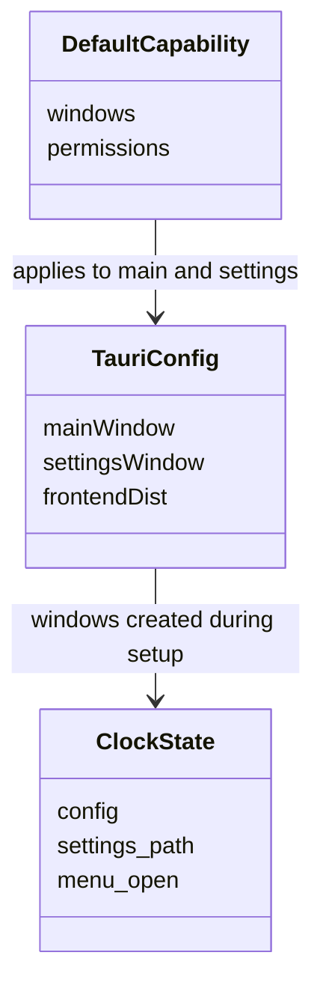
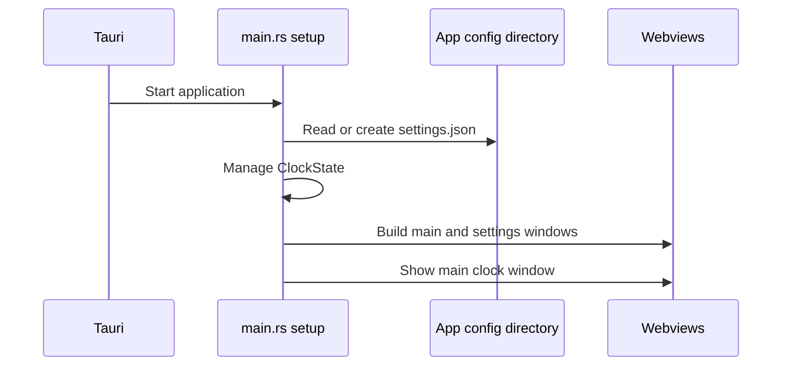

# Tauri package workflow

The package connects webview configuration to the Rust application. This class diagram describes package relationships rather than Rust inheritance.

The definitions are in [tauri.conf.json](../tauri.conf.json), [main.rs](../src/main.rs), and [default.json](../capabilities/default.json). This diagram omits generated Tauri types.

The startup order comes from [main.rs](../src/main.rs); the window definitions come from [tauri.conf.json](../tauri.conf.json). `settings.json` is durable state; `ClockState` is in-process state.
