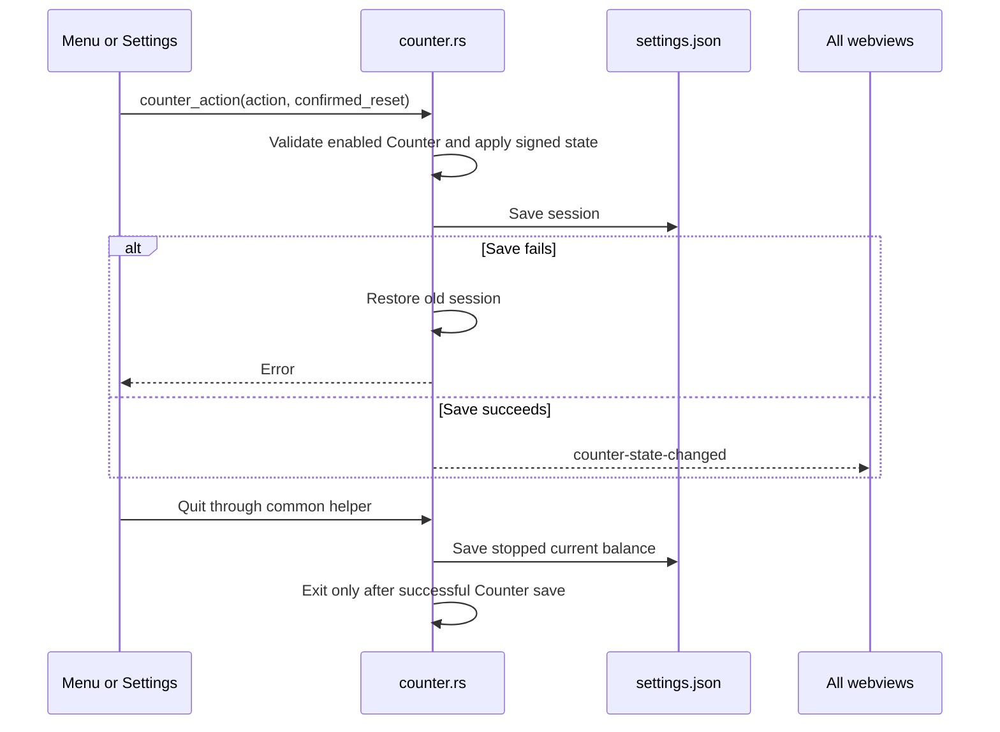
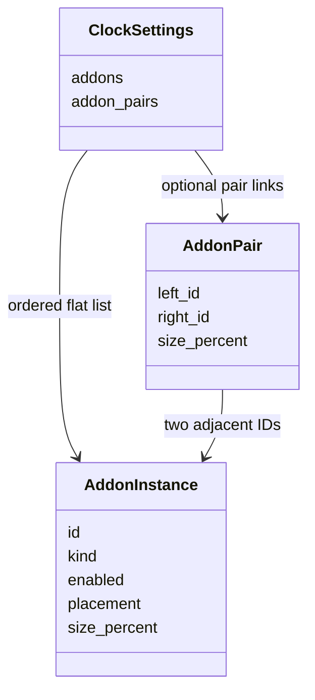
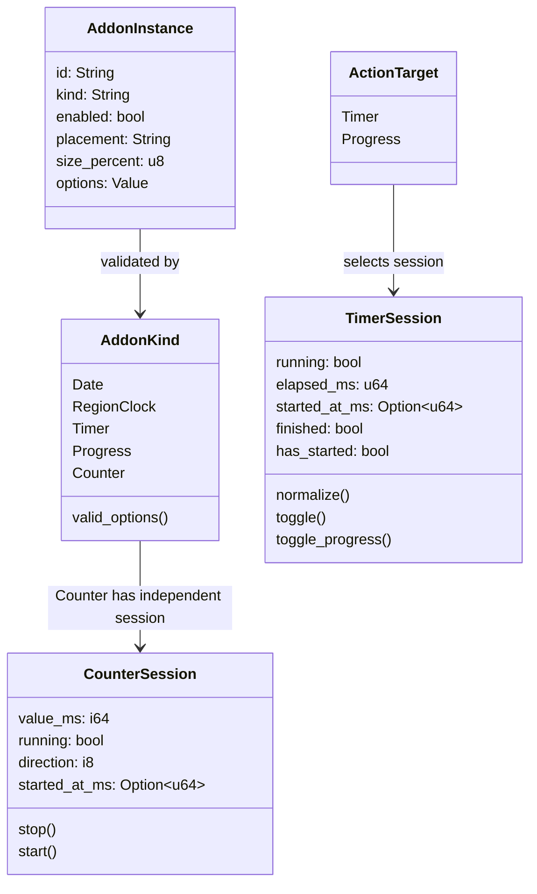
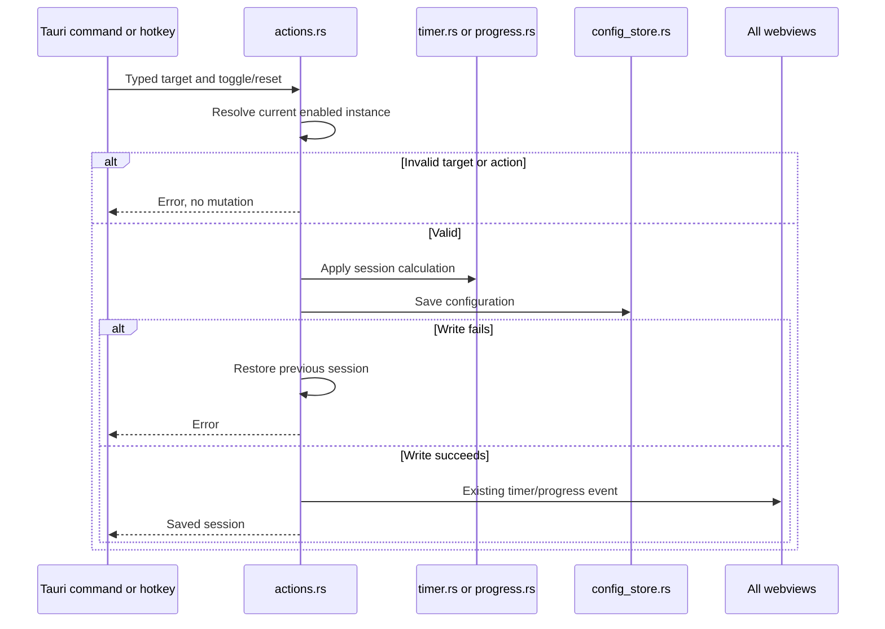

# Native add-on workflows

## Counter state and normal quit

[counter.rs](../counter.rs) provides the signed transition and transaction; [window_commands.rs](../../window_commands.rs) supplies the common quit helper for menu, tray, and shortcut entry points. [lib.rs](../../lib.rs) also checkpoints a running Counter on another Tauri exit request. If the process terminates without an exit request, [config_store.rs](../../config_store.rs) loads the last saved checkpoint stopped rather than counting closed-app time. The diagram omits separate position persistence, which remains in the quit helper.

Removing Counter through Settings changes only the add-on list. Its separate session keeps its balance and continues running if it was running; adding Counter again exposes that session. An explicit disable stops it while retaining the balance. The quit helper stops a running session even when the Counter add-on is absent.

For a Timer mode or preset choice, [actions.rs](../actions.rs) rechecks the enabled Timer and session under the config lock, then requires confirmation if a running or elapsed session would be discarded unless that choice's warning was dismissed. A mode choice writes the new mode and an idle session; a preset choice writes its duration and a running session. If saving fails, prior settings and Timer session are restored with no event. Success emits both settings and Timer session events. Progress continues using its per-ID transaction and session map.

## Pair validation

[instance.rs](../instance.rs) validates pair references, eligibility (Date, Region clock, Timer, or Counter), placement, enabled state, scale, and uniqueness before a settings save. Progress remains ineligible. [config_store.rs](../../config_store.rs) keeps valid flat instances when pair links are stale after loading. Pair metadata is durable; row rendering is derived in the frontend, while Counter's session remains separate.

The Progress preset action reads the selected instance and shared preset list under one config lock, checks whether an existing session needs confirmation, then writes its option duration and new running session together. On write failure it restores the prior settings and session and emits nothing. On success it broadcasts the settings snapshot and all Progress sessions; the frontend's single reactive host updates Start/Pause labels by instance ID.

These names correspond to [instance.rs](../instance.rs), [registry.rs](../registry.rs), [session.rs](../session.rs), and [actions.rs](../actions.rs). The diagram omits persistence, which remains in the application service.

[settings_commands.rs](../../settings_commands.rs) separately asks type modules to reconcile cloned sessions before replacing durable settings. Disabling Progress retains its countdown session; removing, changing mode, or changing duration can remove it. Timer uses its existing different reset rules. The [parent workflow](../../doc/workflow_diagram.md) covers load recovery and settings broadcasts.
