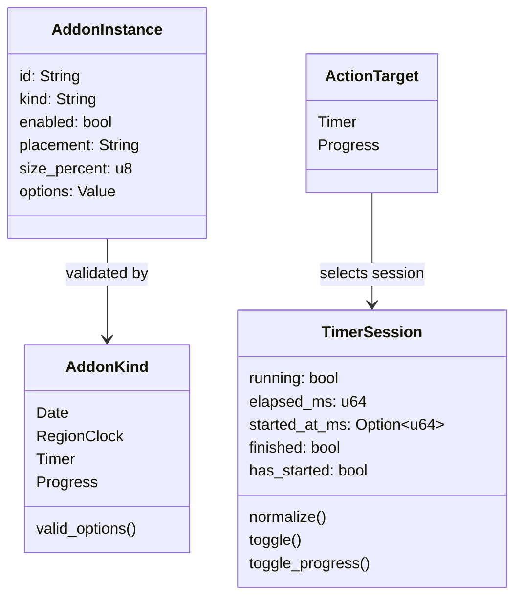
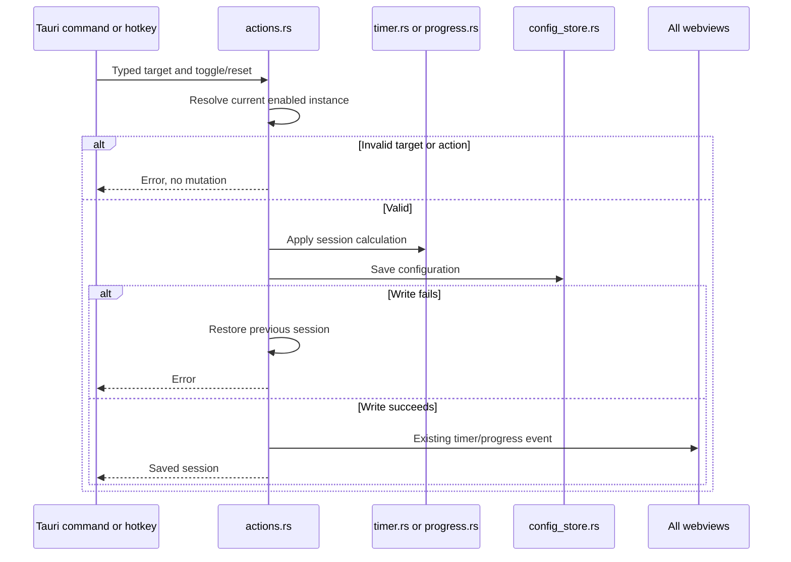

# Native add-on workflows

These names correspond to [instance.rs](../instance.rs), [registry.rs](../registry.rs), [session.rs](../session.rs), and [actions.rs](../actions.rs). The diagram omits persistence, which remains in the application service.

[settings_commands.rs](../../settings_commands.rs) separately asks type modules to reconcile cloned sessions before replacing durable settings. Disabling Progress retains its countdown session; removing, changing mode, or changing duration can remove it. Timer uses its existing different reset rules. The [parent workflow](../../doc/workflow_diagram.md) covers load recovery and settings broadcasts.
