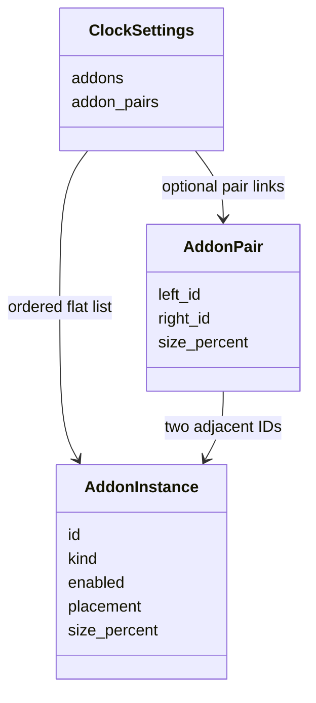
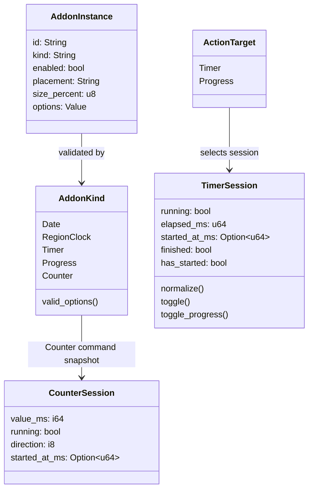
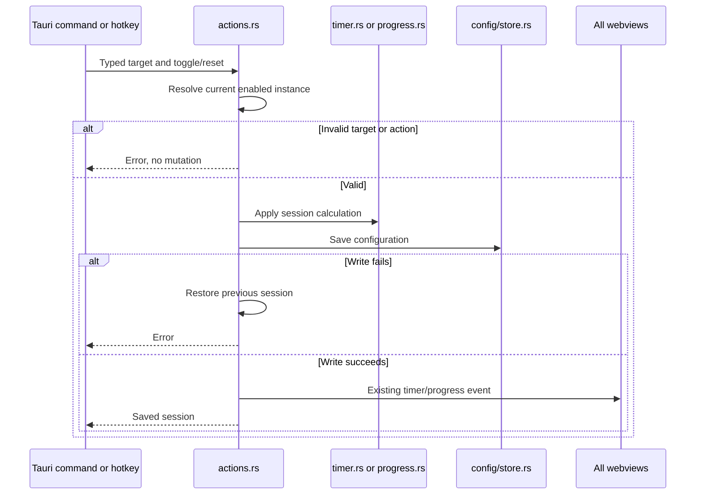

# Native add-on workflows

## Counter state and normal quit

A confirmed Reset follows the same command boundary but deletes all `counter_event` and `counter_run` rows in one SQLite transaction. It zeros and stops the singleton `counter_state` row, increments its reset epoch, and stores only the latest Reset action ID for retry protection. A rejected or failed Reset leaves state and history intact. The action emits the existing state event only after commit.

```mermaid
sequenceDiagram
    participant UI as Menu or Settings
    participant Rust as counter.rs
    participant Disk as topclock.db
    participant Windows as All webviews
    UI->>Rust: counter_action(action, confirmed_reset)
    Rust->>Rust: Validate enabled Counter and capture wall/monotonic time
    alt Count up/down or Stop
        Rust->>Disk: Transaction: state, event, close/open run
    else Confirmed Reset
        Rust->>Disk: Transaction: delete all events/runs; zero state
    end
    alt Commit fails
        Rust-->>UI: Error
    else Commit succeeds
        Rust-->>Windows: counter-state-changed
    end
    UI->>Rust: Quit through common helper
    Rust->>Disk: Commit final stopped balance and run
    Rust->>Rust: Exit only after successful Counter save
```

[counter.rs](../counter.rs) adapts the Tauri commands and [counter_db.rs](../counter_db.rs) owns the SQLite transaction. [window_commands.rs](../../windows/window_commands.rs) supplies the common quit helper for menu, tray, and shortcut entry points. [lib.rs](../../lib.rs) also stops a running Counter on another Tauri exit request. If the process terminates without an exit request, database startup closes the abandoned run at its last durable balance with zero additional measured time. The diagram omits separate position persistence, which remains in the quit helper.

Removing Counter through Settings changes only the add-on list. Its database state keeps its balance and continues running if it was running; adding Counter again exposes it. An explicit disable stages a database stop, saves JSON settings, then commits the stop. A failed JSON save rolls back SQLite; a failed SQLite commit attempts to restore JSON. After a crash between files, startup treats a disabled JSON instance as stopped at the durable checkpoint. The quit helper stops a running Counter even when its add-on instance is absent.

The Counter Details slider writes the app-wide `counter_halo_intensity_percent` setting through the ordinary settings update route. [configuration validation](../../config/validation.rs) checks 0–100, while [config model](../../config/model.rs) defaults a missing field to 50; [counter.rs](../counter.rs) continues to require empty instance options. This preference does not change CounterSession or the action event above.


For a Timer mode or preset choice, [actions.rs](../actions.rs) rechecks the enabled Timer and session under the config lock, then requires confirmation if a running or elapsed session would be discarded unless that choice's warning was dismissed. A mode choice writes the new mode and an idle session; a preset choice writes its duration and a running session. If saving fails, prior settings and Timer session are restored with no event. Success emits both settings and Timer session events. Progress continues using its per-ID transaction and session map.

## Pair validation



[instance.rs](../instance.rs) validates pair references, eligibility (Date, Region clock, Timer, or Counter), shared placement, scale, and uniqueness before a settings save. Either member may be disabled independently. Progress remains ineligible. [config store](../../config/store.rs) keeps valid flat instances when pair links are stale after loading. Pair metadata is durable; row rendering is derived in the frontend, while Counter's session remains separate.

The Progress preset action reads the selected instance and shared preset list under one config lock, checks whether an existing session needs confirmation, then writes its option duration and new running session together. On write failure it restores the prior settings and session and emits nothing. On success it broadcasts the settings snapshot and all Progress sessions; the frontend's single reactive host updates Start/Pause labels by instance ID.



These names correspond to [instance.rs](../instance.rs), [registry.rs](../registry.rs), [session.rs](../session.rs), and [actions.rs](../actions.rs). The diagram omits persistence, which remains in the application service.



[config commands](../../config/commands.rs) separately asks type modules to reconcile cloned sessions before replacing durable settings. Disabling Progress retains its countdown session; removing, changing mode, or changing duration can remove it. Timer uses its existing different reset rules. The [parent workflow](../../doc/workflow_diagram.md) covers load recovery and settings broadcasts.
