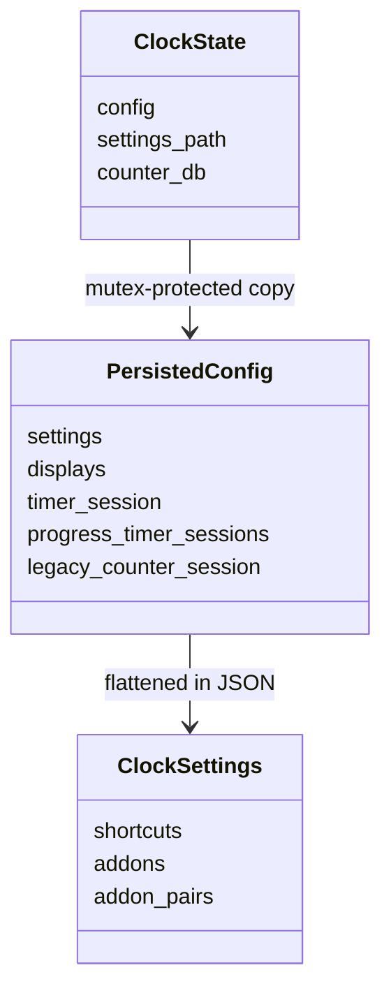
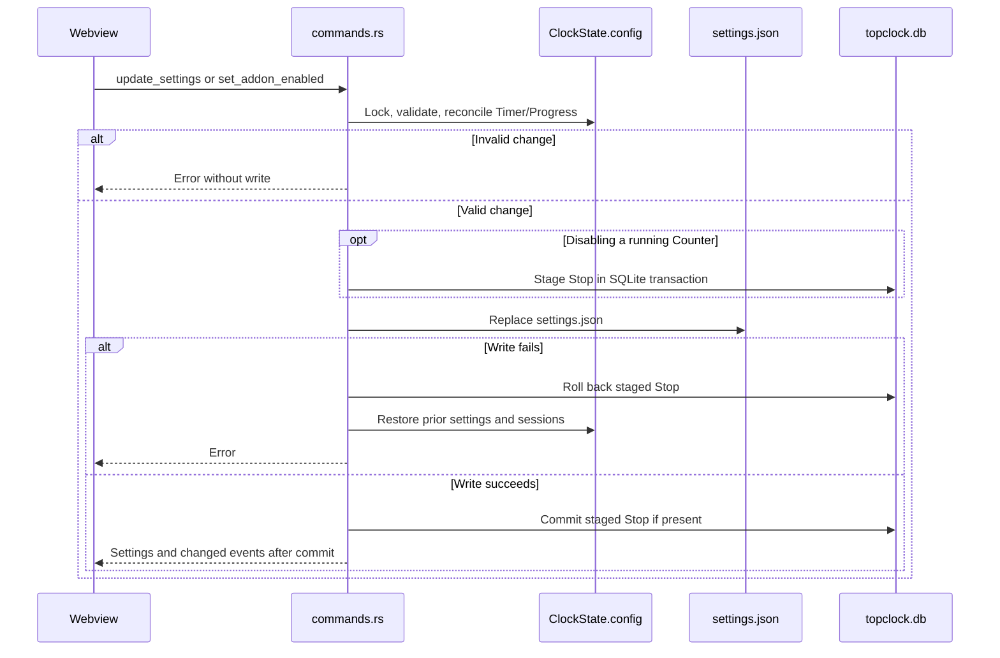

# Configuration workflow

The model is durable; `ClockState` owns its in-process copy. See the [parent workflow](../../doc/workflow_diagram.md) for application startup and other command paths.

## Ownership

[model.rs](../model.rs) defines the saved types; [state.rs](../../state.rs) owns the mutex and path. The diagram omits fields not needed to show ownership.

## Settings save

[commands.rs](../commands.rs) emits after successful writes. A database commit failure after JSON replacement attempts to restore prior JSON; startup recovery closes any abandoned run at the last durable balance after a crash. [store.rs](../store.rs) reads legacy Counter JSON only for database import. There is no authorization step beyond existing Tauri command permissions described by the [package architecture](../../../doc/architecture.md).

`set_addon_enabled` targets one ID even when it belongs to an `AddonPair`; `update_settings` accepts both changed flags from the Settings group control. Both use the sequence above. Mixed enabled flags pass pair validation, and disabling a Timer or Counter still follows its own session reconciliation rule.
