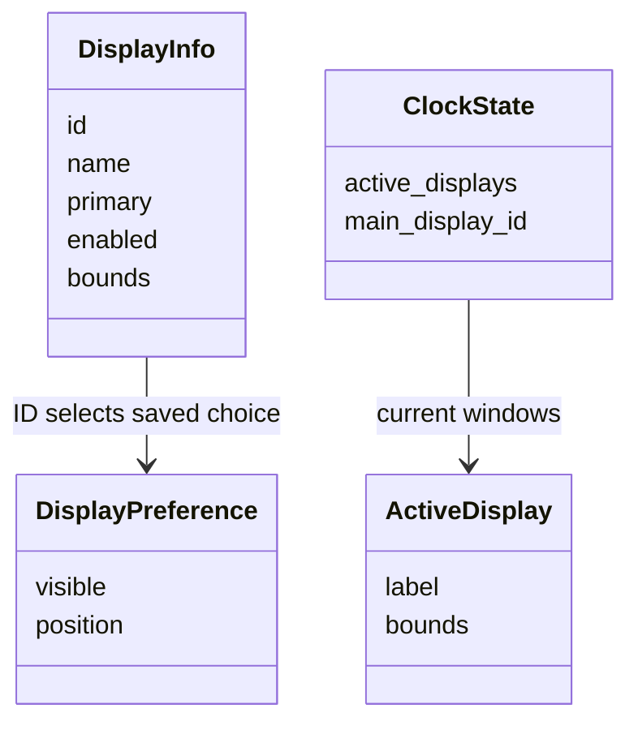
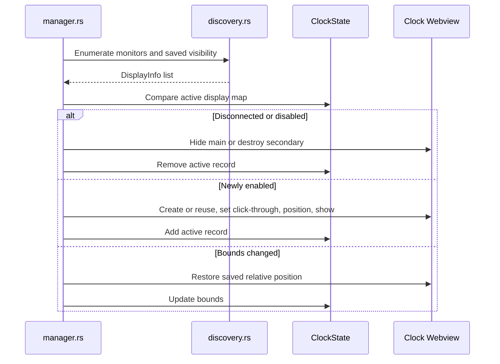

# Display workflow

The display manager connects durable per-display preferences with transient clock windows. See the [parent workflow](../../doc/workflow_diagram.md) for application startup.

## Display records

[mod.rs](../mod.rs) defines discovered and active records; [config/model.rs](../../config/model.rs) defines the durable preference. `ActiveDisplay` is not serialized.

## Reconcile connected monitors

[manager.rs](../manager.rs) performs this loop; [positions.rs](../positions.rs) handles user-requested visibility and reset saves. The diagram omits unchanged displays and the emitted `displays-changed` event.
