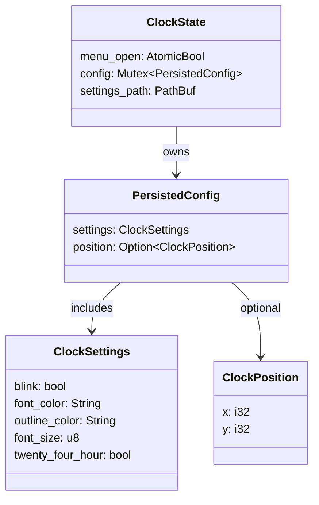
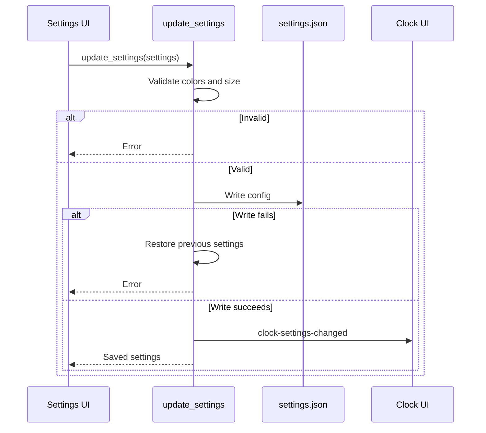

# Rust workflows

The core Rust types in [main.rs](../main.rs) own durable configuration and live window state.

Names and fields match [main.rs](../main.rs). The config is written to `settings.json`; `menu_open` is in-memory only.

The persistence path and error handling are in [main.rs](../main.rs). Window-position saves use the same file. The background monitor polls Windows input and window geometry every 30 ms, changing click-through and emitting events when observed values change.
