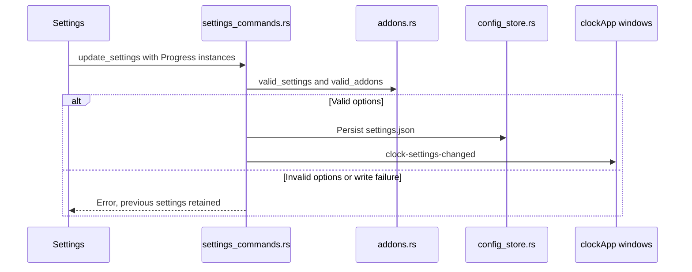
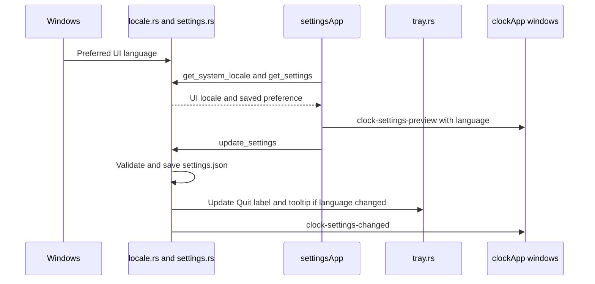
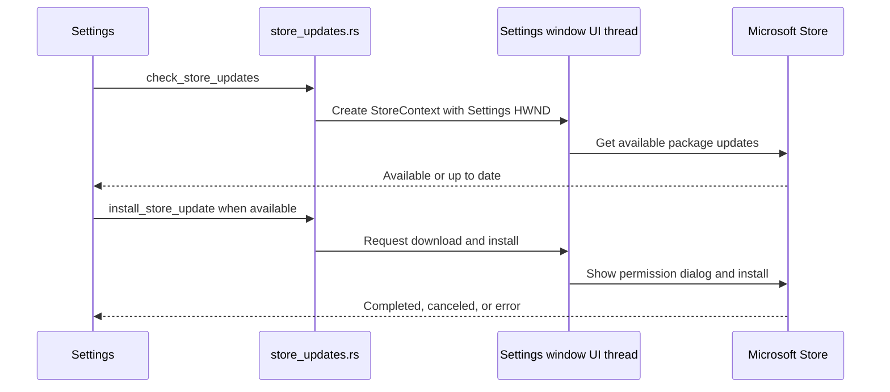
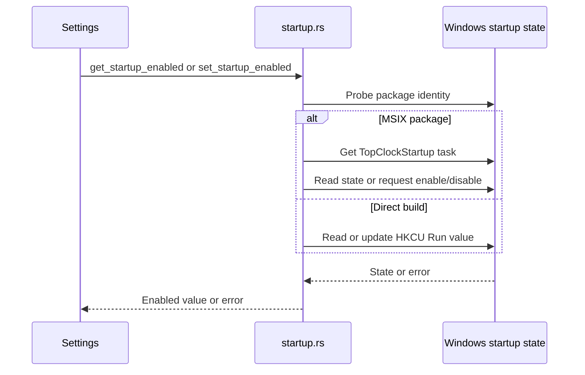
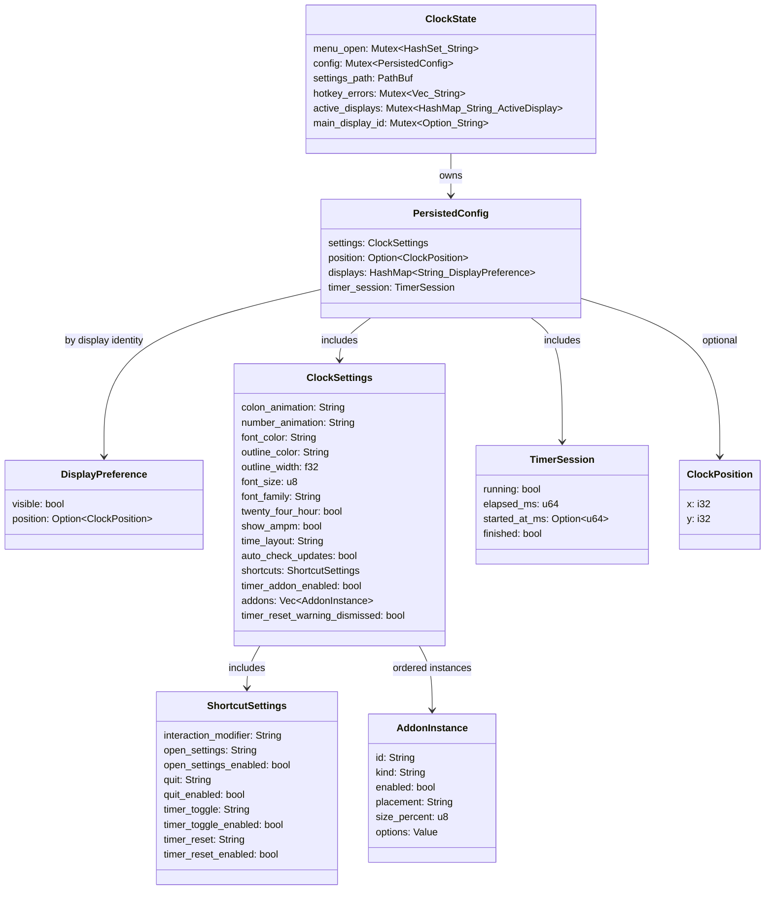
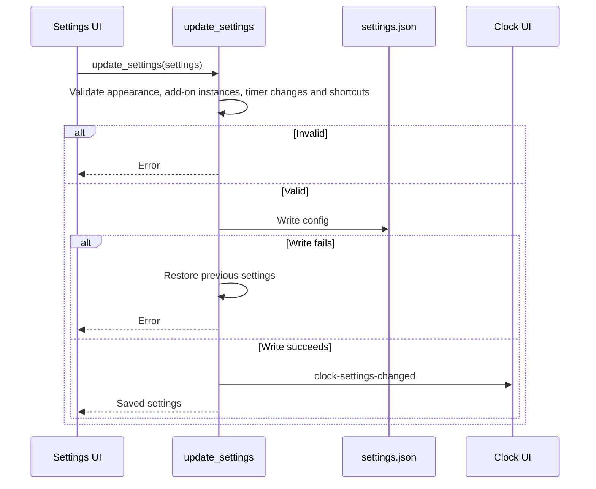
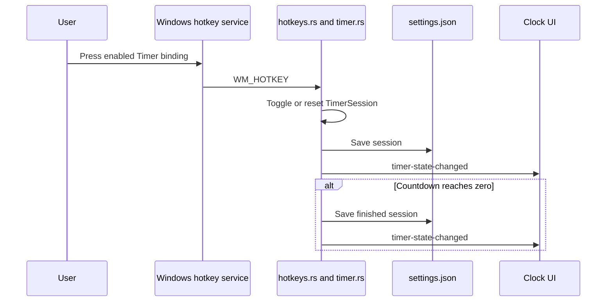
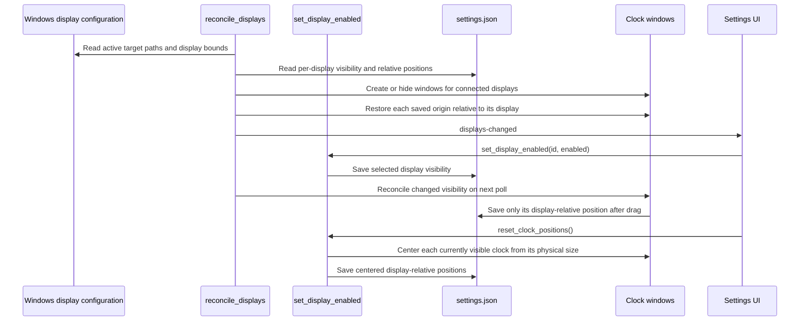

# Rust workflows

## Progress add-on save boundary

[addons.rs](../addons.rs) accepts multiple Progress instances within the shared 16-instance limit. It validates the mode, calendar dates, range order, same-day boundaries, auto-hide flag, and optional percentage, length, and thickness fields. Missing appearance fields from older saved instances remain valid. [settings_commands.rs](../settings_commands.rs) saves only validated settings and rolls back memory on write failure. Progress has no native timer session; both frontend views derive it from local time. The diagram omits the Settings preview event, which is described in the [frontend workflow](../../../src/doc/workflow_diagram.md).

## Windows language and saved preference

The [native locale command](../locale.rs) reads the current user's Windows UI preference in both direct and MSIX processes. The saved value is only `system` or one of four supported language tags; the frontend resolves `system` and formats Date weekdays. Failed validation or save leaves the old setting and tray text in place. See [frontend localization](../../../src/doc/architecture.md).

The General tab calls `open_settings_folder` in [window_commands.rs](../window_commands.rs). The command derives the folder from `ClockState.settings_path`, creates it if necessary, and asks Explorer to open it. Directory or process launch errors return to Settings; this flow does not write `settings.json`.

The sign-in toggle uses [startup.rs](../startup.rs). `is_packaged` probes the process package identity. Packaged builds query the manifest's `TopClockStartup` task and request enablement or disable it through Windows; direct builds continue to read and write the `TopClock` Run value. If Windows disabled the task as a user action, the enable request reports that state and leaves it disabled. Settings reads the authoritative state after a toggle. The Store update UI uses the same package identity query to select [store_updates.rs](../store_updates.rs) instead of the direct-build GitHub release page.

The installation command rechecks availability before requesting installation, so a stale button can return up to date. The Store owns the package and permission dialog. This path needs a Store-signed two-version check; direct builds can only open the GitHub release page.

The `TopClockStartup` declaration is generated by [Build-Msix.ps1](../../../scripts/Build-Msix.ps1). The diagram excludes installed-package behavior that still needs manual verification.

Before Tauri creates any windows, [webview_runtime.rs](../webview_runtime.rs) asks the WebView2 loader for an installed Evergreen runtime version. If unavailable, it shows a native message with Microsoft's download page and exits. This check applies to package and direct builds.

The display manager in [displays.rs](../displays.rs) polls connected desktop displays every two seconds. [display_identity.rs](../display_identity.rs) matches GDI names to active Windows target paths. Enabled displays receive separate clock windows, while one `ClockSettings` and `TimerSession` remain shared. A per-display preference stores visibility and a position relative to that display's origin; absent preferences mean visible.

The core Rust types in [settings.rs](../settings.rs) and [state.rs](../state.rs) own durable configuration and live window state.

Names and fields match [settings.rs](../settings.rs), [addons.rs](../addons.rs), and [state.rs](../state.rs). [config_store.rs](../config_store.rs) writes the config to `settings.json`; `menu_open` and hotkey errors are in-memory only. `timer_addon_enabled` is a retained legacy migration field, set false after migration.
The `options` value contains `format` and optionally `show_weekday` for Date, or `time_zone` and optionally `show_label` for Region clock. [addons.rs](../addons.rs) accepts missing optional switches for older files, requires booleans when present, and validates sizes from 10% to 100% before the save flow below proceeds.

Before selection, the Settings UI calls `get_font_families` in [fonts.rs](../fonts.rs). It enumerates the Windows font table, removes duplicate family names, and returns an error if enumeration fails; it does not write configuration. [settings_commands.rs](../settings_commands.rs) validates changes and calls [config_store.rs](../config_store.rs) to save. Window-position saves in [displays.rs](../displays.rs) use the same file. The background monitor in [interaction.rs](../interaction.rs) polls Windows input and window geometry every 30 ms. Its first poll after the main window is shown reconciles click-through with the current modifier and menu state. On later state changes, `set_click_through` changes `WS_EX_TRANSPARENT` while retaining `WS_EX_LAYERED` and refreshes the native frame; the monitor also emits state and proximity events. It calls [timer.rs](../timer.rs) to normalize a completed Timer on the main window.

The hotkey service sends only successfully registered bindings. Timer session state survives restart by storing accumulated milliseconds and the last start epoch; the UI formats the current value from that state. The configured interaction modifier is polled separately and never has an off switch.

## Display reconciliation

The manager polls every two seconds and creates a secondary clock only for an enabled connected display. Windows without a target path use a GDI slot identity. The `main` and Settings windows stay allocated even when hidden; disconnected secondary clocks are destroyed. Reset skips clocks that are not currently visible and leaves disabled display preferences unchanged. If moving a clock or saving the config fails, the command tries to put moved windows back and reports the error. `clock-settings-changed` and `timer-state-changed` remain application-wide, while proximity and modifier events target an individual clock.
