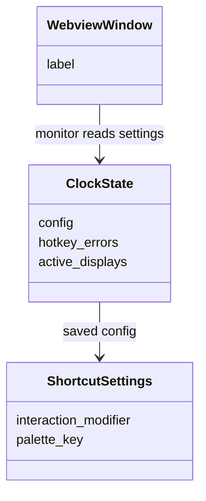
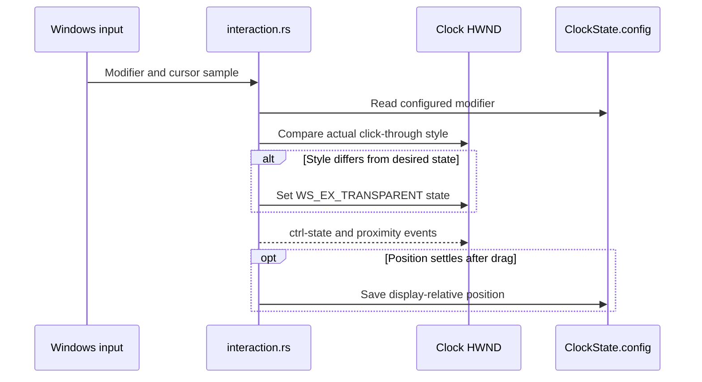

# Native input workflow

The two monitors run independently and read shared settings. The [parent workflow](../../doc/workflow_diagram.md) covers application startup.

## Ownership

[state.rs](../../state.rs) owns runtime state; [config/model.rs](../../config/model.rs) owns the saved keys. Each clock has an [interaction monitor](../interaction.rs); the [palette monitor](../palette.rs) is application-wide.

## Clock modifier and click-through

The monitor also invokes Timer completion checks. Menu dismissal and palette cancellation have their own paths in [interaction.rs](../interaction.rs) and [palette.rs](../palette.rs); the diagram focuses on the clock's pass-through invariant.
