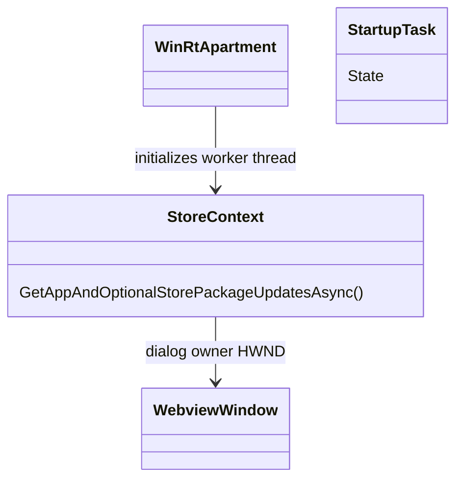
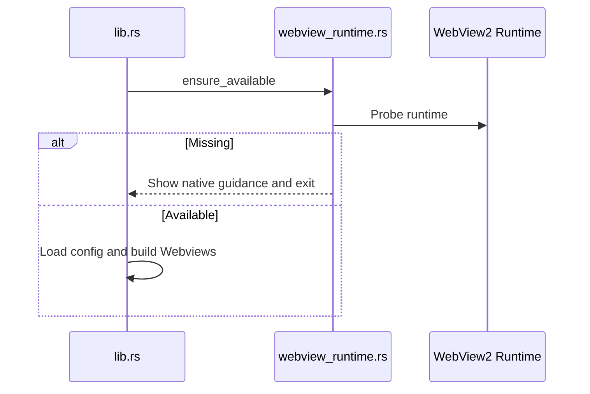

# Platform service workflow

The platform services are called by startup, Settings, tray, and update commands. See the [parent workflow](../../doc/workflow_diagram.md) for the complete application path.

## Service relationships

[startup.rs](../startup.rs) selects StartupTask or the direct-build Run key. [store_updates.rs](../store_updates.rs) owns `WinRtApartment` and uses `StoreContext` only for packaged builds. The diagram shows API relationships, not application-owned persisted fields.

## Runtime startup gate

The guard in [webview_runtime.rs](../webview_runtime.rs) runs before managed state or windows are created. The Store update flow is documented in the [package workflow](../../../doc/workflow_diagram.md).
