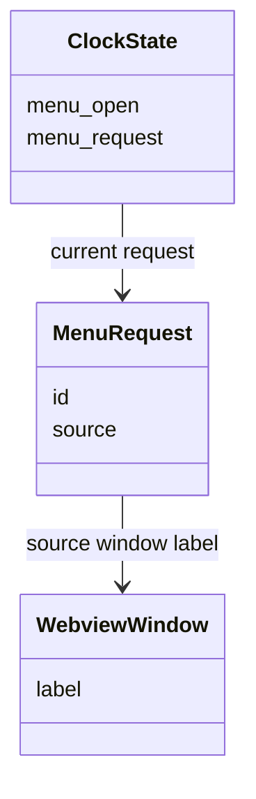

# Window and tray workflow

The menu and tray route actions into existing commands. See the [parent workflow](../../doc/workflow_diagram.md) for startup and display reconciliation.

## Runtime relationships



[menu_window.rs](../menu_window.rs) defines the request; [state.rs](../../state.rs) stores it. The separate `menu` Webview is configured by the [Tauri package](../../../doc/architecture.md).

## Quit route

```mermaid
sequenceDiagram
    participant Entry as Menu, tray, or shortcut
    participant Quit as window_commands.rs
    participant Counter as addons/counter.rs
    participant Displays as displays/positions.rs
    participant App as Tauri
    Entry->>Quit: quit_app
    Quit->>Counter: Checkpoint and stop running Counter
    alt Save fails
        Counter-->>Quit: Error; keep app running
    else Save succeeds
        Quit->>Displays: Save current clock positions
        Quit->>App: Exit
    end
```

[window_commands.rs](../window_commands.rs) is the common explicit Quit path. A separate Tauri exit-request hook in [lib.rs](../../lib.rs) also checkpoints Counter before another exit request completes.
