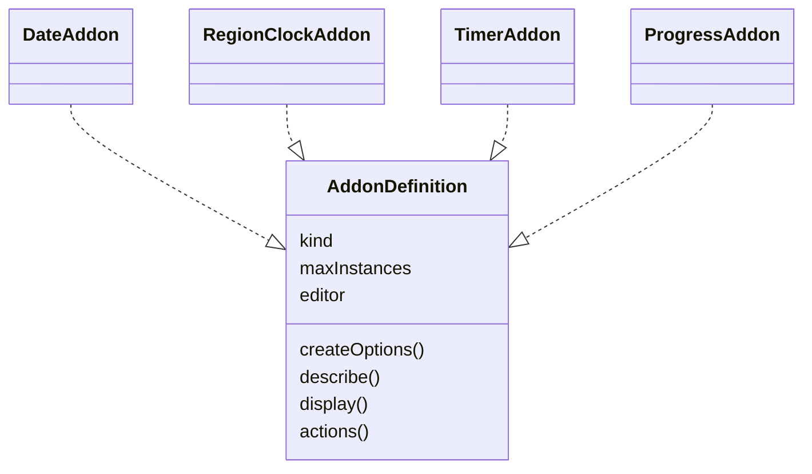
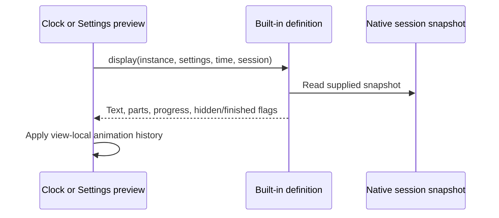

# Built-in definition workflow

The class diagram shows the shared object contract, rather than JavaScript inheritance.

The four definition objects live in [date.js](../date.js), [region-clock.js](../region-clock.js), [timer.js](../timer.js), and [progress.js](../progress.js). The notation describes their common fields; no runtime class or inheritance is created.

Definitions calculate display data without writes. Type edit methods validate changes before using the existing Settings save path. [The host workflow](../../doc/workflow_diagram.md) covers actions and persistence.
