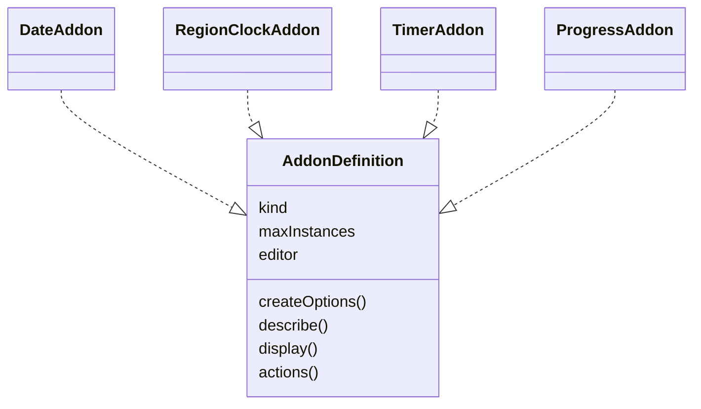
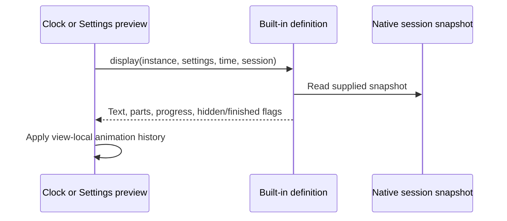

# Built-in definition workflow

For Region clock editing, [region-picker.js](../region-picker.js) joins browser-supported time zones with the bundled [IANA country map](../zone-country-codes.js), then derives localized and English names with `Intl.DisplayNames`. The [view](../../views/region-clock.html) filters those records from a transient query and sends only a chosen ID to the existing option editor. A Settings language change rebuilds the records; Escape and blur reset the query to the current selected label. The [display formatter](../region-clock.js) continues using the saved zone ID.

For an enabled countdown, `progressAddon.actions` returns Start/Pause and Reset for the clock menu using the same per-ID session state as the Settings buttons. The menu's Set control renders choices supplied by `progressAddon.menu.choices`; its native action emits a new session map, and the definition's next action calculation changes only the selected row's Start/Pause label. The other Progress modes return no actions.

The class diagram shows the shared object contract, rather than JavaScript inheritance.

The four definition objects live in [date.js](../date.js), [region-clock.js](../region-clock.js), [timer.js](../timer.js), and [progress.js](../progress.js). The notation describes their common fields; no runtime class or inheritance is created.

Definitions calculate display data without writes. Timer and Progress editors read the host's shared reactive sessions and write draft resets through its setters before using the existing Settings save path. [The host workflow](../../doc/workflow_diagram.md) covers actions and persistence.
