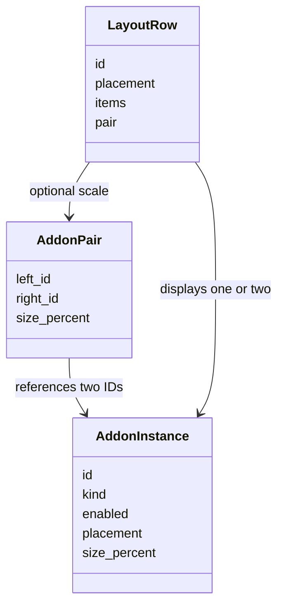
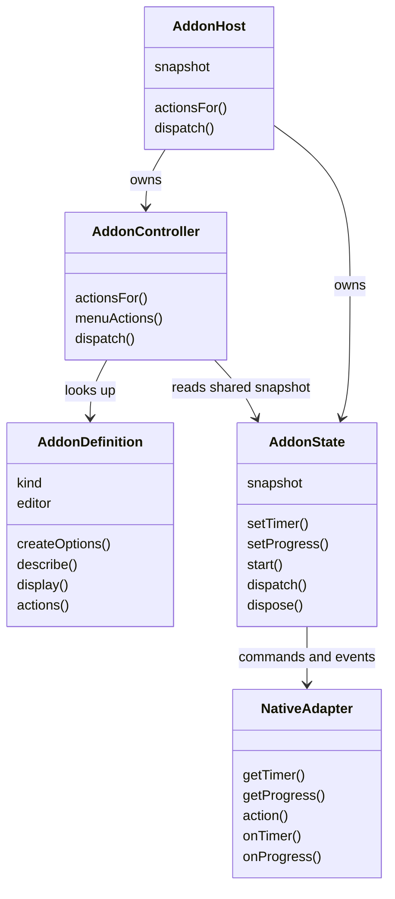
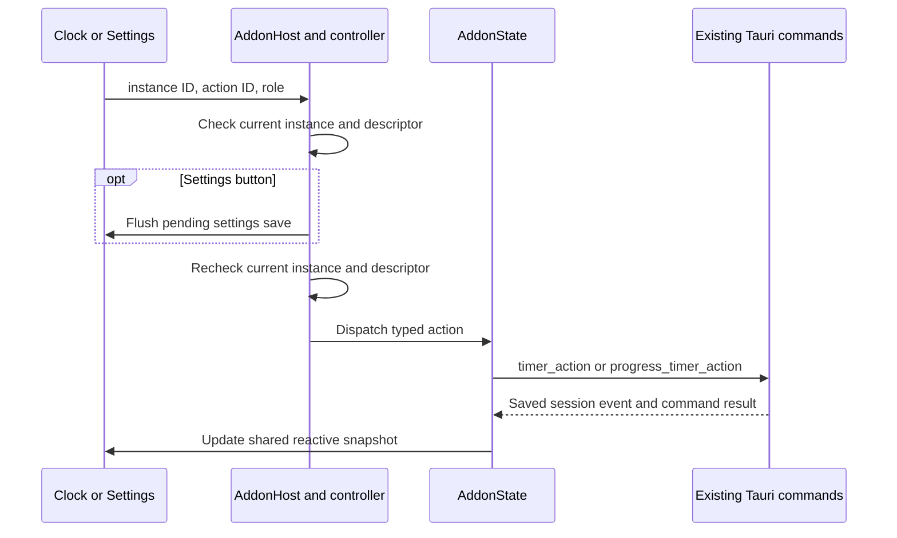

# Frontend add-on host workflows

## Pair layout and editing

[layout.js](../layout.js) derives rows without moving type options into the pair. [instance-editor.js](../instance-editor.js) updates the flat list and pair metadata together; pointer hit testing includes horizontal distance for the two side-by-side Settings members. The Rust validator enforces two adjacent eligible members with shared placement and enabled state. A group switch mirrors both flags; removing a member removes its pair record. These are JavaScript records and a native serialized record, not inheritance.

For the separate menu webview, `menuEntries()` combines enabled action descriptors and optional grouped choices from each compiled definition. Progress supplies its own preset choices and confirmation metadata. `dispatchMenuChoice()` revalidates the chosen ID, then the native adapter invokes `progress_timer_set_preset`; Rust atomically saves only the selected countdown. Settings and each clock observe its broadcasts. The registry also declares optional Details fragments for the catalog and instance buttons.

The diagram represents JavaScript objects and their contracts, not inheritance.

[registry.js](../registry.js) supplies definitions. [host.js](../host.js) constructs one Alpine-reactive [state.js](../state.js) snapshot and passes that same object to [controller.js](../controller.js) and the page. The [native adapter](../native-adapter.js) bridges to Rust. Each webview has its own host; Rust owns durable state shared across windows.

An unavailable action fails before native dispatch; Rust checks it again. Session events can arrive before command responses, so [state.js](../state.js) keeps the newer event snapshot. The controller and Alpine templates read the same stable reactive object, so an action label tracks its instance without a separate page copy. Subscription cleanup occurs on Alpine destruction. Settings drafts and display animation histories stay with their respective pages.
