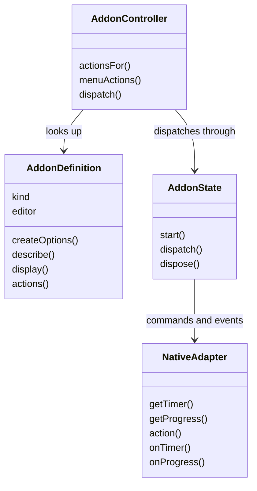
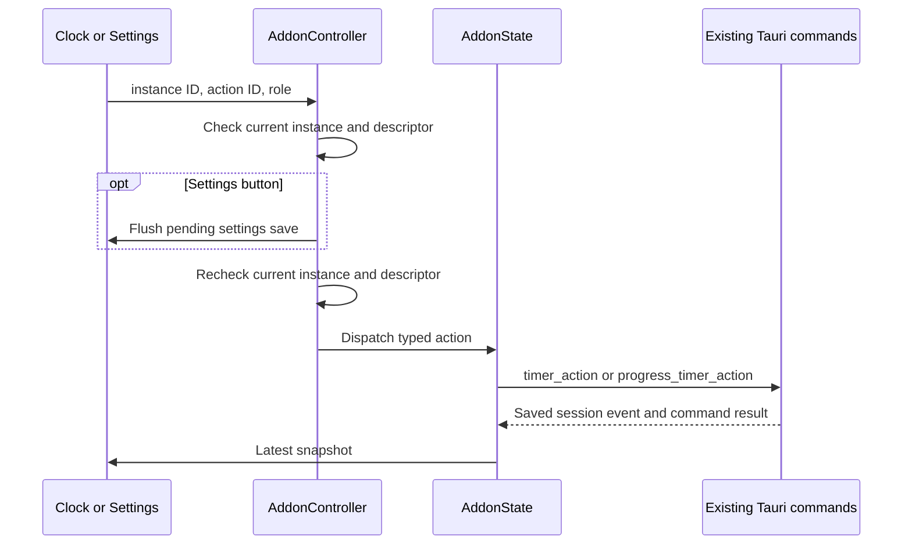

# Frontend add-on host workflows

The diagram represents JavaScript objects and their contracts, not inheritance.

[registry.js](../registry.js) supplies definitions. [controller.js](../controller.js) uses the current settings and session snapshot; [state.js](../state.js) and [native-adapter.js](../native-adapter.js) bridge to Rust. These are local per-webview objects, while Rust owns durable state.

An unavailable action fails before native dispatch; Rust checks it again. Session events can arrive before command responses, so [state.js](../state.js) keeps the event snapshot. Subscription cleanup occurs on Alpine destruction. Settings drafts and display animation histories stay with their respective pages.
