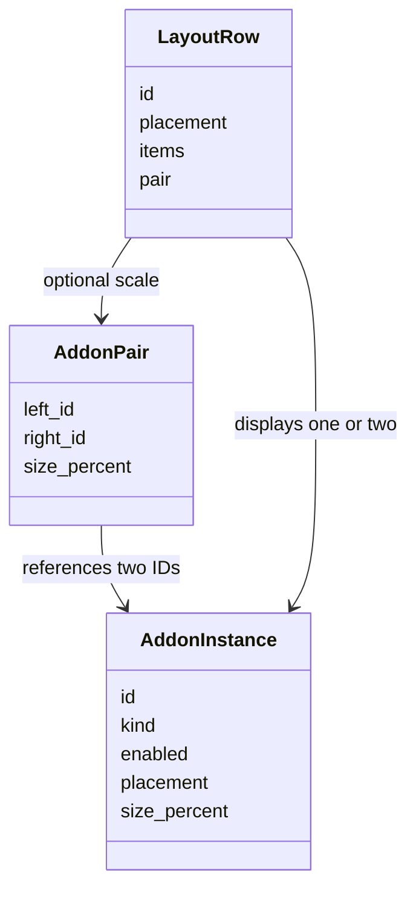
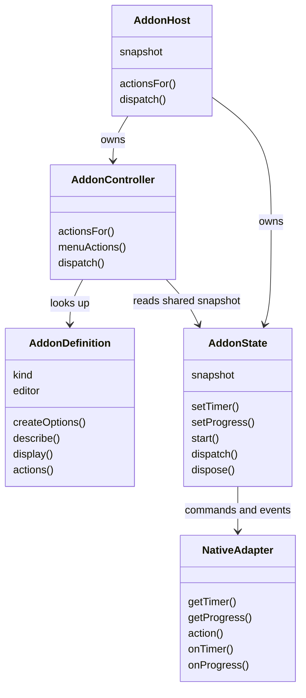
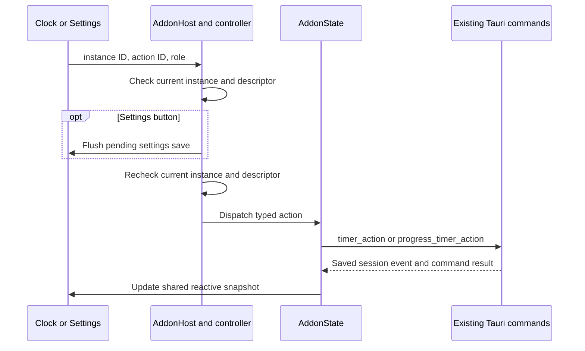

# Frontend add-on host workflows

The clock menu's Add-on disclosure uses [controller.js](../controller.js) to list every configured row from [layout.js](../layout.js), including disabled rows and a single row per pair. A switch sends an explicit target state through [native-adapter.js](../native-adapter.js) and waits for saved settings. The menu applies the returned snapshot and stays open; a rejected command shows an error without changing the switch. See the [menu sequence diagram](../../doc/workflow_diagram.md#clock-menu-add-on-switches).

## Counter action and display

```mermaid
sequenceDiagram
    participant Menu as Clock menu or Settings
    participant Host as AddonHost
    participant Rust as counter_action
    participant Clock as Clock and preview
    Menu->>Host: Count up, Count down, Stop, or confirmed Reset
    Host->>Rust: Dispatch current enabled Counter action
    Rust-->>Host: Saved CounterSession
    Rust-->>Clock: counter-state-changed
    Clock->>Clock: Format balance; map sign and running state to color
```

[counter.js](../builtins/counter.js) supplies the three menu actions and pure `H:MM:SS`/`D:HH:MM` formatting. Its [appearance helper](../builtins/signed-balance-appearance.js) selects blue/red for a running nonzero balance and lighter shades for a stopped one; the clock and preview receive the same result. No Counter primary-click role exists. Reset has a Settings-only role and passes confirmation to Rust; an invalid or disabled target is rejected before a native write. The [native workflow](../../../src-tauri/src/addons/doc/workflow_diagram.md) covers shutdown persistence.


Timer and Progress definitions contribute grouped menu entries. The controller asks for named sections, flattens the choices for current-instance revalidation, then the adapter invokes the matching native command. Timer Mode choices remain available in both modes; Timer Set choices exist only in countdown mode. The host updates its reactive Timer session from the command result only if a newer `timer-state-changed` event has not arrived. See the [Timer definition](../builtins/timer.js), [menu](../../menu.js), and [native workflow](../../../src-tauri/src/addons/doc/workflow_diagram.md).

## Region editor selection

The [Region view](../views/region-clock.html) filters indexed city, country, and ID terms from the [Settings picker module](../builtins/region-picker.js) on input. The country terms come from the bundled [IANA map](../builtins/zone-country-codes.js), not saved add-on data. Clicking a result or pressing Enter sends its exact ID to `editAddonOption` in [instance-editor.js](../instance-editor.js), which follows the existing save and preview route. Closing without a choice restores the current display label and makes no settings change. Search state does not enter the host session or serialized add-on options.

## Pair layout and editing



[layout.js](../layout.js) derives rows without moving type options or sessions into the pair. [instance-editor.js](../instance-editor.js) updates the flat list and pair metadata together; pointer hit testing includes horizontal distance for the two side-by-side Settings members. Date, Region clock, Timer, and Counter are eligible, while Progress is not. The Rust validator enforces two adjacent eligible members with shared placement and enabled state. A group switch mirrors both flags; removing a member removes its pair record. These are JavaScript records and a native serialized record, not inheritance.

For the separate menu webview, `menuEntries()` combines enabled action descriptors and optional grouped sections from each compiled definition. Timer supplies Mode and countdown Set choices, while Progress supplies its own preset choices and confirmation metadata. `dispatchMenuChoice()` revalidates the chosen ID, then the native adapter invokes the corresponding Timer or Progress command; Rust atomically saves settings and the affected session. Settings and each clock observe its broadcasts. The registry also declares optional Details fragments for the catalog and instance buttons.

The diagram represents JavaScript objects and their contracts, not inheritance.



[registry.js](../registry.js) supplies definitions. [host.js](../host.js) constructs one Alpine-reactive [state.js](../state.js) snapshot and passes that same object to [controller.js](../controller.js) and the page. The [native adapter](../native-adapter.js) bridges to Rust. Each webview has its own host; Rust owns durable state shared across windows.



An unavailable action fails before native dispatch; Rust checks it again. Session events can arrive before command responses, so [state.js](../state.js) keeps the newer event snapshot. The controller and Alpine templates read the same stable reactive object, so an action label tracks its instance without a separate page copy. Subscription cleanup occurs on Alpine destruction. Settings drafts and display animation histories stay with their respective pages.
