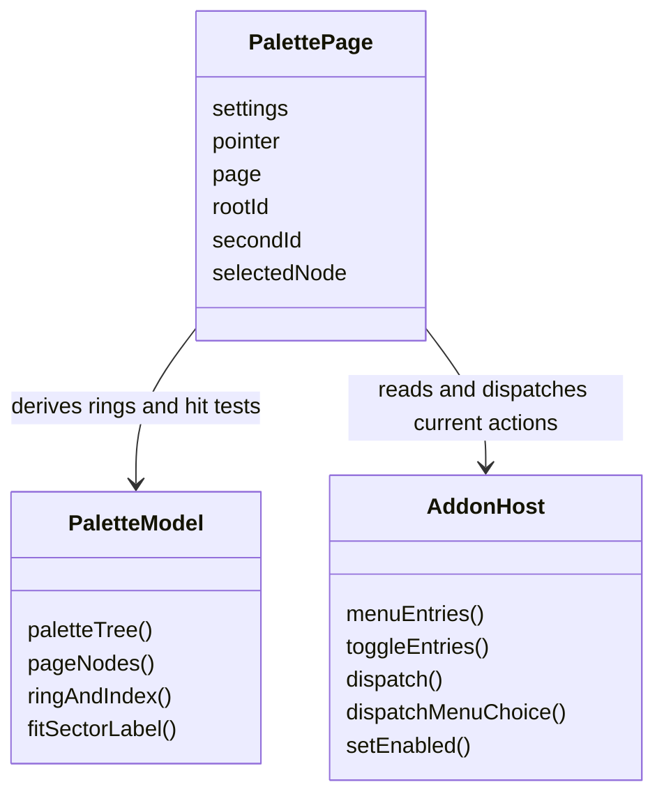
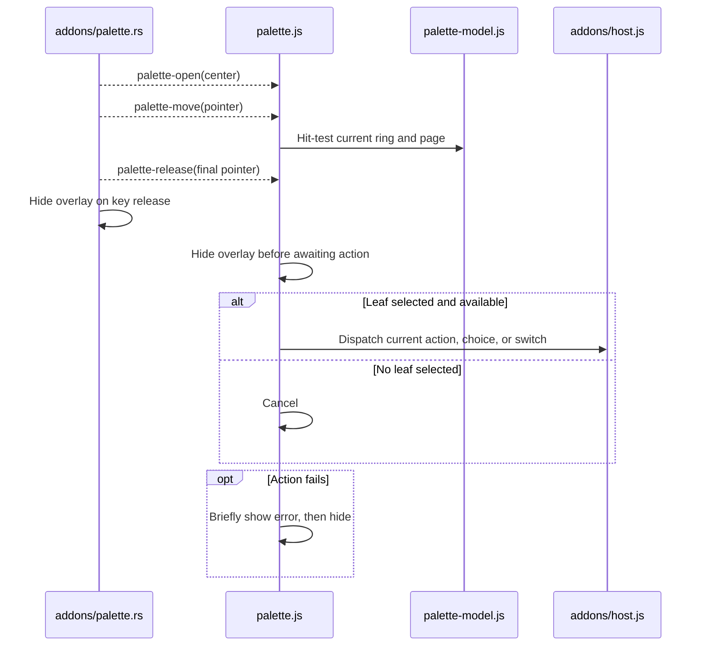

# Mouse palette frontend workflow

[palette.js](../palette.js) owns transient selection state; [palette-model.js](../palette-model.js) owns pure calculations; [host.js](../../host.js) rechecks action availability before native dispatch. No class shown here is serialized. Saved enable/key fields belong to [native settings](../../../../src-tauri/src/settings.rs).

The final release position is hit-tested again to avoid acting on a stale hover. Returning to the first ring replaces the outer choices; returning to the center clears selection. The center uses a short localized “Cancel” label; all sector labels scale to their available width. Confirmation-required choices open the existing [clock-menu confirmation](../../../menu.js) before the host call. The Settings sector invokes a palette-only toggle command, which asks the Settings page to run its save-and-close method when already visible. A mouse click, Escape, another modifier, or Tab cancels the native overlay. This diagram omits Quit's existing Tauri command and the native monitor's physical-window setup; see the [parent workflow](../../doc/workflow_diagram.md).
