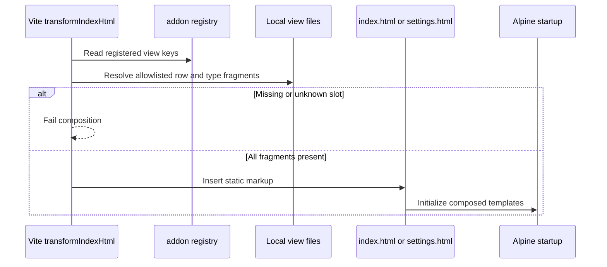

# Bundled view composition

These are static HTML fragments and a build process, so a class diagram would imply runtime objects that do not exist. The sequence below shows the actual ownership boundary.

The [Vite helper](../../../../scripts/addon-fragments.js) performs the lookup. [clock-row.html](../clock-row.html) renders the common display shape from the type modules. [settings-row.html](../settings-row.html) includes the four Settings control fragments. [preview-row.html](../preview-row.html) is inserted inside separate above and below loops. Runtime data never becomes markup during this flow.
