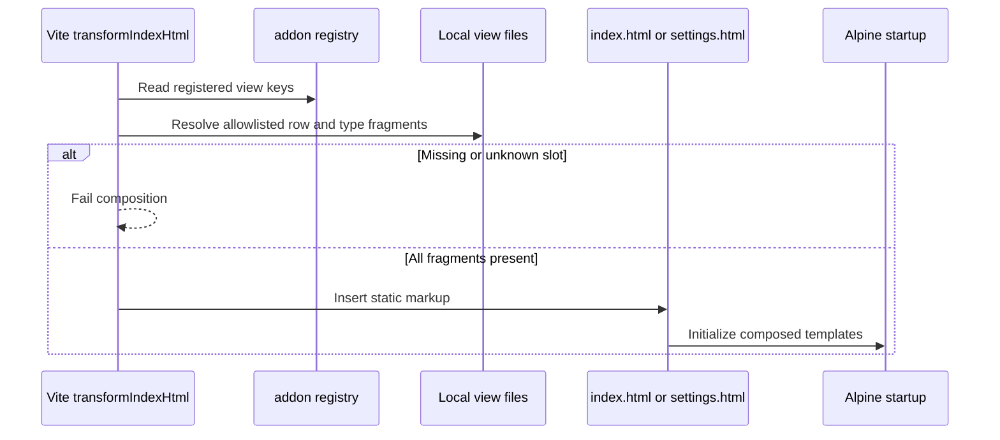

# Bundled view composition

A Progress instance and the catalog card call `openAddonDetails(kind)` on the Settings Alpine component. The compiled definition selects the allowlisted `progress-details.html` fragment. The dialog edits shared presets through the ordinary Settings save controller; the view fragment does not invoke native commands. Its content stays in a vertical block above a separately styled modal action footer.

These are static HTML fragments and a build process, so a class diagram would imply runtime objects that do not exist. The sequence below shows the actual ownership boundary.

The [add-on build helper](../../build-fragments.js) performs the lookup. [clock-row.html](../clock-row.html) renders the common display shape from the type modules. [settings-row.html](../settings-row.html) includes the four Settings control fragments. [preview-row.html](../preview-row.html) is inserted inside separate above and below loops. Runtime data never becomes markup during this flow.
