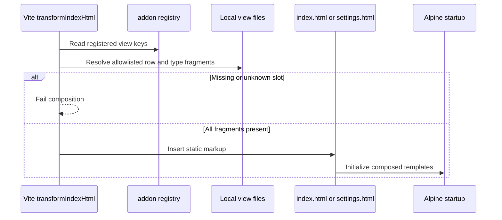

# Bundled view composition

The Timer Settings fragment calls `timerChange('mode', value)` even while the session runs; Settings asks for confirmation when needed and sends the choice through the host. Its Details button opens the allowlisted Timer preset editor. That editor changes only the Timer preset list and both Timer warning preferences through the ordinary Settings save controller. The menu disclosures are rendered in [menu.html](../../../../menu.html) from each compiled add-on's sections, with one expanded section at a time.

The [Region editor fragment](../region-clock.html) mounts only when its parent `addon` is a Region clock. It creates one local `regionZonePicker`, receives shared country/city/ID records from Settings, and displays city/country labels plus exact IDs. Focus opens the list, typing filters it, and a pointer or Enter commits a selected ID through the parent Settings method. Escape, Tab, or blur closes the list and restores the selected label. A Settings language change updates the records; search state is never serialized.

The same registered member fragments are composed inside either a single card or a two-member card. Each `x-for` has one element root; the paired wrapper controls shared settings and presents its members in two equal columns. Its one Edit/Done button toggles both detail panels using the card's local `expanded` flag; member buttons are hidden in pairs. Grid stretching keeps the vertical divider as tall as the longer panel. A member remains the action and editor target by its stable ID. See the [layout workflow](../../doc/workflow_diagram.md#pair-layout-and-editing).

A Progress instance and the catalog card call `openAddonDetails(kind)` on the Settings Alpine component. The compiled definition selects the allowlisted `progress-details.html` fragment. The dialog edits shared presets through the ordinary Settings save controller; the view fragment does not invoke native commands. Its content stays in a vertical block above a separately styled modal action footer.

These are static HTML fragments and a build process, so a class diagram would imply runtime objects that do not exist. The sequence below shows the actual ownership boundary.

The [add-on build helper](../../build-fragments.js) performs the lookup. [clock-row.html](../clock-row.html) renders the common display shape from the type modules. [settings-row.html](../settings-row.html) includes the four Settings control fragments. [preview-row.html](../preview-row.html) is inserted inside separate above and below loops. Runtime data never becomes markup during this flow.
