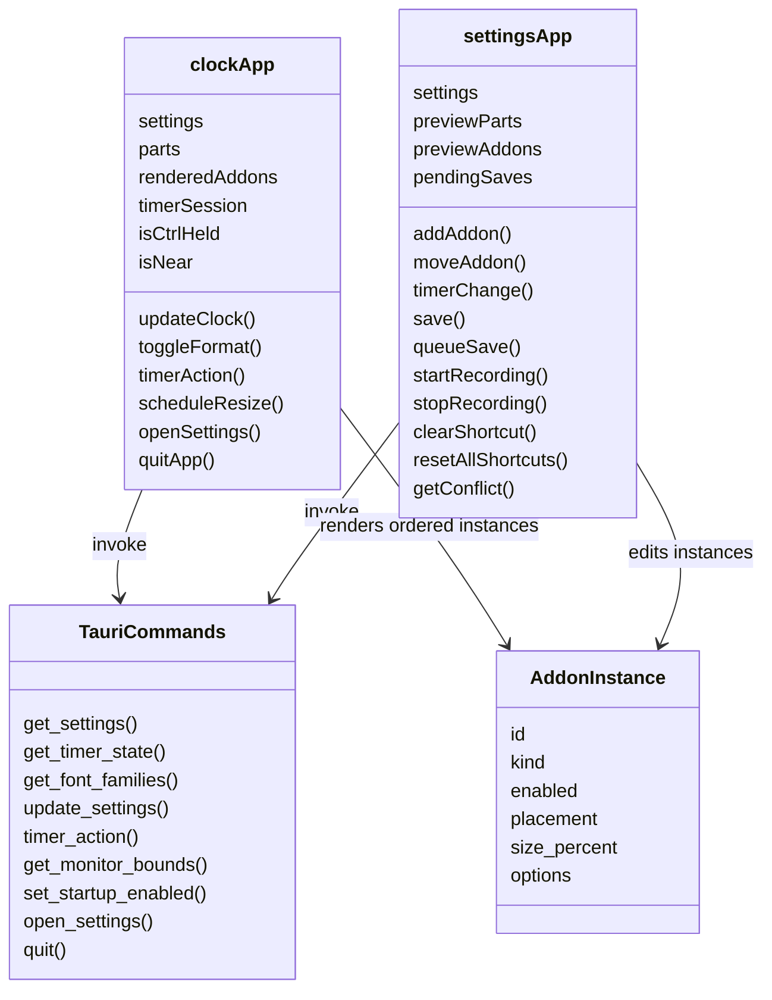
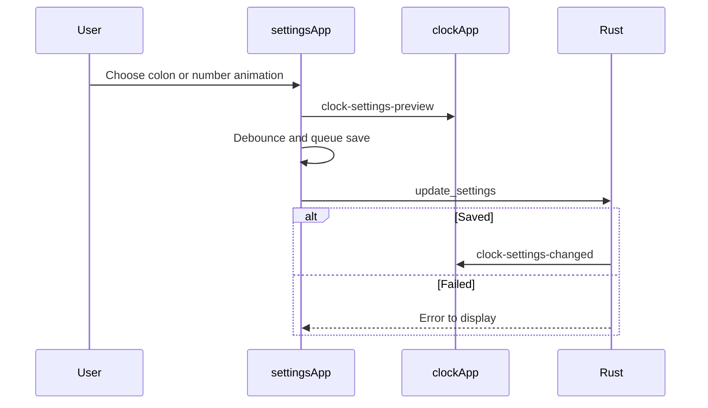
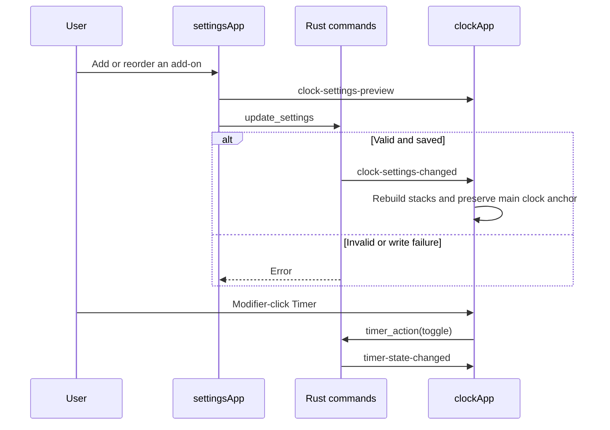

# Frontend workflows

Both UI components are Alpine component objects. This diagram shows their relationship to the native command boundary.

These names map to [main.js](../main.js), [settings.js](../settings.js), and the command registrations in [main.rs](../../src-tauri/src/main.rs). Both UI components call the shared `timeParts` function in [time-format.js](../time-format.js), which leaves hours unpadded and keeps minutes and seconds at two digits, then `markChangedNumbers` in [clock-animations.js](../clock-animations.js). The tracker compares each displayed hour, minute and second with its previous value. [style.css](../style.css) sizes clock segments to their text, keeping a one-digit hour beside the colon. CSS applies the chosen number effect to changed parts and the chosen colon effect to separators independently. `TauriCommands` represents the command interface, not a source class.

On initialization, `settingsApp` calls `get_font_families` before enabling the font select; [fonts.rs](../../src-tauri/src/fonts.rs) reads the Windows font table. The sequence above follows [settings.js](../settings.js) after a control changes. `clockApp` applies preview and saved settings in [main.js](../main.js), measures the whole clock group and menu, and resizes the native window. After the first resize, it adjusts the window position to preserve the main clock's top and right screen coordinates where monitor bounds permit. The Settings preview scales fonts above 64 pixels down to fit its card. The native side owns durability; see [Rust workflow](../../src-tauri/src/doc/workflow_diagram.md).

The [Add-ons tab](../../settings.html) controls placement, order, a visible 10%–100% size slider, and options. It previews the Date weekday and Region label switches using the shared formatter in [addons.js](../addons.js). The [clock](../../index.html) reserves distinct rows above and below the main display; the optional weekday uses 80% of its Date row's font size. Timer actions and running progress are native state; frontend display values are computed on each tick without a mode label. The menu Reset action calls the same timer command.

In the [General tab](../../settings.html), the startup or manual release check in [settings.js](../settings.js) sets `updateAvailable` after comparing the latest tag with the installed version. The General sidebar badge and its accessible label follow that state, while the update row shows the status text and download action. A successful current-version result hides the badge; a failed network check does not claim that an available update disappeared.
