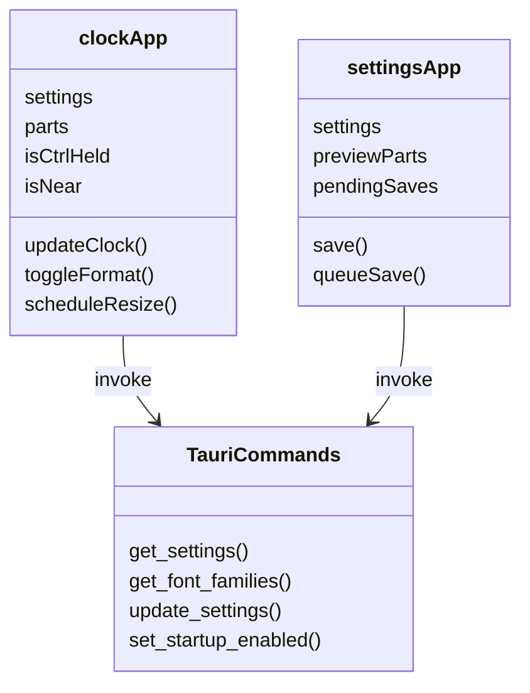
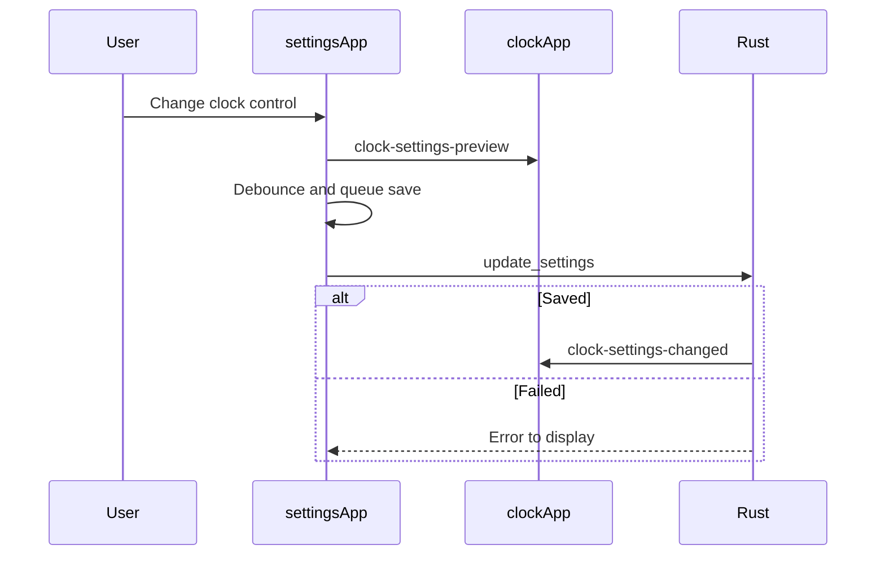

# Frontend workflows

Both UI components are Alpine component objects. This diagram shows their relationship to the native command boundary.

These names map to [main.js](../main.js), [settings.js](../settings.js), and the command registrations in [main.rs](../../src-tauri/src/main.rs). Both UI components call the shared `timeParts` function in [time-format.js](../time-format.js). `TauriCommands` represents the command interface, not a source class.

On initialization, `settingsApp` calls `get_font_families` before enabling the font select; [fonts.rs](../../src-tauri/src/fonts.rs) reads the Windows font table. The sequence above follows [settings.js](../settings.js) after a control changes. `clockApp` applies both preview and saved settings in [main.js](../main.js), then measures the rendered text and resizes the clock window when needed. The native side owns durability; see [Rust workflow](../../src-tauri/src/doc/workflow_diagram.md).
