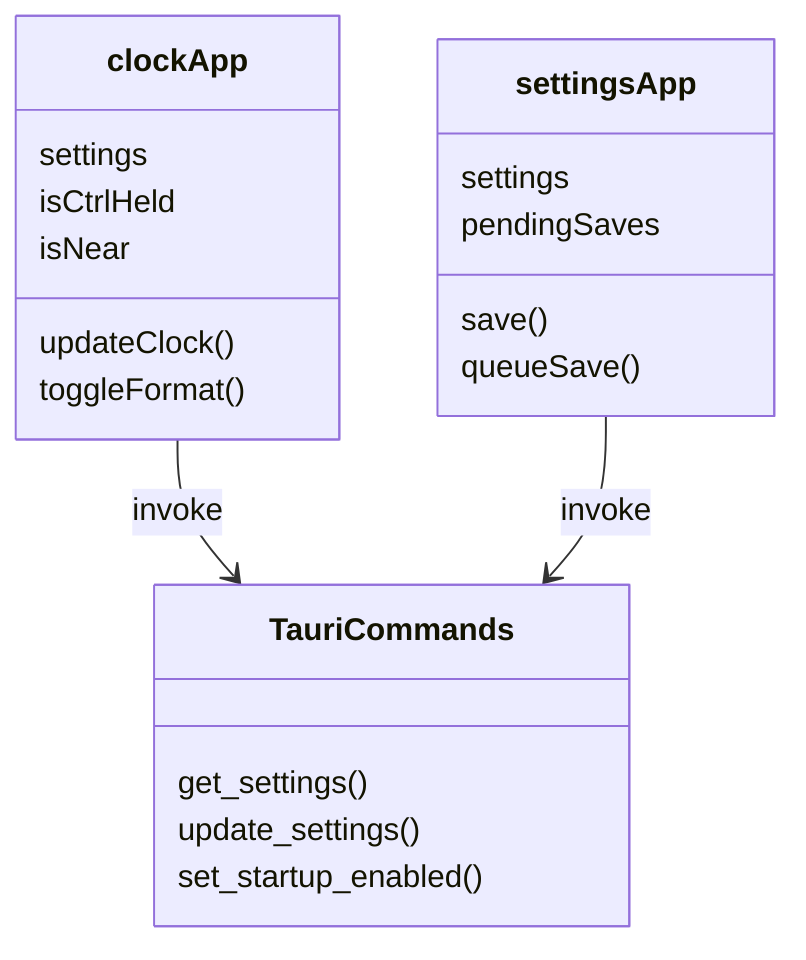
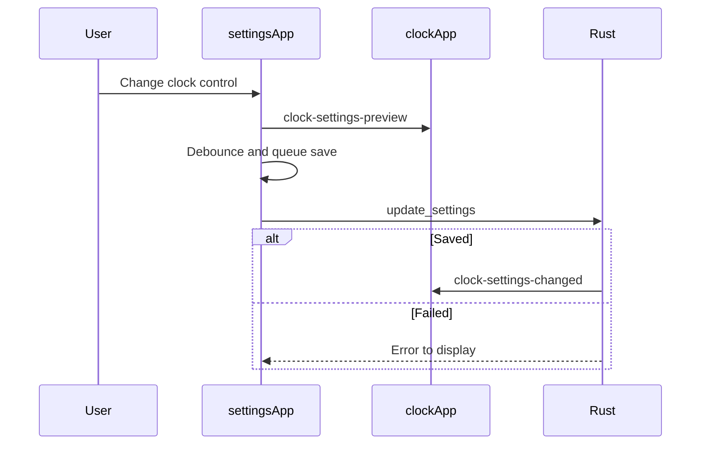

# Frontend workflows

Both UI components are Alpine component objects. This diagram shows their relationship to the native command boundary.

These names map to [main.js](../main.js), [settings.js](../settings.js), and the command registrations in [main.rs](../../src-tauri/src/main.rs). `TauriCommands` represents the command interface, not a source class.

The sequence follows [settings.js](../settings.js). `clockApp` applies both preview and saved settings in [main.js](../main.js). The native side owns durability; see [Rust workflow](../../src-tauri/src/doc/workflow_diagram.md).
