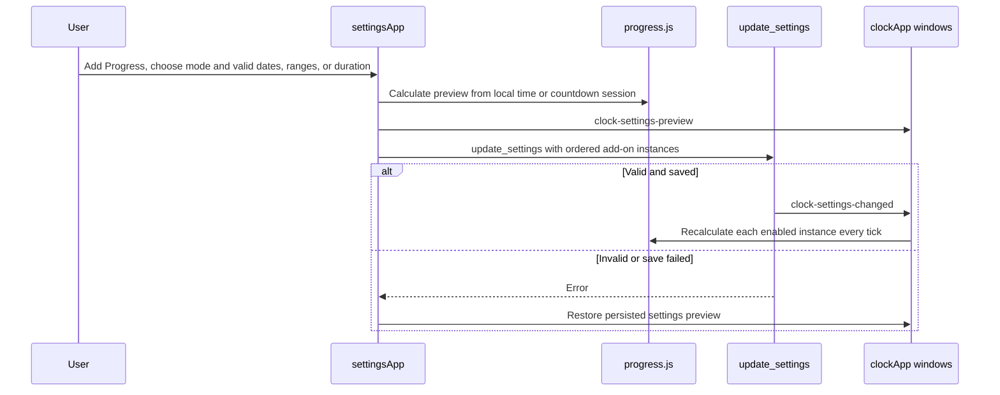
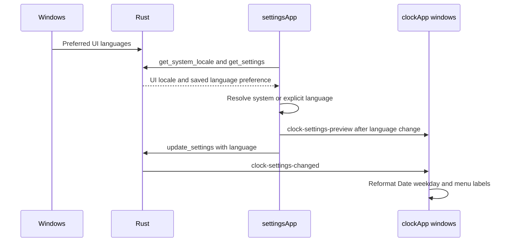
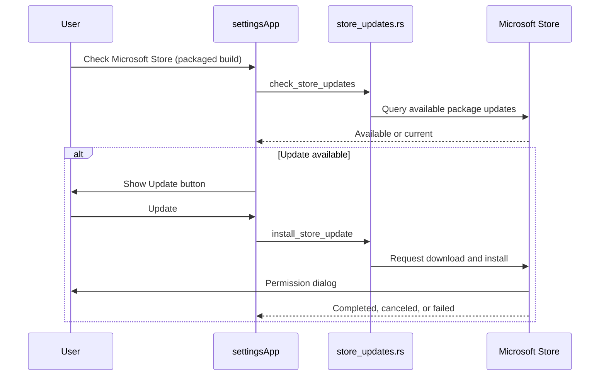
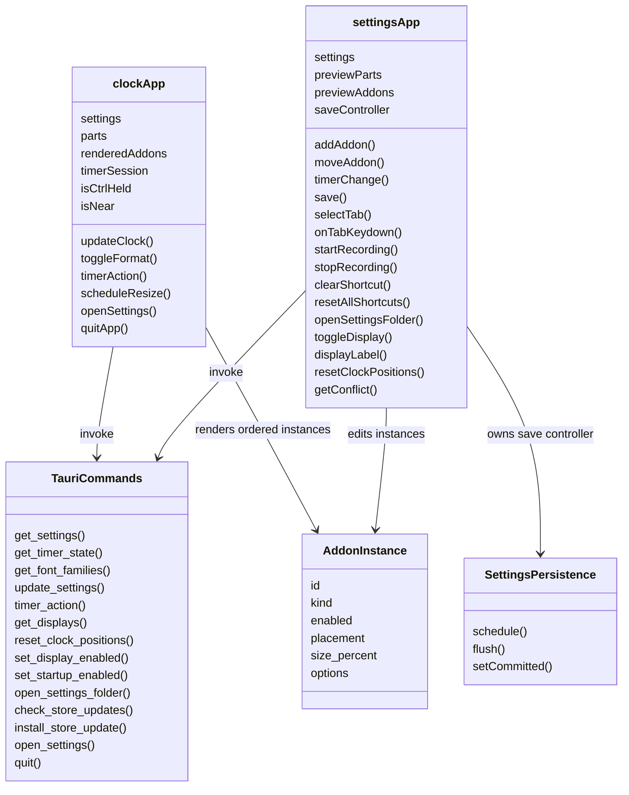
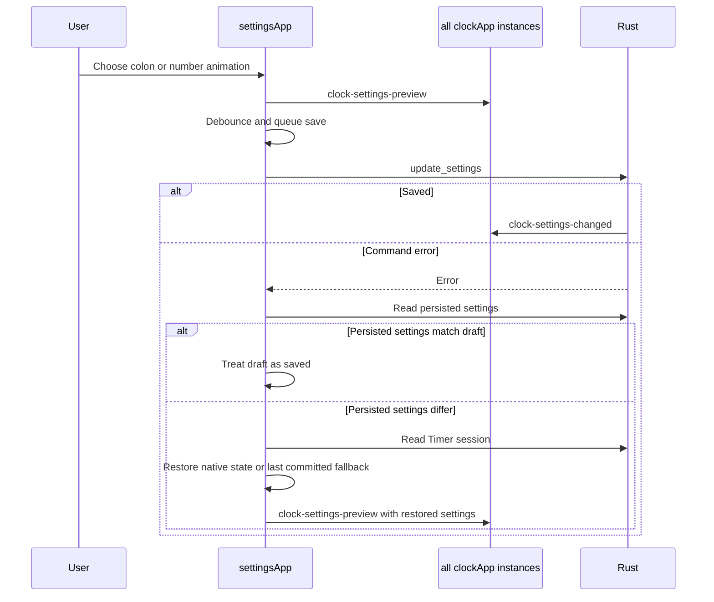
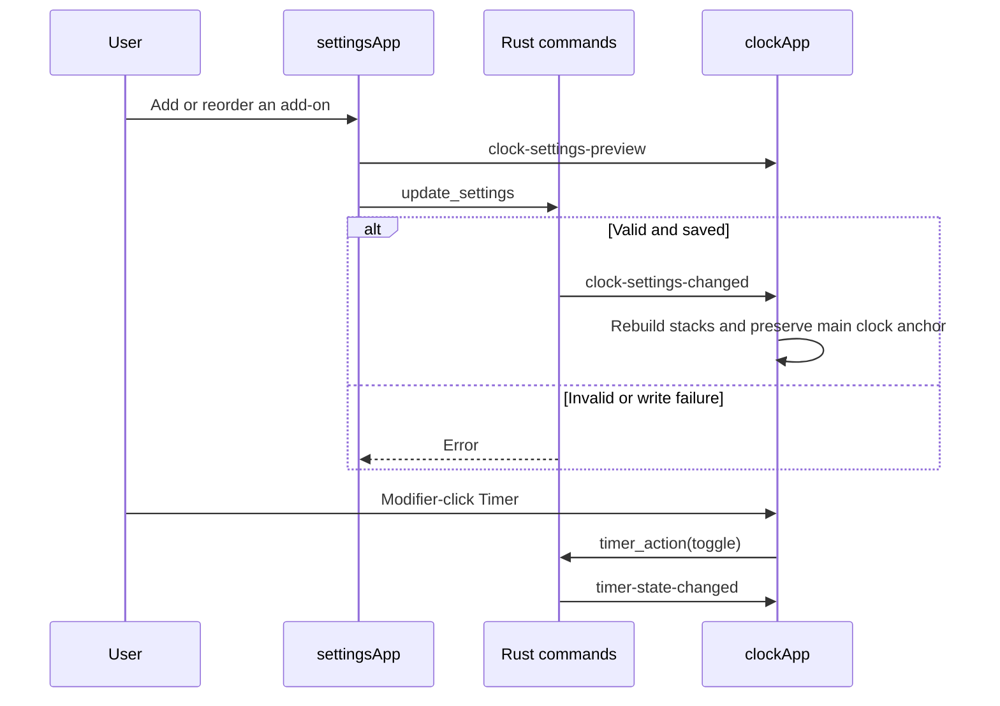

# Frontend workflows

## Progress add-on settings and display

[settings-addons.js](../settings-addons.js) rejects invalid edits before `save()` and saves per-instance percentage, length, and thickness choices. [addons.rs](../../src-tauri/src/addons.rs) validates the final saved shape, including optional appearance fields for compatibility. [progress.js](../progress.js) uses local dates and daily time ranges; each time range has its own caption-free bar, and optional auto-hide applies only after the final range has been complete for one minute. Countdown mode reads each instance's durable native session, fills one bar from empty to full, and pulses on completion. Settings Start/Pause and Reset, or modifier-click on that clock bar, invoke `progress_timer_action(id, action)`; `progress-timer-states-changed` refreshes both views. The numeric Timer uses its own session and controls. The clock and Settings preview use the same calculation, responsive dimensions, and [progress.css](../progress.css). The diagram omits CSS animation frames and the existing 200 ms clock tick.

## Language selection and Date weekday

[i18n.js](../i18n.js) supplies bundled translations and `Intl.DateTimeFormat` weekdays to both pages. The language preference is durable in `settings.json`; the detected Windows UI language is read at startup and is not saved. Rust updates the tray label after a successful language change. Unsupported Windows languages resolve to English.

The General tab's Settings files button calls `open_settings_folder`; Rust opens the app config directory in Explorer. Failures appear in the Settings error toast, and this action does not change saved settings.

General calls `is_packaged` before starting any update check. If true, [settings-updates.js](../settings-updates.js) calls the native Store check on button press and changes the button to **Update** when a published package is available. That action asks Windows Store to install the update, with cancellation and failure reported in Settings. If false, the GitHub reminder opens a release page; TopClock never installs that download. The sign-in switch invokes the same native command names on both channels; [startup.rs](../../src-tauri/src/startup.rs) chooses Windows StartupTask or the Run key, and Settings refreshes the reported state after changing it.

The Store publishes updates only after a separate Partner Center submission and certification. This diagram describes the Store-installed MSIX path; an unpackaged process, including a direct launch from `release-assets/msix-stage-tbkmax.TopClock`, uses the GitHub browser path.

Every clock window runs `clockApp` with the same persisted appearance and add-ons. `settingsApp` broadcasts a preview to all windows, while `get_displays` and `set_display_enabled` control which display windows are present. The General tab renders these switches in a separate display section, and `displayLabel()` strips the Windows device prefix for visible and accessible names without changing the display ID sent to Rust. Rust owns per-display position persistence; Ctrl-drag and resize anchoring can place a clock beyond display edges.

Both UI components are Alpine component objects. This diagram shows their relationship to the native command boundary.

These names map to [main.js](../main.js), [settings.js](../settings.js), and the command registrations in [lib.rs](../../src-tauri/src/lib.rs). Settings delegates add-on actions to [settings-addons.js](../settings-addons.js), shortcut actions to [settings-shortcuts.js](../settings-shortcuts.js), update checks to [settings-updates.js](../settings-updates.js), and save ordering to [settings-persistence.js](../settings-persistence.js). Both UI components call the shared `timeParts` function in [time-format.js](../time-format.js), which leaves hours unpadded and keeps minutes and seconds at two digits, then `markChangedNumbers` in [clock-animations.js](../clock-animations.js). The tracker compares each displayed hour, minute and second with its previous value. [style.css](../style.css) sizes clock segments to their text, keeping a one-digit hour beside the colon. CSS applies the chosen number effect to changed parts and the chosen colon effect to separators independently. `TauriCommands` represents the command interface; `SettingsPersistence` represents the object returned by `createSettingsPersistence`, rather than a source class.

On initialization, `settingsApp` calls `get_font_families` before enabling the font select; [fonts.rs](../../src-tauri/src/fonts.rs) reads the Windows font table. The sequence above follows [settings-persistence.js](../settings-persistence.js) after a control changes. The save controller snapshots each draft, debounces it, and serializes writes. It rolls back only when the latest draft fails, so an earlier failed write cannot erase a newer draft. `clockApp` applies preview and saved settings in [main.js](../main.js), measures the whole clock group and menu, and resizes the native window. After the first resize, it adjusts the window position to preserve the main clock's top and right screen coordinates without clamping to monitor bounds. The Settings preview scales fonts above 64 pixels down to fit its card. The native side owns durability; see [Rust workflow](../../src-tauri/src/doc/workflow_diagram.md).

The Settings navigation in [settings.html](../../settings.html) exposes four tab buttons and four mounted panels. [settings-tabs.js](../settings-tabs.js) maps Arrow, Home, and End keys to the next selected tab; the selected tab receives focus and its panel remains available to keyboard users. The Shortcuts tab draws the core and Timer actions from one metadata list in [settings-shortcuts.js](../settings-shortcuts.js).

The Clock tab's Reset positions button calls `resetClockPositions()` in [settings.js](../settings.js), which invokes `reset_clock_positions`. Rust centers each visible window on its display and saves display-relative coordinates. A hidden display keeps its prior position; command errors appear in the Settings error toast. See the [native display workflow](../../src-tauri/src/doc/workflow_diagram.md).

The [Add-ons tab](../../settings.html) controls placement, order, a visible 10%–100% size slider, and options. It previews the localized Date weekday and Region label switches using the shared formatter in [addons.js](../addons.js). The [clock](../../index.html) reserves distinct rows above and below the main display; the optional weekday uses 80% of its Date row's font size. Timer actions and running progress are native state; frontend display values are computed on each tick without a mode label. The menu Reset action calls the same timer command.

In the [General tab](../../settings.html), the direct-build check compares the latest GitHub tag with the installed version. The packaged check uses Store availability instead. The General sidebar badge and its accessible label follow `updateAvailable`; the action is **View GitHub release ↗** for a browser release page or **Update** for a Store installation. The check button and current-version message name the active source. A successful current-version result hides the badge; a failed check leaves any earlier available state intact.
