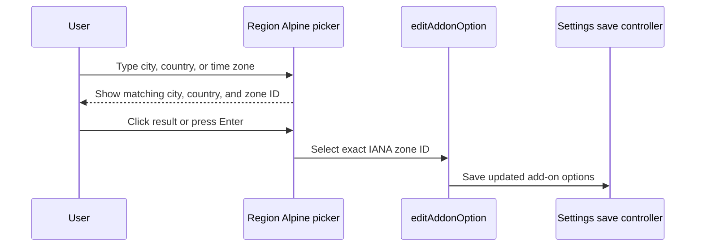
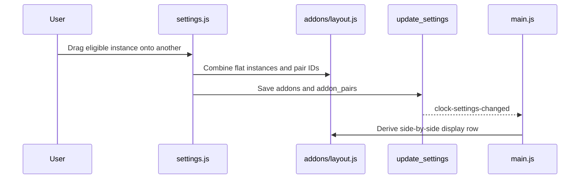
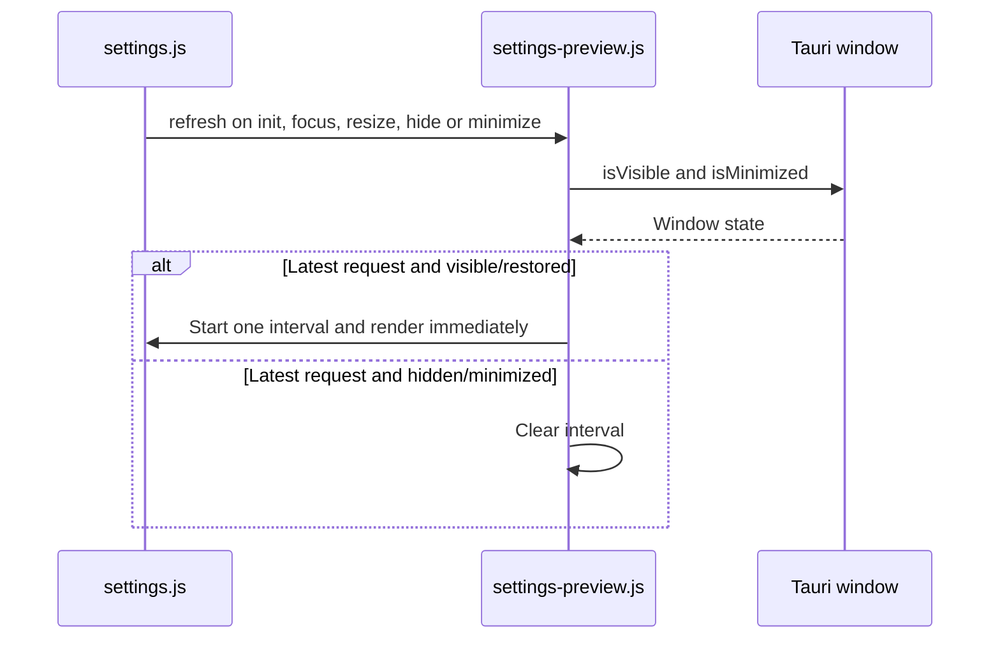
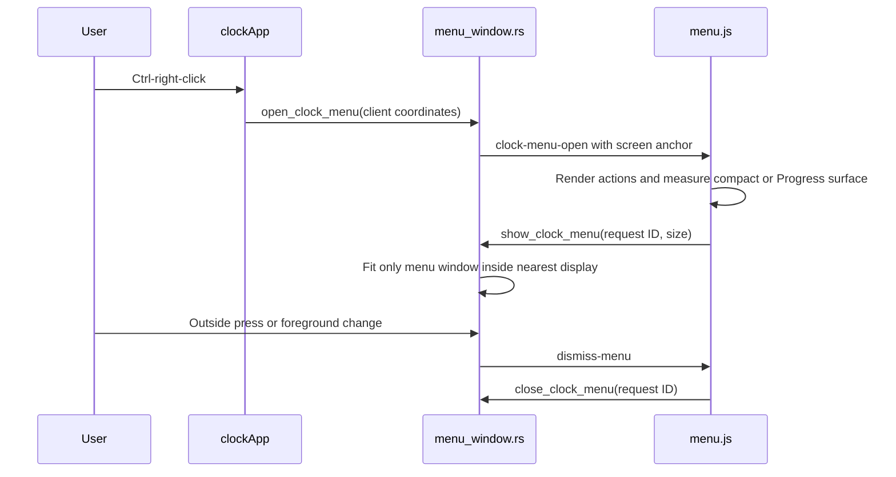
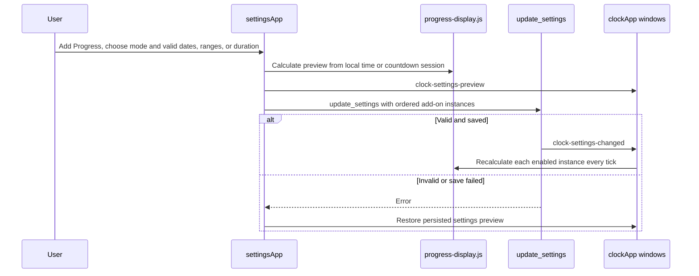
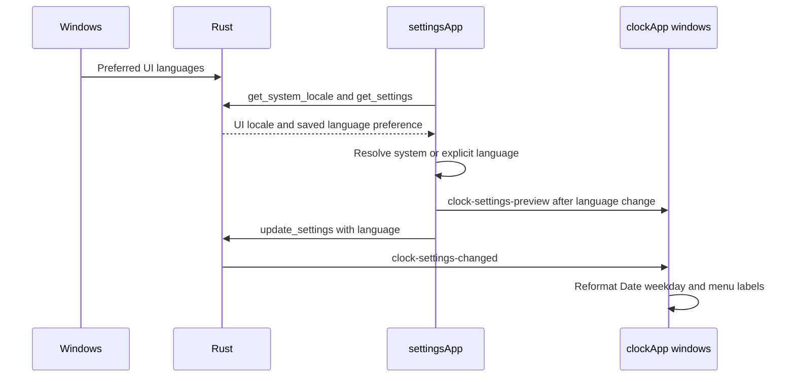
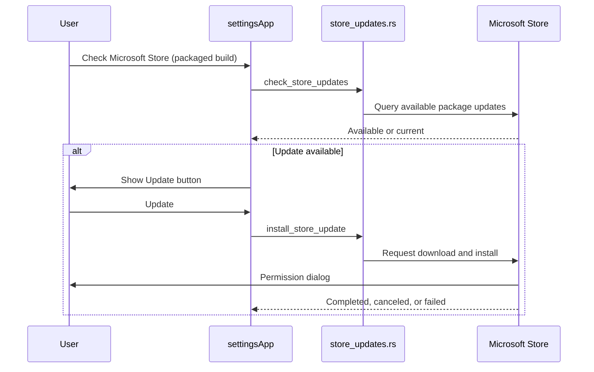
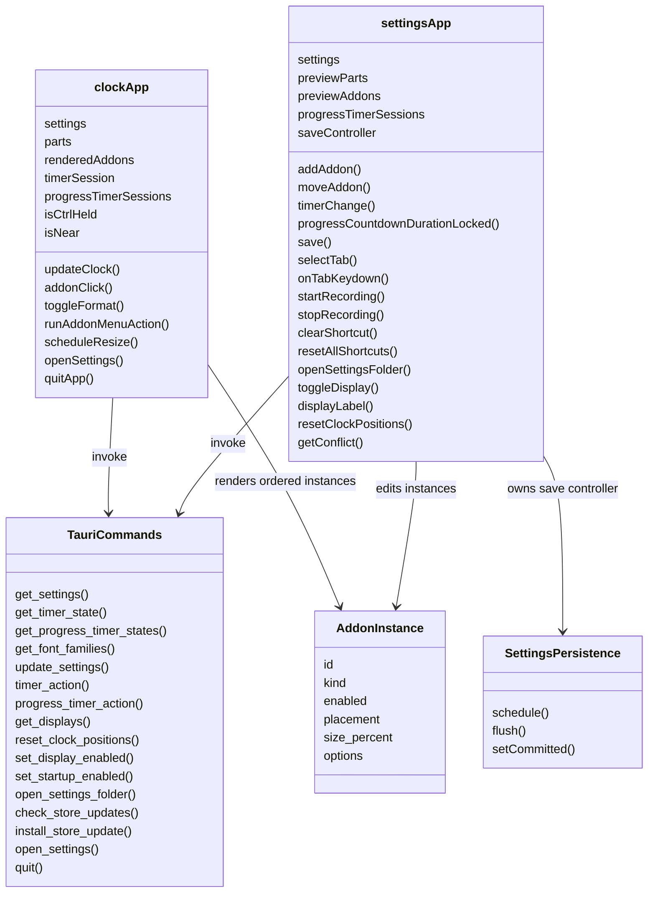
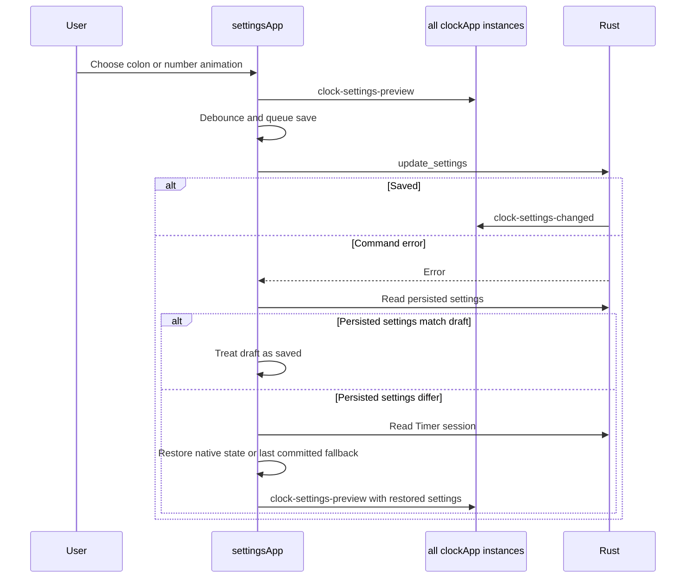
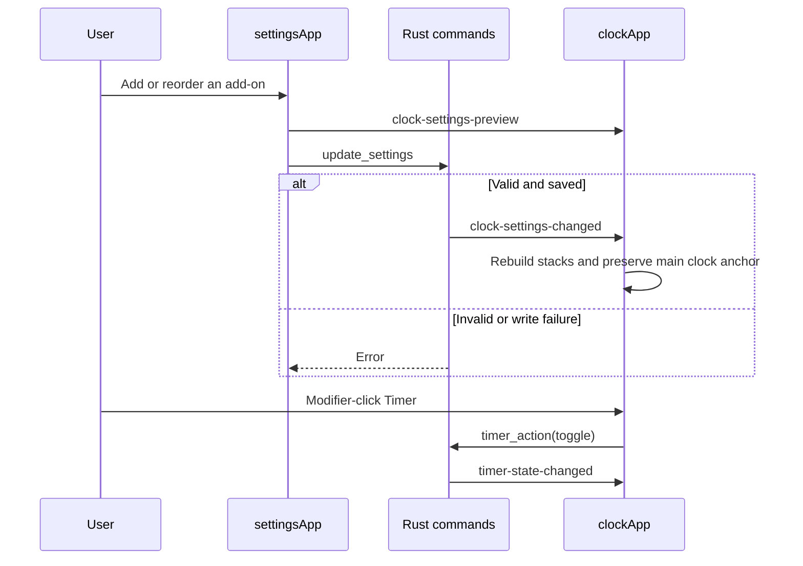

# Frontend workflows

## Clock menu add-on switches

```mermaid
sequenceDiagram
    participant User
    participant Menu as menu.js
    participant Host as addons/controller.js
    participant Rust as settings_commands.rs
    User->>Menu: Expand Add-on and select a switch
    Menu->>Host: setEnabled(instance ID, new state)
    Host->>Rust: set_addon_enabled(id, enabled)
    alt Save succeeds
        Rust-->>Menu: Saved ClockSettings
        Rust-->>Menu: clock-settings-changed
        Menu-->>User: Update switches; keep menu open
    else Save fails or instance vanished
        Rust-->>Menu: Error
        Menu-->>User: Show error; keep previous state
    end
```

The disclosure is below the existing add-on action rows in [menu.html](../../menu.html). [controller.js](../addons/controller.js) derives its switch rows from the same pair layout as Settings; Rust applies a paired switch to both saved members. Mode and Set choices also stay open on success, while first-level actions still close the menu. [menu.js](../menu.js) marks newly expanded rows as visually pending before Alpine reveals them. They still take their final layout space, so `show_clock_menu` receives the correct dimensions. After that native resize completes, the current request clears the pending state and [menu.css](../menu.css) fades the rows in. A later resize request supersedes an earlier completion. Overflow stays clipped during resizing and returns to scrolling when needed. The [native workflow](../../src-tauri/src/doc/workflow_diagram.md) owns validation, persistence, and session reconciliation.

Counter uses the shared add-on display and action pipeline. [menu.js](../menu.js) renders three actions from the Counter definition; [settings.js](../settings.js) opens a confirmation dialog for Reset and dispatches only after confirmation. [main.js](../main.js) and the Settings preview read the same signed `counterSession` snapshot and [appearance result](../addons/builtins/signed-balance-appearance.js), while [the native workflow](../../src-tauri/src/addons/doc/workflow_diagram.md) owns saving and stopping on quit. No primary-click action is registered for Counter. Its `H:MM:SS` display changes to `D:HH:MM` at 100 hours; Stop changes the displayed color to a lighter shade of the same sign. Its session remains independent when [layout.js](../addons/layout.js) places it beside Date, Region clock, or Timer.

## Timer menu mode and preset

An enabled Timer contributes Start/Pause, Reset, and a Mode disclosure. Countdown adds a Set disclosure using Timer's own saved preset list. A running or elapsed Timer opens the inline confirmation before a mode switch or preset restart unless that operation's warning is dismissed. The menu choice button in [menu.html](../../menu.html) converts the optional `selected` value to a boolean before binding `disabled`, so Progress presets without that field still receive clicks. The menu rechecks its current choice before calling `timer_set_mode` or `timer_set_preset`; Rust revalidates and emits settings and Timer session events after one save. Settings observes those events, and its mode selector uses the same native mode command. The Settings Details dialog edits only Timer presets and their warning preference through the normal settings save flow. See [Timer definition](../addons/builtins/timer.js) and [native transaction](../../src-tauri/src/addons/doc/workflow_diagram.md).

## Region time zone search



[region-clock.html](../addons/views/region-clock.html) keeps the query and active result local to each editor. [region-picker.js](../addons/builtins/region-picker.js) indexes zone IDs and country names from the bundled [IANA map](../addons/builtins/zone-country-codes.js); changing Settings language rebuilds the visible names. Escape or leaving the field restores the selected label without writing. The normal Settings save controller handles persistence and preview updates after selection.

## Combined add-on layout



The [instance editor](../addons/instance-editor.js) also swaps members, moves a whole pair, splits a dragged member, and mirrors the pair switch. Pointer targeting measures both axes so dragging between the left and right panels swaps members; a short movement within one panel does not split it. The paired Settings card uses one local `expanded` flag to open both member editors; single cards keep their own Edit/Done button. [settings.html](../../settings.html) and [index.html](../../index.html) render the same derived grouping. Rust validates adjacency, placement, enable state and eligible kinds before saving; see the [native add-on workflow](../../src-tauri/src/addons/doc/workflow_diagram.md). The diagram omits the existing debounced preview and save rollback, which still apply.

## Add-on Details layout

The catalog and configured Progress instances open the same registered detail fragment. Settings places that fragment above a dedicated modal action footer. Preset chips and the input form wrap within the modal, and the modal scrolls when needed. Catalog cards keep Add on the left and Details on the right.

## Progress menu preset

The clock menu filters enabled Progress countdowns and reads their Start/Pause labels from the shared add-on host. Set expands the shared preset list within the selected row. A preset with recorded progress opens an inline confirmation unless the warning was dismissed; the native command checks again before it changes the saved duration and session together. A successful command broadcasts both `clock-settings-changed` and `progress-timer-states-changed`, so every clock and Settings refreshes its duration and action label. The Add-ons catalog and each countdown detail panel open the same shared editor; edits use the ordinary Settings save controller. The dialog's warning checkbox can re-enable a previously dismissed confirmation.

## Settings preview lifetime



[settings-preview.js](../settings-preview.js) rejects obsolete responses. Settings and timer events keep the component's state current while rendering is paused. Existing component relationships below still apply.

## Menu layout and dismissal



[main.js](../main.js) keeps the clock window sized to its own content and does not clamp its saved position. [menu.css](../menu.css) lets an action-only menu fit its labels and shortcut badges, while Timer and Progress groups and confirmation use the wider layout. [menu.js](../menu.js) measures the surface width plus shadow space before asking Rust to position the window; it handles section expansion, confirmation, Escape, and action dispatch through the add-on host. The menu window scrolls when its content exceeds a display. The 30 ms native pointer observer can miss very short nonactivating clicks; see the [native workflow](../../src-tauri/src/doc/workflow_diagram.md).

## Progress add-on settings and display



[Progress definition](../addons/builtins/progress.js) rejects invalid edits before `save()` and saves per-instance percentage, length, and thickness choices. The compact week grid displays each range as a row with seven day cells; selecting a row opens its time editor. Each range can select several weekdays; Every day clears its optional `days` array. The editor prevents removing the last day, rejects overlap on a shared day, and sorts valid time edits by start time. [Progress calculations](../addons/builtins/progress-display.js) filters ranges against the local weekday before calculating bars and the final auto-hide time. A day with no matching ranges hides the instance. A valid Minutes edit before the first Start or after finish or Reset saves on input; blur restores the last valid value if entry is incomplete. The field stays locked through Pause and restart because the native session records whether it has started. [native add-on validators](../../src-tauri/src/addons/doc/architecture.md) validates the final saved shape, including optional appearance fields for compatibility. [Progress calculations](../addons/builtins/progress-display.js) uses local dates and daily time ranges; each time range has its own caption-free bar, and optional auto-hide applies one minute after the last range scheduled for the current day finishes. Countdown mode reads each instance's durable native session, fills one bar from empty to full, and pulses on completion. Settings Start/Pause and Reset, or modifier-click on that clock bar, invoke `progress_timer_action(id, action)`; `progress-timer-states-changed` refreshes both views. The numeric Timer uses its own session and controls. The clock and Settings preview use the same calculation, responsive dimensions, and [progress.css](../addons/builtins/progress.css). The diagram omits CSS animation frames and the existing 200 ms clock tick.

For Settings action labels, a native session event or command result updates the add-on host's single reactive snapshot. The controller reads that same snapshot while producing each row's action descriptors; Alpine redraws the changed Start/Pause text. The clock and Settings pages do not mirror session fields.

## Language selection and Date weekday



[i18n.js](../i18n.js) supplies bundled translations and `Intl.DateTimeFormat` weekdays to both pages. The language preference is durable in `settings.json`; the detected Windows UI language is read at startup and is not saved. Rust updates the tray label after a successful language change. Unsupported Windows languages resolve to English.

The General tab's Settings files button calls `open_settings_folder`; Rust opens the app config directory in Explorer. Failures appear in the Settings error toast, and this action does not change saved settings.

General calls `is_packaged` before starting any update check. If true, [settings-updates.js](../settings-updates.js) calls the native Store check on button press and changes the button to **Update** when a published package is available. That action asks Windows Store to install the update, with cancellation and failure reported in Settings. If false, the GitHub reminder opens a release page; TopClock never installs that download. The sign-in switch invokes the same native command names on both channels; [startup.rs](../../src-tauri/src/startup.rs) chooses Windows StartupTask or the Run key, and Settings refreshes the reported state after changing it.



The Store publishes updates only after a separate Partner Center submission and certification. This diagram describes the Store-installed MSIX path; an unpackaged process, including a direct launch from `release-assets/msix-stage-tbkmax.TopClock`, uses the GitHub browser path.

Every clock window runs `clockApp` with the same persisted appearance and add-ons. `settingsApp` broadcasts a preview to all windows, while `get_displays` and `set_display_enabled` control which display windows are present. The General tab renders these switches in a separate display section, and `displayLabel()` strips the Windows device prefix for visible and accessible names without changing the display ID sent to Rust. Rust owns per-display position persistence; Ctrl-drag and resize anchoring can place a clock beyond display edges.

Both UI components are Alpine component objects. This diagram shows their relationship to the native command boundary.



The add-on controller and state subscriptions are described in [their workflow](../addons/doc/workflow_diagram.md). These names map to [main.js](../main.js), [settings.js](../settings.js), and the command registrations in [lib.rs](../../src-tauri/src/lib.rs). Settings delegates add-on actions to [the shared controller](../addons/controller.js), shortcut actions to [settings-shortcuts.js](../settings-shortcuts.js), update checks to [settings-updates.js](../settings-updates.js), and save ordering to [settings-persistence.js](../settings-persistence.js). Both UI components call the shared `timeParts` function in [time-format.js](../time-format.js), which leaves hours unpadded and keeps minutes and seconds at two digits, then `markChangedNumbers` in [clock-animations.js](../clock-animations.js). The tracker compares each displayed hour, minute and second with its previous value. [style.css](../style.css) sizes clock segments to their text, keeping a one-digit hour beside the colon. CSS applies the chosen number effect to changed parts and the chosen colon effect to separators independently. `TauriCommands` represents the command interface; `SettingsPersistence` represents the object returned by `createSettingsPersistence`, rather than a source class.



On initialization, `settingsApp` calls `get_font_families` before enabling the font select; [fonts.rs](../../src-tauri/src/fonts.rs) reads the Windows font table. The sequence above follows [settings-persistence.js](../settings-persistence.js) after a control changes. The save controller snapshots each draft, debounces it, and serializes writes. It rolls back only when the latest draft fails, so an earlier failed write cannot erase a newer draft. `clockApp` applies preview and saved settings in [main.js](../main.js), measures the clock group and resizes only the clock window. After the first resize, it adjusts the window position to preserve the main clock's top and right screen coordinates without clamping to monitor bounds. The Settings preview scales fonts above 64 pixels down to fit its card. The native side owns durability; see [Rust workflow](../../src-tauri/src/doc/workflow_diagram.md).

The Settings navigation in [settings.html](../../settings.html) exposes four tab buttons and four mounted panels. [settings-tabs.js](../settings-tabs.js) maps Arrow, Home, and End keys to the next selected tab; the selected tab receives focus and its panel remains available to keyboard users. The Shortcuts tab draws the core and Timer actions from one metadata list in [settings-shortcuts.js](../settings-shortcuts.js).

The Clock tab's Reset positions button calls `resetClockPositions()` in [settings.js](../settings.js), which invokes `reset_clock_positions`. Rust centers each visible window on its display and saves display-relative coordinates. A hidden display keeps its prior position; command errors appear in the Settings error toast. See the [native display workflow](../../src-tauri/src/doc/workflow_diagram.md).




The [Add-ons tab](../../settings.html) shows configured rows around a clock block before the catalog and live preview. A pointer drag begins on a row's handle after a small movement threshold; pointer capture keeps the gesture active, the card follows the pointer, and the nearest row or clock block shows the intended insertion. Releasing inside the panel commits the move: a row's upper or lower half inserts before or after that row, while the clock block's upper or lower half moves the add-on above or below the clock. Releasing outside cancels it. The same handle's Up and Down arrow keys move one visible position, crossing the clock boundary when needed. [instance-editor.js](../addons/instance-editor.js) updates array order and placement together, then calls the normal save and preview path shown above. Each row's Edit button reveals the 10%–100% size slider and options; rows start closed independently. The catalog opens by default for an empty list, otherwise starts closed, and expands to show every type, leaving any vertical scrolling to the Settings page. The top Add button scrolls to the catalog. The live preview starts closed; when opened, it previews the localized Date weekday and Region label switches using the [registered type formatters](../addons/builtins/doc/architecture.md). Disclosure and drag target state stay in Alpine and are not saved. The [clock](../../index.html) reserves distinct rows above and below the main display; the optional weekday uses 80% of its Date row's font size. Timer actions and running progress are native state; frontend display values are computed on each tick without a mode label. The menu Reset action calls the same timer command.

In the [General tab](../../settings.html), the direct-build check compares the latest GitHub tag with the installed version. The packaged check uses Store availability instead. The General sidebar badge and its accessible label follow `updateAvailable`; the action is **View GitHub release ↗** for a browser release page or **Update** for a Store installation. The check button and current-version message name the active source. A successful current-version result hides the badge; a failed check leaves any earlier available state intact.
