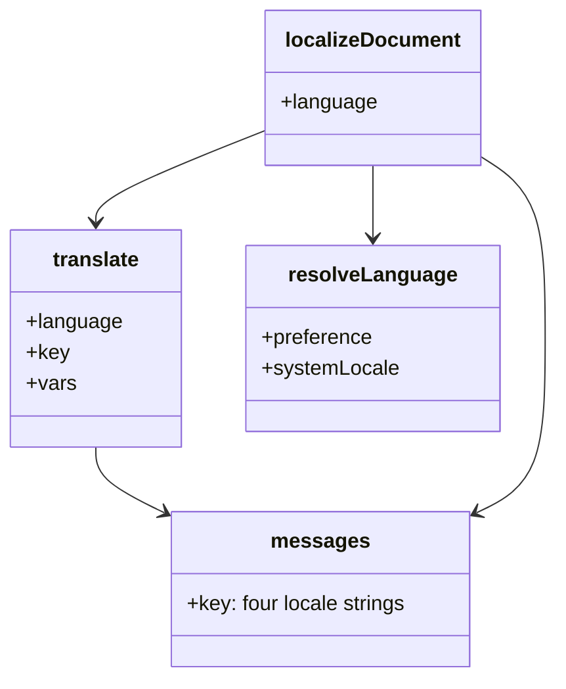
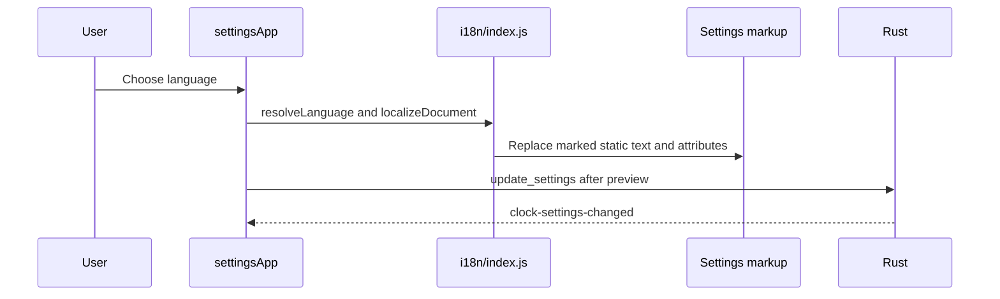

# Frontend localization workflow

The new Clock tab labels and accessibility names resolve through the existing `data-i18n-text` and `data-i18n-aria-label` paths. All four language rows use the same keys; no translation is needed for the saved numeric percentage or boolean schedule fields.

The modules below are JavaScript functions and data, not ES classes. The class diagram shows their ownership and use.

[index.js](../index.js) reads [messages.js](../messages.js). A page resolves the effective language, sets its HTML `lang`, and calls `localizeDocument`. The translator reads explicit keys in static HTML and in new Alpine nodes observed by `MutationObserver`; Alpine's `x-text` labels call `t()` independently.

Only the language preference is durable. The DOM observer and original text nodes belong to one webview. Save failure recovery follows the [Settings workflow](../../settings/doc/workflow_diagram.md); native tray localization is outside this folder.

The Settings Counter Reset modal resolves `addons.counterResetWarning` through the same `translate` path before dispatching a confirmed native Reset. The text describes history deletion; translation itself never changes database state.
