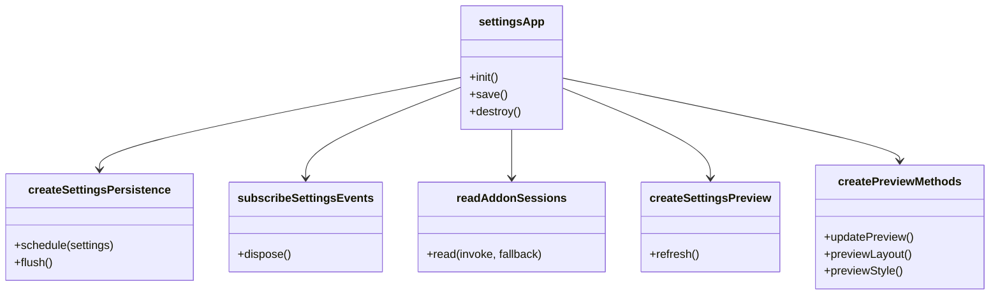
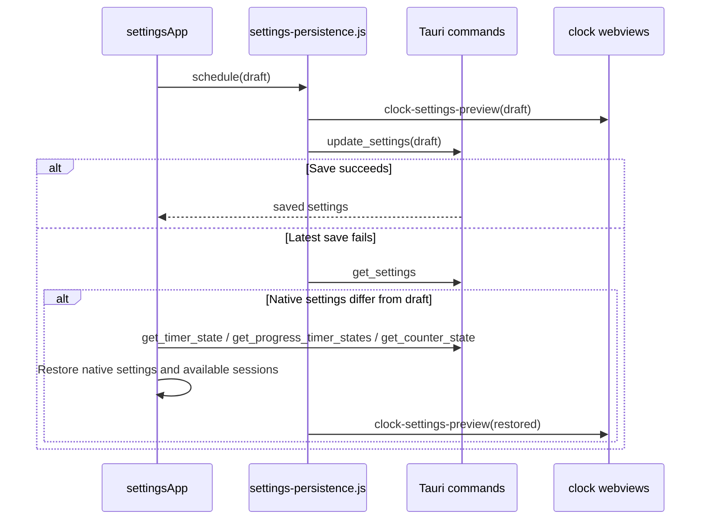

# Settings workflows

## Clock visibility controls

The transparency slider and two schedule switches edit the Settings draft, broadcast `clock-settings-preview`, and enter the existing debounced `update_settings` queue. Rust validates and saves the three fields, then emits `clock-settings-changed`; each clock reevaluates opacity on its next tick. The preview applies baseline transparency only so appearance remains editable while the desktop schedule is hidden. Save failure follows the rollback flow below.

The Settings component composes separate save, event, recovery, and preview helpers. The diagram describes module relationships; these names are JavaScript functions and Alpine state, not ES classes.

[settings.js](../settings.js) supplies callbacks to [settings-events.js](../settings-events.js), so event names and registration stay together while page state remains in Alpine. It also supplies native readback to [settings-persistence.js](../settings-persistence.js); [settings-recovery.js](../settings-recovery.js) reads add-on sessions only after a failed write. [settings-preview.js](../settings-preview.js) composes its timer and rendering methods into the page without sharing preview animation state with the desktop clock.

The save queue and revision check prevent an older failed write from replacing a newer draft. Native settings and sessions are durable; local preview and registration state are not. A Settings close flushes pending writes before hiding the window. See the [parent workflow](../../doc/workflow_diagram.md) for clock and tray interactions.

In the Add-ons card, a member switch saves its own enabled flag through this sequence. The Combined control shows on when either member is enabled; clicking it sets both flags off, and clicking it again sets both on. The preview filters disabled members, then [layout.js](../../addons/layout.js) keeps the pair scale on the lone visible member. The group control has no separate saved field or previous-mix memory.

Counter Reset uses a separate modal: Cancel closes it without a command; Confirm sends `counter_action(reset, confirmedReset)` through the add-on host. Its localized warning describes deletion of all Counter history, and Rust remains authoritative for the transaction. The [native workflow](../../../src-tauri/src/addons/doc/workflow_diagram.md) describes the database deletion.
