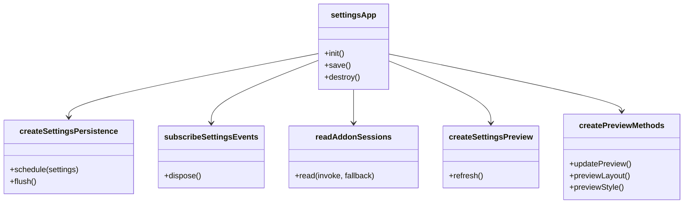
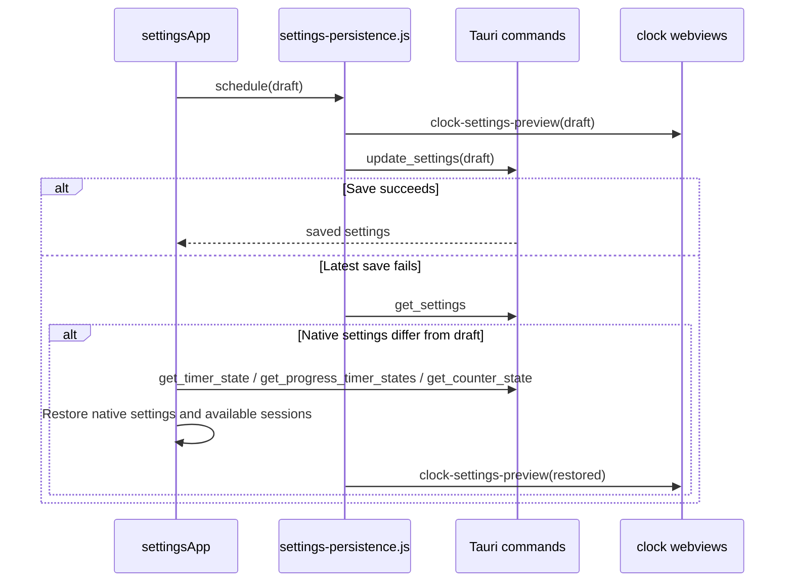

# Settings workflows

The Settings component composes separate save, event, recovery, and preview helpers. The diagram describes module relationships; these names are JavaScript functions and Alpine state, not ES classes.

[settings.js](../settings.js) supplies callbacks to [settings-events.js](../settings-events.js), so event names and registration stay together while page state remains in Alpine. It also supplies native readback to [settings-persistence.js](../settings-persistence.js); [settings-recovery.js](../settings-recovery.js) reads add-on sessions only after a failed write. [settings-preview.js](../settings-preview.js) composes its timer and rendering methods into the page without sharing preview animation state with the desktop clock.

The save queue and revision check prevent an older failed write from replacing a newer draft. Native settings and sessions are durable; local preview and registration state are not. A Settings close flushes pending writes before hiding the window. See the [parent workflow](../../doc/workflow_diagram.md) for clock and tray interactions.
